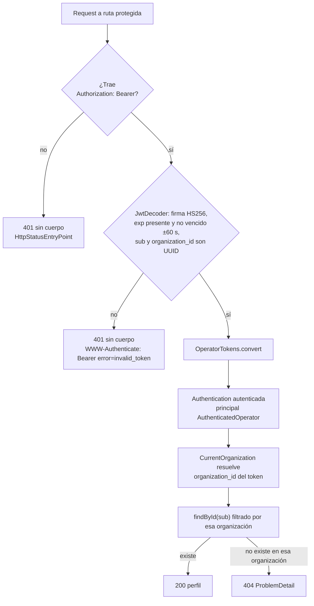

# Operadores y autenticación

Issue #5. Decisiones: P-021 (módulo), P-022 (email único y login en dos pasos), P-023 (token), P-024 (endpoints y
errores), P-025 (alta y disponibilidad) en `docs/decisiones.md`. Se apoya en el multi-tenant de `docs/multi-tenant.md`.

## Resumen

Un `Operator` es una persona del equipo de una organización: tiene email, nombre, clave (guardada como hash), rol
(`OPERATOR` o `SUPERVISOR`) y disponibilidad (`ONLINE`, `AWAY` u `ON_LEAVE`; un operador nuevo arranca `AWAY`). El
email es único en todo el sistema, así que para entrar alcanza con email y clave: no se elige organización.

El operador entra con `POST /api/auth/login` y recibe un JWT que vale 8 horas. Con ese token en
`Authorization: Bearer <token>` llama al resto de la API. Al validar el token, Spring Security deja como principal un
`AuthenticatedOperator`, que implementa `OrganizationMember`: desde ahí, Hibernate filtra y asigna todo por la
organización del token, sin que el código la pase a mano (P-018). `GET /api/me` devuelve el operador del token.

Se activa en cada request: el login es la única ruta de la API que no pide token (además de health y `/error`, P-006).

Todavía no hay alta de operadores por API, ni forma de cambiar la disponibilidad, ni autorización por rol (P-025). En
desarrollo, los operadores se cargan por SQL (ver «Alta de un operador en desarrollo»).

## Piezas

Módulo `operators` (`backend/src/main/java/com/communicatorone/operators/`), todo package-private salvo las dos
excepciones, que son públicas porque las traduce el handler del paquete raíz:

| Clase | Qué hace |
|---|---|
| `Operator` | Entidad de la tabla `operators`, con `@TenantId organizationId` (`Operator.java:25-27`). `Operator.register(email, name, role, rawPassword, encoder)` valida con `Assert` que no falte nada (`IllegalArgumentException`), normaliza el email, guarda el hash y arranca `AWAY` (`Operator.java:44-59`). `acceptsPassword` compara contra el hash (`Operator.java:65-67`). |
| `OperatorRole`, `Availability` | Enums `OPERATOR`/`SUPERVISOR` y `ONLINE`/`AWAY`/`ON_LEAVE`, guardados por nombre (`@Enumerated(STRING)`, `Operator.java:35-39`). |
| `OperatorRepository` | `JpaRepository` con `findByEmail`, filtrado por organización como toda consulta derivada. |
| `OperatorEmailDirectory` | La única consulta que cruza organizaciones: dado un email, devuelve solo el `organization_id` (`OperatorEmailDirectory.java:17-21`). |
| `OperatorAuthentication` | Caso de uso: `signIn(email, password)` y `currentOperator(principal)` (`OperatorAuthentication.java:34-49`). |
| `OperatorTokens` | Emite el JWT (`issueFor`, `OperatorTokens.java:33-45`) y convierte un JWT ya validado en la `Authentication` con `AuthenticatedOperator` (`convert`, mapeo directo de los claims, `OperatorTokens.java:47-52`). |
| `AuthenticatedOperator` | `record (operatorId, organizationId)` que implementa `OrganizationMember` y `AuthenticatedPrincipal`; `getName()` devuelve el id del operador, así que `Authentication.getName()` también (`AuthenticatedOperator.java:7-13`). |
| `TokenConfiguration` | Beans `JwtEncoder`, `JwtDecoder` (con los validadores de tiempos y de claims) y `PasswordEncoder` (`TokenConfiguration.java:27-47`). |
| `AuthenticationProperties` | `communicator-one.authentication.jwt-secret` y `token-lifetime` (default `8h`); rechaza al arrancar un secreto nulo, en blanco o de menos de 32 bytes UTF-8 y un `token-lifetime` nulo, cero o negativo (`AuthenticationProperties.java:13-22`), y no muestra el secreto en `toString` (`AuthenticationProperties.java:24-27`). |
| `AuthenticationController` | `POST /api/auth/login` y `GET /api/me`, con sus DTOs como records anidados (`AuthenticationController.java:24-53`). `LoginRequest` recorta los espacios del email antes de validar (`AuthenticationController.java:38-40`). |
| `InvalidCredentialsException`, `OperatorNotFoundException` | Públicas; las traduce `ApiExceptionHandler`. |

En el paquete raíz (`backend/src/main/java/com/communicatorone/`):

- `SecurityConfiguration`: `POST /api/auth/login` público (`SIGN_IN`, `SecurityConfiguration.java:25-26`, `:37`),
  resource server JWT con `OperatorTokens` como converter (`SecurityConfiguration.java:39-41`), un `BearerTokenResolver`
  que no lee el header `Authorization` en el login (`SecurityConfiguration.java:40`, `:47-50`) y 401 sin cuerpo para
  quien no trae token (`SecurityConfiguration.java:42-43`).
- `ApiExceptionHandler`: único `@RestControllerAdvice`, extiende `ResponseEntityExceptionHandler`.
  `InvalidCredentialsException` → 401 con el mensaje de la excepción como `detail`, «Invalid email or password»
  (`ApiExceptionHandler.java:14-17`, `InvalidCredentialsException.java:5-7`);
  `OperatorNotFoundException` → 404 (`ApiExceptionHandler.java:19-22`). Los 400 de validación y de JSON ilegible los
  arma `ResponseEntityExceptionHandler`.
- `ClockConfiguration`: bean `Clock.systemUTC()` (`ClockConfiguration.java:10-13`), que usan la emisión y la validación
  del token.

Esquema (`backend/src/main/resources/db/migration/V2__create_operators.sql`):

```sql
CREATE TABLE operators (
    id UUID PRIMARY KEY,
    organization_id UUID NOT NULL REFERENCES organizations (id),
    email TEXT NOT NULL,
    name TEXT NOT NULL,
    password_hash TEXT NOT NULL,
    role TEXT NOT NULL,
    availability TEXT NOT NULL,
    CONSTRAINT operators_email_key UNIQUE (email)
);

CREATE INDEX operators_organization_id_idx ON operators (organization_id);
```

La base no exige minúsculas en el email (no hay `CHECK`): lo garantiza `Operator.register`. Quien inserte por SQL tiene
que normalizarlo él mismo.

Configuración: `communicator-one.authentication.jwt-secret: ${JWT_SECRET}` sin default (`application.yml:15-17`);
`JWT_SECRET=` en `.env.example:9-10`. Sin la variable, vacía o con menos de 32 bytes, la app no arranca: falla
`AuthenticationProperties`. Lo mismo con `communicator-one.authentication.token-lifetime` en cero o negativo.

## Diagramas

Login:

```mermaid
sequenceDiagram
    participant W as Cliente (web/)
    participant C as AuthenticationController
    participant A as OperatorAuthentication
    participant D as OperatorEmailDirectory
    participant CO as CurrentOrganization
    participant R as OperatorRepository
    participant T as OperatorTokens
    W->>C: POST /api/auth/login {email, password}
    Note over W,C: un Bearer en el header se ignora (BearerTokenResolver)
    Note over C: LoginRequest recorta el email;<br/>@Valid: 400 si falta algo,<br/>el email no es válido o es muy largo
    C->>A: signIn(email, password)
    A->>A: Operator.normalizedEmail(email)
    A->>D: organizationOf(email)
    Note over D: JdbcTemplate, sin filtro de organización:<br/>SELECT organization_id FROM operators WHERE email = ?
    alt email desconocido
        D-->>A: vacío
        A->>A: compara la clave contra un hash ficticio
        A-->>C: InvalidCredentialsException
        C-->>W: 401 ProblemDetail
    else email conocido
        D-->>A: organizationId
        A->>CO: callAs(organizationId, ...)
        CO->>R: findByEmail(email), filtrado por organizationId
        R-->>A: Operator
        alt clave equivocada o hash sin prefijo conocido
            A-->>C: InvalidCredentialsException
            C-->>W: 401 ProblemDetail (idéntico)
        else clave correcta
            A->>T: issueFor(operator)
            T-->>C: IssuedToken(value, expiresAt)
            C-->>W: 200 {accessToken, expiresAt}
        end
    end
```

Request autenticado (por ejemplo `GET /api/me`):



## Flujo en detalle

### Login en dos pasos

Sin usuario autenticado no hay organización activa y el resolver devuelve el centinela, así que un
`operators.findByEmail(email)` suelto volvería siempre vacío. Por eso `OperatorAuthentication.signIn`
(`OperatorAuthentication.java:34-44`):

1. Normaliza el email con `Operator.normalizedEmail` (`strip` + `toLowerCase(Locale.ROOT)`, `Operator.java:61-63`), la
   misma función que usa el alta. Los espacios alrededor ya los sacó `LoginRequest` antes de validar
   (`AuthenticationController.java:38-40`), así que acá en la práctica solo cambian las mayúsculas. Un email de solo
   espacios queda vacío y `@NotBlank` lo rechaza con 400.
2. Busca la organización del email con `OperatorEmailDirectory.organizationOf` (`OperatorEmailDirectory.java:17-21`).
   Es la única consulta del sistema que cruza organizaciones a propósito (P-022), va por `JdbcTemplate` y devuelve solo
   el `organization_id`: ni el hash ni otros datos del operador.
3. Con esa organización abre un ámbito `currentOrganization.callAs(organizationId, () -> operators.findByEmail(email))`
   (`OperatorAuthentication.java:60-64`) y carga el operador con la lectura filtrada normal. `signIn` no es
   `@Transactional` justamente porque `callAs` rechaza abrirse con una transacción en curso.
4. Si no encontró operador (en el paso 2 o en el 3), compara igual la clave recibida contra un hash que se genera una vez
   al arrancar (`OperatorAuthentication.java:31`, `:36-39`), para que un email desconocido tarde lo mismo que una clave
   equivocada, y lanza `InvalidCredentialsException`.
5. Si la clave no coincide (`Operator.acceptsPassword`, `OperatorAuthentication.java:40-42`), lanza la misma excepción.
   Si el `password_hash` guardado no tiene un prefijo `{id}` conocido, el `DelegatingPasswordEncoder` lanza
   `IllegalArgumentException`; `accepts` la atrapa, deja un WARN con el id del operador (no el email) y lo trata como
   clave equivocada (`OperatorAuthentication.java:51-58`). Ese caso no compara ningún hash, así que no tarda lo mismo.
6. Si coincide, emite el token (`OperatorAuthentication.java:43`).

Todos los rechazos terminan en el mismo `ProblemDetail` 401, así que la respuesta no revela si el email existe.

### Token

`OperatorTokens.issueFor` (`OperatorTokens.java:33-45`) firma con HS256 (`JwsHeader.with(MacAlgorithm.HS256)`) usando la
clave `HmacSHA256` hecha con los bytes UTF-8 de `JWT_SECRET` (`TokenConfiguration.java:61-63`). El encoder de Nimbus
agrega un `kid` al header. Claims:

| Claim | Valor |
|---|---|
| `sub` | id del operador |
| `organization_id` | id de su organización (`OperatorTokens.java:21`, `:38`) |
| `iat` | `clock.instant()` truncado a segundos (`OperatorTokens.java:34`) |
| `exp` | `iat` + `token-lifetime` (8 h por defecto) |

No lleva rol, authorities, `iss` ni refresh token: cuando vence, se vuelve a iniciar sesión. El `expiresAt` de la
respuesta es el mismo instante que `exp`.

Ejemplo real (header y payload decodificados):

```json
{"kid":"dYktYKTvoJnCL9cxWU7tKK7dsYRt63jyH4ZR_twP3uM","alg":"HS256"}
{"sub":"1d5e27d6-c1a0-47f2-83a2-54ad8a05dd5b","exp":1794668358,"iat":1794639558,"organization_id":"11111111-1111-1111-1111-111111111111"}
```

Validación (`TokenConfiguration.java:32-42`): `NimbusJwtDecoder` con la misma clave y HS256 verifica la firma, y un
`DelegatingOAuth2TokenValidator` junta tres validadores de claims (`TokenConfiguration.java:38-40`):

- un `JwtTimestampValidator` con el `Clock` inyectado, la tolerancia por defecto de 60 s y
  `setAllowEmptyExpiryClaim(false)` (`TokenConfiguration.java:35-37`), así que un token sin `exp` se rechaza;
- dos `JwtClaimValidator` que exigen que `sub` y `organization_id` existan y sean strings con forma de UUID
  (`isUuid`, `TokenConfiguration.java:49-59`).

Si alguno falla, la respuesta es 401 con `WWW-Authenticate: Bearer error="invalid_token"`. Con el token ya validado,
`OperatorTokens.convert` solo mapea los claims: la `Authentication` es un `UsernamePasswordAuthenticationToken`
autenticado, con principal `AuthenticatedOperator(sub, organization_id)` y sin authorities
(`OperatorTokens.java:47-52`). Como `AuthenticatedOperator` es un `AuthenticatedPrincipal`, el nombre de esa
`Authentication` es el id del operador.

Como el principal implementa `OrganizationMember`, `CurrentOrganization` toma de ahí la organización activa
(`docs/multi-tenant.md`, «Usuario autenticado»). El token no se vuelve a contrastar con la base en cada request.

### Perfil propio: `GET /api/me`

`OperatorAuthentication.currentOperator` (`OperatorAuthentication.java:46-49`, `@Transactional(readOnly = true)`) hace
`operators.findById(principal.operatorId())`. La lectura ya está filtrada por la organización del token, así que un
token bien firmado cuyo `organization_id` no es la organización del operador (`sub`) da 404 sin datos del operador, y lo
mismo pasa si el operador ya no existe.

### Disponibilidad y rol

Un operador nuevo arranca `AWAY` (`Operator.java:49`). No hay endpoint para cambiar la disponibilidad ni chequeos por
rol: el rol se guarda y se devuelve en `/api/me`, nada más (P-025).

## Contrato para los clientes (web/)

- **Login:** `POST /api/auth/login`, `Content-Type: application/json`. En esa ruta el header `Authorization` se
  ignora: un cliente que todavía manda su token vencido o inválido puede volver a iniciar sesión.
- **Uso del token:** `Authorization: Bearer <accessToken>` en todas las demás rutas.
- **`expiresAt`:** instante ISO-8601 en UTC con `Z`, sin fracción de segundo (`"2026-11-14T14:59:18Z"`). Es el
  momento en que el token deja de servir (con hasta 60 s de tolerancia del servidor). No hay refresh.
- **`role` y `availability`:** strings con el nombre exacto de los enums: `OPERATOR` | `SUPERVISOR` y
  `ONLINE` | `AWAY` | `ON_LEAVE`.
- **401 del login:** `application/problem+json` con `detail` «Invalid email or password». Es credencial inválida,
  sea email desconocido o clave equivocada: se muestra al usuario como tal.
- **401 de una ruta protegida:** sin cuerpo. Si el token es inválido o venció, trae
  `WWW-Authenticate: Bearer error="invalid_token", ...`; si no se mandó token, no trae ese header. En los dos casos
  significa lo mismo: volver a iniciar sesión.
- **400:** pedido inválido (`ProblemDetail`, `detail` «Invalid request content.») o JSON ilegible (`detail` «Failed to
  read request»). El login valida `email` (`@NotBlank @Email @Size(max = 254)`) y `password`
  (`@NotBlank @Size(max = 128)`) (`AuthenticationController.java:35-36`), con el email ya recortado: los espacios
  alrededor y las mayúsculas no importan, y un email de solo espacios da 400.
- **404 de `/api/me`:** el operador del token no existe en su organización; tratarlo también como sesión inválida.

## Ejemplos

Login correcto (las mayúsculas del email no importan):

```http
POST /api/auth/login
Content-Type: application/json

{"email": "Ana@Acme.TEST", "password": "clave-de-prueba"}
```

```http
HTTP/1.1 200
Content-Type: application/json

{"accessToken": "eyJraWQiOiJkWWt0...", "expiresAt": "2026-11-14T14:59:18Z"}
```

Perfil:

```http
GET /api/me
Authorization: Bearer eyJraWQiOiJkWWt0...
```

```json
{
  "id": "1d5e27d6-c1a0-47f2-83a2-54ad8a05dd5b",
  "organizationId": "11111111-1111-1111-1111-111111111111",
  "email": "ana@acme.test",
  "name": "Ana Pérez",
  "role": "SUPERVISOR",
  "availability": "AWAY"
}
```

Errores:

| Situación | Respuesta |
|---|---|
| Clave equivocada, email desconocido o `password_hash` sin prefijo `{id}` conocido | 401 `application/problem+json`: `{"detail":"Invalid email or password","instance":"/api/auth/login","status":401,"title":"Unauthorized"}` |
| Falta `email` o `password`, email vacío, de solo espacios o inválido, email de más de 254 caracteres (ya recortado) o clave de más de 128 caracteres | 400 `{"detail":"Invalid request content.","instance":"/api/auth/login","status":400,"title":"Bad Request"}` |
| JSON ilegible | 400 `{"detail":"Failed to read request",...}` |
| Ruta protegida sin token | 401 sin cuerpo ni `WWW-Authenticate` |
| Token con otra firma, vencido, sin `exp`, sin `organization_id` o con ids que no son UUID | 401 sin cuerpo, `WWW-Authenticate: Bearer error="invalid_token", error_description="...", ...` |
| Bearer inválido o vencido mandado al login | Se ignora: el login responde según email y clave |
| Token válido cuyo `sub` no existe en su `organization_id` | 404 `ProblemDetail` sin datos del operador |

## Alta de un operador en desarrollo

No hay endpoint de alta (P-025). Con el Postgres de compose levantado y las migraciones ya aplicadas (la app arrancó
una vez), se cargan una organización y un operador por SQL. La fila tiene que cumplir lo que garantizaría
`Operator.register`, porque la base no lo controla:

- `email` en minúsculas y sin espacios (si no, el login normalizado no lo encuentra y responde 401);
- `password_hash` con el prefijo `{bcrypt}` (el `DelegatingPasswordEncoder` elige el algoritmo por el prefijo; sin él,
  el login responde el mismo 401 que una clave equivocada y deja un WARN `Operator <id> has a password hash without a
  known encoding`);
- `role` y `availability` con el nombre exacto de los enums (`OPERATOR`/`SUPERVISOR`, `ONLINE`/`AWAY`/`ON_LEAVE`; un
  valor distinto rompe la carga de la entidad);
- `organization_id` de una organización existente (FK).

El hash se genera con `htpasswd` (paquete `apache2-utils`), que da un bcrypt `$2y$` que el `BCryptPasswordEncoder` de
Spring acepta; se le antepone `{bcrypt}`:

```bash
HASH="{bcrypt}$(htpasswd -bnBC 10 "" 'clave-de-prueba' | tr -d ':\n')"
```

Desde la raíz del repo, con los valores por defecto de `.env.example`:

```bash
docker compose exec -T postgres psql -v ON_ERROR_STOP=1 -v hash="$HASH" \
  -U communicator_one -d communicator_one <<'SQL'
INSERT INTO organizations (id, name)
VALUES ('11111111-1111-1111-1111-111111111111', 'Acme');

INSERT INTO operators (id, organization_id, email, name, password_hash, role, availability)
VALUES (gen_random_uuid(), '11111111-1111-1111-1111-111111111111', 'ana@acme.test', 'Ana Pérez',
        :'hash', 'SUPERVISOR', 'AWAY');
SQL
```

Después: `POST /api/auth/login` con `ana@acme.test` y `clave-de-prueba`. El SQL y el comando de hash se probaron
contra la app (también que un email con mayúsculas en la fila da 401).

## Tests

`backend/src/test/java/com/communicatorone/operators/OperatorTest.java` (sin Spring, con el `DelegatingPasswordEncoder`
real):

| Test | Qué cubre |
|---|---|
| `operatorEmailIsNormalizedToLowercaseWithoutSurroundingSpaces` | `register` guarda el email recortado y en minúsculas. |
| `operatorWithoutEmailNameRoleOrPasswordIsRejected` | Email, nombre o clave nulos, vacíos o en blanco, y rol nulo → `IllegalArgumentException`. |
| `registeredOperatorAcceptsTheirPasswordAndRejectsAnyOther` | `acceptsPassword` acepta la clave propia y rechaza otra que difiere en una mayúscula. |
| `newOperatorStartsAway` | La disponibilidad inicial es `AWAY`. |

`backend/src/test/java/com/communicatorone/operators/AuthenticationTest.java` (`@SpringBootTest(RANDOM_PORT)` +
`TestcontainersConfiguration`, por HTTP con `RestClient`, sin `@Transactional`). Cada test crea dos organizaciones,
Acme y Globex, con un operador cada una (Ana `OPERATOR` en Acme, Bruno `SUPERVISOR` en Globex), con emails únicos
porque la suite no limpia la base y el email es único global. El reloj es un `MutableClock` que arranca en
`MutableClock.INITIAL_INSTANT` (`2026-03-02T09:00:00Z`), se puede adelantar y vuelve a ese instante después de cada
test.

| Test | Qué cubre |
|---|---|
| `signedInOperatorSeesTheirOwnProfile` | Login 200 con solo `accessToken` y `expiresAt`; `expiresAt` = ahora + 8 h = `exp` del token; `/api/me` devuelve id, organización, email, nombre, rol y `AWAY`. |
| `emailIsCaseInsensitiveAtSignIn` | El login con el email en mayúsculas funciona. |
| `emailWithSurroundingSpacesSignsIn` | El login con espacios alrededor del email funciona y `/api/me` devuelve a Ana. |
| `operatorStillSendingTheirExpiredTokenCanSignInAgain` | Con el token vencido todavía en `Authorization`, el login da 200 y el token nuevo sirve. |
| `operatorOfAnotherOrganizationSignsInToTheirOwnOrganization` | El operador de Globex entra a Globex. |
| `tokenClaimingAnotherOrganizationDoesNotRevealTheOperator` | Token firmado con el secreto real, `sub` de Ana y `organization_id` de Globex → 404 sin email, nombre ni organización de Ana. |
| `wrongPasswordIsRejected` | 401 `application/problem+json` con «Invalid email or password» y sin token. |
| `unknownEmailIsRejectedExactlyLikeAWrongPassword` | Email desconocido: mismo status, tipo de contenido y cuerpo que la clave equivocada. |
| `operatorWhosePasswordHashHasNoKnownEncodingIsRejectedExactlyLikeAnUnknownEmail` | Se le saca el prefijo `{bcrypt}` al hash de Ana por SQL: el login con su clave da 401 `application/problem+json` con el mismo cuerpo que un email desconocido. |
| `malformedSignInRequestIsRejectedAsBadRequest` | Cuerpo vacío, sin email, sin clave, email vacío, de solo espacios o inválido, clave en blanco, clave de 129 caracteres y JSON cortado → 400 sin token. |
| `tokenSignedWithAnotherSecretIsRejected` | 401 sin cuerpo con `WWW-Authenticate: Bearer`. |
| `tokenIsStillAcceptedJustBeforeItExpires` | A las 8 h + 59 s el token sigue sirviendo (tolerancia de 60 s). |
| `expiredTokenIsRejected` | A las 8 h + 61 s, 401 con `WWW-Authenticate: Bearer`. |
| `tokenWithoutOrganizationIsRejected` | Token sin `organization_id` → 401. |
| `tokenWithoutExpirationIsRejected` | Token sin `exp` → 401 (`allowEmptyExpiryClaim=false`). |
| `registeredOperatorIsStoredWithoutTheirPasswordInClearText` | La fila tiene organización, email, nombre, rol `SUPERVISOR`, disponibilidad `AWAY` y un `password_hash` que no contiene la clave. |
| `emailAlreadyUsedInAnotherOrganizationCannotBeRegistered` | El mismo email (con otras mayúsculas y espacios) en Globex → `DataIntegrityViolationException`; queda solo el de Acme. |

`backend/src/test/java/com/communicatorone/operators/AuthenticationPropertiesTest.java` (sin Spring):

| Test | Qué cubre |
|---|---|
| `secretOfExactly32BytesWithAPositiveLifetimeIsAccepted` | Un secreto de exactamente 32 bytes con 8 h de vida se acepta. |
| `missingBlankOrShorterThan32BytesSecretIsRejected` | Secreto nulo, vacío, en blanco o de 31 bytes → `IllegalArgumentException` que nombra `jwt-secret`. |
| `missingZeroOrNegativeTokenLifetimeIsRejected` | `token-lifetime` nulo, `PT0S` o `PT-1S` → `IllegalArgumentException` que nombra `token-lifetime`. |

`backend/src/test/java/com/communicatorone/operators/OperatorTokensTest.java` (sin Spring):
`authenticationFromATokenIsNamedAfterTheOperator` comprueba que la `Authentication` que arma `convert` tiene como
nombre el id del operador (`sub`).

Otros:

- `CommunicatorOneApplicationTest.protectedEndpointsRejectRequestsWithoutCredentials` suma `/api/me` a las rutas que
  responden 401 sin credenciales (solo mira el status).
- `ModularStructureTest.applicationIsOrganizedInTheEightDomainModules` exige el módulo `operators`.
- `TenantIsolationTest.everyBusinessEntityBelongsToAnOrganization` cubre que `Operator` tenga `@TenantId`.

Fixtures: `OperatorFixture` (mismo paquete de test) crea organizaciones por `JdbcTemplate` y operadores con
`callAs` + `save(Operator.register(...))`, usando el bean `PasswordEncoder` de la app. `TestcontainersConfiguration`
registra un secreto JWT solo de test (`TestcontainersConfiguration.java:17`, `:25-28`) y el `MutableClock` como
`Clock` `@Primary` (`:30-34`), que usan tanto la emisión como la validación del token. `AuthenticationTest` firma los
tokens armados a mano con el `JwtEncoder` de la app (o con uno de otro secreto, en
`tokenSignedWithAnotherSecretIsRejected`) y lee el `exp` con el `JwtDecoder` de la app.

Sin test automático: que una ruta protegida sin token responde sin `WWW-Authenticate` (verificado a mano contra la
app) y la igualación de tiempos con el hash ficticio.

## Pendiente antes de un deploy público

- **Rate limit:** no hay límite ni bloqueo por intentos fallidos en el login.
- **Alta real de operadores:** solo existe el SQL de desarrollo; hace falta un alta (por API o por herramienta) antes
  de tener usuarios reales.
- **`JWT_SECRET` en el deploy:** definir dónde vive y cómo se inyecta (gestor de secretos, no un archivo en el
  servidor). Es obligatoria: sin ella la app no arranca.
- **Rotación:** cambiar `JWT_SECRET` invalida todos los tokens emitidos (todos los operadores vuelven a iniciar
  sesión); no hay soporte para dos claves a la vez.
- **Token sin revocación:** organización (y, si se suma, rol) quedan fijos en el token hasta que vence; borrar un
  operador no corta su token, solo hace que `/api/me` dé 404.
- **OpenAPI:** Swagger y `/v3/api-docs` piden token y todavía no declaran el esquema de seguridad bearer.
