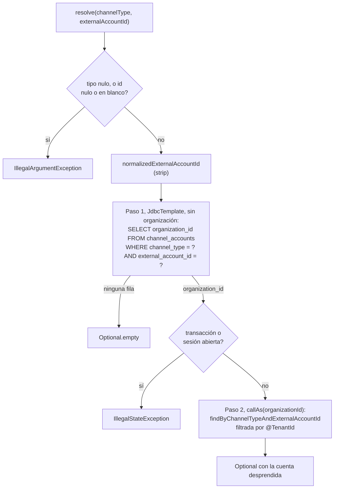

# Canales y cuentas de canal

Issue #42 (primera parte de #9). Decisiones: P-043 (entidad y alcance), P-044 (unicidad global y resolución entre
organizaciones), P-045 (FK de tres columnas desde `messages`, que reemplaza la de dos columnas que anunciaba P-039) en
`docs/decisiones.md`. Se apoya en `docs/multi-tenant.md` y en los mensajes de `docs/mensajes.md`.

## Resumen

Una `ChannelAccount` es **nuestra** identidad en un canal: el número de WhatsApp, la página de Facebook, la cuenta de
Instagram o el bot de Telegram por el que una organización recibe y manda mensajes. Es de una sola organización y la
identifica el par **tipo de canal + id que le dio el proveedor** (`externalAccountId`): el `phone_number_id` de
WhatsApp, el id de la página, el id del bot.

Cuando llega un webhook, el proveedor dice a qué cuenta suya iba dirigido, pero no a qué organización. Por eso el
módulo `channels` resuelve la cuenta **sin organización activa**: `ChannelAccountDirectory.resolve(channelType,
externalAccountId)` busca la cuenta en todas las organizaciones y la devuelve con su `organizationId`, para que el
pipeline entrante (#10) abra el ámbito de esa organización antes de resolver la persona, la oportunidad y el mensaje.

Se va a activar con cada webhook que procese #10. Hoy nadie llama a `resolve` fuera de los tests.

La base también controla, desde #42, que todo mensaje apunte a una cuenta que existe, que es de su misma organización
y cuyo tipo coincide con el `channel` del mensaje (FK de tres columnas, P-045).

Fuera de #42: el valor `SANDBOX` de `ChannelType`, el puerto `ChannelAdapter` y el registro de adaptadores (#43); el
pipeline entrante (#10); credenciales, URL o secreto del webhook, «tiene bot», alta, baja y listado de cuentas (#11);
el envío, que va a leer `allowsOutbound` (#12).

## Piezas

Módulo `channels` (`backend/src/main/java/com/communicatorone/channels/`). Depende de `messaging` solo por
`ChannelType` (público, P-038) y de `organizations` solo por `CurrentOrganization` (pública). No hay ciclo:
`messaging` no conoce a `channels`. Todo es package-private: el único consumidor previsto es #10, que vive en el
mismo módulo (P-043).

| Clase | Visibilidad | Qué hace |
|---|---|---|
| `ChannelAccount` | package-private | Entidad de la tabla `channel_accounts` (`ChannelAccount.java:16-18`): `id`, `@TenantId organizationId` (`ChannelAccount.java:24-26`), `channelType` guardado por nombre, `externalAccountId`, `displayName` y `allowsOutbound`. Fábrica `register(channelType, externalAccountId, displayName, allowsOutbound)` (`ChannelAccount.java:48-54`), que exige tipo y nombre visible y normaliza el id con `normalizedExternalAccountId` (`strip`, `ChannelAccount.java:56-59`). Accesores `id()`, `organizationId()`, `channelType()` y `allowsOutbound()` (`ChannelAccount.java:61-75`). Sin setters, sin accesor de `displayName` (nadie lo lee todavía) y sin `toString` propio. |
| `ChannelAccountRepository` | package-private | `JpaRepository<ChannelAccount, UUID>` con la consulta derivada `findByChannelTypeAndExternalAccountId` (`ChannelAccountRepository.java:8-10`), filtrada por `@TenantId` como toda consulta derivada. |
| `ChannelAccountDirectory` | package-private | `@Component` con `resolve(ChannelType, String): Optional<ChannelAccount>` (`ChannelAccountDirectory.java:25-31`). Primero busca la organización con `JdbcTemplate` (el privado `organizationOf`, `ChannelAccountDirectory.java:33-39`) y después carga la cuenta con `callAs` y la consulta filtrada. Recibe `JdbcTemplate`, `CurrentOrganization` y el repositorio en el constructor package-private (`ChannelAccountDirectory.java:18-23`). Sin `@Transactional`. |

El `package-info.java` con `@ApplicationModule` ya existía desde el scaffold y `ModularStructureTest` ya declaraba
`channels`. #42 suma la migración V7 (ver «Esquema»), que además agrega una restricción a `messages`.

## Contrato de `resolve` (para #10)

```java
Optional<ChannelAccount> account = directory.resolve(ChannelType.WHATSAPP, "106540352242922");
```

| Entrada | Salida |
|---|---|
| Tipo + id de una cuenta registrada en cualquier organización, sin organización activa | `Optional` con la cuenta (desprendida): su `id`, su `organizationId`, su `channelType` y su `allowsOutbound` |
| Lo mismo, dentro de `callAs` de **otra** organización | La cuenta de su propia organización: la organización activa no influye |
| El id con espacios alrededor (`" 106540352242922  "`) | La misma cuenta: se recorta con la misma función que al registrar |
| Un id que no está registrado para ese tipo (aunque exista en otro tipo) | `Optional.empty()` |
| El mismo id con otro tipo de canal | La cuenta de ese tipo, si existe: `WHATSAPP "777"` y `TELEGRAM "777"` son dos cuentas |
| Tipo nulo | `IllegalArgumentException` («A channel account is resolved by its channel type») |
| Id nulo, vacío o en blanco | `IllegalArgumentException` («A channel account needs the id its provider gave it») |
| Llamado con una transacción o una sesión de JPA abierta, y la cuenta existe | `IllegalStateException` de `callAs` («The organization cannot be switched inside a transaction or open session») |
| Llamado con una transacción o una sesión de JPA abierta, y la cuenta no existe | `Optional.empty()`: el `callAs` no llega a ejecutarse |

Quien llama a `resolve`:

1. **No tiene una transacción ni una sesión de JPA abierta.** `resolve` no es `@Transactional` porque el segundo paso
   es un `callAs`, que lanza `IllegalStateException` si hay sincronización de transacción activa o una sesión ligada
   al hilo (`CurrentOrganization.java:32-38`, `:47-50`). Es el mismo motivo por el que `OperatorAuthentication.signIn`
   no es transaccional (P-022). La excepción solo aparece si la cuenta existe: con un id desconocido el primer paso
   devuelve vacío y el `callAs` nunca corre. Un test que solo pruebe ids desconocidos dentro de una transacción no lo
   va a detectar.
2. **Trata el `Optional.empty()` como «webhook para una cuenta que no conocemos»**: no hay organización a la que
   asignarlo. Qué responde al proveedor lo decide #10.
3. **Después abre el ámbito de la organización de la cuenta** y pasa el tipo de la cuenta como canal del mensaje:

```java
directory.resolve(channelType, payloadAccountId).ifPresent(account ->
        currentOrganization.runAs(account.organizationId(), () -> {
            var personId = personDirectory.resolveOrCreate(identity);
            // ... isRecorded, recordActivity ...
            timeline.recordReceived(new ReceivedMessage(personId, opportunityId, account.id(),
                    account.channelType(), externalId, content, occurredAt));
        }));
```

Pasar `account.channelType()` (y no un tipo que el pipeline arme por su cuenta) es lo que garantiza que el mensaje
cumpla la FK de tres columnas: si `channel` no coincide con el tipo de la cuenta, la base rechaza el `INSERT`
(`DataIntegrityViolationException`, ver «Esquema»).

`resolve` devuelve la entidad desprendida (la sesión del `callAs` ya se cerró), como
`OperatorAuthentication.operatorWithEmail`. Tiene solo columnas básicas, así que no hay carga perezosa que pueda fallar
después.

## Diagramas

Resolución en dos pasos (`ChannelAccountDirectory.java:25-39`):



Dónde encaja en el flujo entrante de #10:


## Flujo en detalle

### Registro (`ChannelAccount.register`)

1. Exige el tipo con `Assert.notNull` («A channel account needs its channel type») y el nombre visible con
   `Assert.hasText` («A channel account needs a display name», `ChannelAccount.java:50-51`). El nombre se guarda tal
   cual, como `Operator.name`.
2. Normaliza el id con `normalizedExternalAccountId` (`ChannelAccount.java:56-59`): `Assert.hasText` («A channel
   account needs the id its provider gave it») y `strip`. No cambia mayúsculas: el id es opaco y se compara exacto.
   Sigue el patrón de `Operator.register` / `Operator.normalizedEmail`.
3. La organización la asigna Hibernate al guardar, con la organización activa (`@TenantId`, P-018). Hoy solo guarda
   `ChannelsFixture.account` en los tests; en desarrollo, las cuentas se cargan por SQL (ver «Alta de una cuenta en
   desarrollo»).

Ejemplo: `register(WHATSAPP, "  106540352242922 ", "Ventas", true)` guarda `external_account_id = 106540352242922`.

### Resolución (`ChannelAccountDirectory.resolve`)

1. Valida el tipo (`ChannelAccountDirectory.java:26`) y normaliza el id con la misma función que el registro
   (`ChannelAccountDirectory.java:27`), así que un payload con espacios encuentra la cuenta.
2. **Paso 1** (`ChannelAccountDirectory.java:33-39`): `JdbcTemplate` con `SELECT organization_id FROM channel_accounts
   WHERE channel_type = ? AND external_account_id = ?`. Es la tercera consulta del sistema que cruza organizaciones a
   propósito, después de la del login (P-022) y la del job de cierre (P-037), y como ellas devuelve solo el id de la
   organización (`docs/multi-tenant.md`, `.claude/rules/java.md`). Por el `UNIQUE` global devuelve como mucho una fila.
3. **Paso 2** (`ChannelAccountDirectory.java:28-30`): con esa organización abre `currentOrganization.callAs` y carga
   la cuenta con la consulta derivada, que Hibernate filtra por `@TenantId` como cualquier otra lectura.

Son dos consultas por webhook, las dos sobre el índice único. Se descartó una sola consulta nativa que devuelva la
fila entera (se salta `@TenantId`; la regla es que las consultas que cruzan organizaciones devuelven solo ids de
organización).

## Esquema

`backend/src/main/resources/db/migration/V7__create_channel_accounts.sql`:

```sql
CREATE TABLE channel_accounts (
    id UUID PRIMARY KEY,
    organization_id UUID NOT NULL REFERENCES organizations (id),
    channel_type TEXT NOT NULL,
    external_account_id TEXT NOT NULL,
    display_name TEXT NOT NULL,
    allows_outbound BOOLEAN NOT NULL,
    CONSTRAINT channel_accounts_channel_type_external_account_id_key UNIQUE (channel_type, external_account_id),
    CONSTRAINT channel_accounts_id_organization_id_channel_type_key UNIQUE (id, organization_id, channel_type)
);

CREATE INDEX channel_accounts_organization_id_idx ON channel_accounts (organization_id);

ALTER TABLE messages
    ADD CONSTRAINT messages_channel_account_id_organization_id_channel_fkey
        FOREIGN KEY (channel_account_id, organization_id, channel)
        REFERENCES channel_accounts (id, organization_id, channel_type);
```

Restricciones:

- `channel_accounts_channel_type_external_account_id_key` (`V7__create_channel_accounts.sql:8`) es **global**, sin
  `organization_id`: un mismo número o página no puede pertenecer a dos organizaciones, porque entonces un webhook no
  sabría a cuál asignarse (P-044). Un intento de registrarla en otra organización falla con
  `DataIntegrityViolationException` que nombra la restricción.
- `channel_accounts_id_organization_id_channel_type_key` (`V7__create_channel_accounts.sql:9`) es redundante con la
  clave primaria, pero hace falta como destino de la FK de tres columnas de `messages`.
- `messages_channel_account_id_organization_id_channel_fkey` (`V7__create_channel_accounts.sql:14-17`) garantiza que la
  cuenta de un mensaje exista, sea de la misma organización y tenga el mismo tipo que su `channel`, aunque alguien
  inserte por SQL (P-045). Implica la FK de dos columnas que anunciaba P-039, así que no se agregó el `UNIQUE (id,
  organization_id)` que esa decisión preveía. Es `NO ACTION`: borrar una cuenta con mensajes, o cambiarle el tipo,
  falla.
- La FK implícita a `organizations` (`V7__create_channel_accounts.sql:3`) rechaza guardar sin organización
  (centinela `UUID(0, 0)`).
- Sin `CHECK` de valores de `channel_type` ni de id recortado o no vacío, como `messages.channel` y `operators.role`:
  lo garantiza `register` y, en el SQL de desarrollo, quien lo escribe.

Índices y las consultas que sirven:

| Índice | Consulta |
|---|---|
| `channel_accounts_channel_type_external_account_id_key` (el `UNIQUE` global) | El paso 1 de `resolve` (`WHERE channel_type = ? AND external_account_id = ?`) y el paso 2, al que Hibernate le agrega `AND organization_id = ?`. |
| `channel_accounts_id_organization_id_channel_type_key` | Destino de la FK de `messages`: el `INSERT` de un mensaje busca la cuenta por `(id, organization_id, channel_type)`. |
| `channel_accounts_organization_id_idx` (`V7__create_channel_accounts.sql:12`) | El lado de `channel_accounts` de la FK a `organizations` y el futuro listado de cuentas de una organización (#11). Lo pide `.claude/rules/flyway.md`. |
| `messages_organization_id_channel_account_id_external_id_key` (de V6) | El lado de `messages` de la FK nueva: al borrar una cuenta o cambiarle la clave, el chequeo busca mensajes por `organization_id` y `channel_account_id`, que son el prefijo de ese `UNIQUE`. No hizo falta un índice nuevo en `messages`. |

Fila de ejemplo después de `ChannelsFixture.account(acme, WHATSAPP, "  106540352242922 ", true)`:

```
channel_accounts: id = <id>, organization_id = <Acme>, channel_type = WHATSAPP,
                  external_account_id = 106540352242922, display_name = Ventas, allows_outbound = true
```

Concurrencia: el `INSERT` de un mensaje toma `FOR KEY SHARE` sobre la fila de su cuenta (chequeo de la FK). No choca
con otros mensajes ni con el rival de `concurrentDuplicatedWebhooksRecordASingleMessage`; solo esperaría a un `DELETE`
de la cuenta o a un cambio de su clave, que hoy nadie hace.

## Alta de una cuenta en desarrollo

No hay endpoint ni servicio de alta (llega con #11). Con el Postgres de compose levantado y las migraciones ya
aplicadas, se carga por SQL. La fila tiene que cumplir lo que garantizaría `ChannelAccount.register`, porque la base no
lo controla:

- `channel_type` con el nombre exacto del enum `ChannelType` (`WHATSAPP`, `INSTAGRAM`, `MESSENGER`, `TELEGRAM`,
  `EMAIL`, `SMS`, `WEBCHAT`; un valor distinto rompe la carga de la entidad);
- `external_account_id` no vacío y sin espacios alrededor (si no, `resolve`, que recorta lo que recibe y rechaza un id
  en blanco, no lo encuentra);
- `display_name` no vacío ni en blanco (`register` lo exige con `Assert.hasText`; la columna solo es `NOT NULL`);
- `organization_id` de una organización existente (FK; ver «Alta de un operador en desarrollo» en
  `docs/autenticacion.md` para crear una).

Desde la raíz del repo, con los valores por defecto de `.env.example` y la organización de ejemplo de
`docs/autenticacion.md`:

```bash
docker compose exec -T postgres psql -v ON_ERROR_STOP=1 -U communicator_one -d communicator_one <<'SQL'
INSERT INTO channel_accounts (id, organization_id, channel_type, external_account_id, display_name, allows_outbound)
VALUES (gen_random_uuid(), '11111111-1111-1111-1111-111111111111', 'WHATSAPP', '106540352242922', 'Ventas', true);
SQL
```

Un segundo `INSERT` con el mismo `channel_type` y `external_account_id` falla por
`channel_accounts_channel_type_external_account_id_key`, aunque sea para otra organización.

## Tests

`backend/src/test/java/com/communicatorone/channels/ChannelAccountTest.java` (sin Spring). 1 método, 7 ejecuciones.

| Test | Qué cubre |
|---|---|
| `channelAccountWithoutTypeExternalIdOrDisplayNameIsRejected` | Parametrizado: tipo nulo; id nulo, `""` y `"   "`; nombre nulo, `""` y `"   "`. Cada uno da `IllegalArgumentException` con su mensaje exacto. |

`backend/src/test/java/com/communicatorone/channels/ChannelAccountDirectoryTest.java` (`@SpringBootTest` con
`RANDOM_PORT` + Testcontainers, sin `@Transactional`). Cada test crea sus organizaciones con `ChannelsFixture`, que
registra cuentas con `callAs` + `ChannelAccount.register` (nombre «Ventas») y compara con el record
`ChannelsFixture.RegisteredAccount(id, organizationId, channelType, allowsOutbound)`. Como la base es compartida y el
`UNIQUE` es global, los ids externos llevan un sufijo al azar (`ChannelsFixture.externalAccountId(prefix)`). 8 métodos,
10 ejecuciones con los parametrizados.

| Test | Qué cubre |
|---|---|
| `eachAccountResolvesToItsOwnOrganizationWithoutAnActiveOrganization` | Acme (`allowsOutbound = true`) y Globex (`false`) con cuentas `WHATSAPP`: sin ámbito ni usuario, cada id resuelve a su cuenta con id, organización, tipo y `allowsOutbound`. |
| `unknownExternalAccountIdResolvesNothing` | Con una cuenta en Acme, otro id del mismo tipo da vacío. |
| `sameExternalAccountIdOnAnotherChannelIsAnotherAccount` | El mismo id en `WHATSAPP` (Acme) y en `TELEGRAM` (Globex): se registran las dos y cada tipo resuelve a la suya. |
| `externalAccountIdCannotBelongToTwoOrganizations` | Registrar en Globex el id `WHATSAPP` de Acme da `DataIntegrityViolationException` con `channel_accounts_channel_type_external_account_id_key` en el mensaje; Globex queda con 0 cuentas y `resolve` sigue devolviendo la de Acme. |
| `channelAccountOfAnotherOrganizationIsNotVisible` | Bajo `callAs(globex)`, `findById` y `findByChannelTypeAndExternalAccountId` de la cuenta de Acme dan vacío; bajo `callAs(acme)` la encuentran (control). |
| `accountRegisteredWithSurroundingSpacesResolvesByItsTrimmedId` | Registrada con espacios alrededor: la resuelven el id recortado y el id con otros espacios. |
| `resolutionIgnoresAnotherActiveOrganization` | `resolve` dentro de `callAs(globex)` devuelve la cuenta de Acme. |
| `resolvingWithoutChannelTypeOrExternalAccountIdIsRejected` | Parametrizado: `(null, "123")`, `(WHATSAPP, null)` y `(WHATSAPP, "  ")` dan `IllegalArgumentException` con su mensaje. |

`backend/src/test/java/com/communicatorone/messaging/TimelineTest.java` suma tres tests de la FK nueva (detalle en
`docs/mensajes.md`, «Tests»): `messageCannotPointToAChannelAccountOfAnotherOrganization`,
`messageCannotPointToAnUnknownChannelAccount` y `messageOnAChannelOtherThanItsAccountTypeIsRejected`. Los tres afirman
`DataIntegrityViolationException`, ninguna fila con ese `externalId` y, en la salida, el nombre de
`messages_channel_account_id_organization_id_channel_fkey`. Para eso, `MessagingFixture.channelAccount` ahora inserta
por SQL una cuenta real (`WHATSAPP` por defecto, o del tipo que se le pase; `MessagingFixture.java:61-73`), sin
depender de clases de `channels`.

`TenantIsolationTest.everyBusinessEntityBelongsToAnOrganization` cubre que `ChannelAccount` lleve `@TenantId`, y
`ModularStructureTest` que `channels` no use internos de `messaging` ni de `organizations`.

No hay test de `resolve` llamado dentro de una transacción (el contrato del punto 1 de «Contrato de `resolve`» sale de
`CurrentOrganization`, que ya tiene sus tests en `TenantIsolationTest`).

Comando: `./mvnw test -Dtest='ChannelAccount*Test,TimelineTest'` desde `backend/` (skill `run-tests`).

## Riesgos y pendientes

- **El `UNIQUE` global revela que la cuenta existe en otra organización.** Cuando haya alta de cuentas (#11), una
  organización que intente registrar un número que ya es de otra va a recibir un error de unicidad, y con eso sabe que
  ese número está dado de alta en el sistema. P-031 oculta el `DETAIL` (los valores) en el log, pero el rechazo en sí
  es la señal. #11 decide qué responde (por ejemplo, un error genérico) y si exige verificar la propiedad de la cuenta.
- **Una cuenta con mensajes no se puede borrar** (ni cambiarle el tipo): la FK de `messages` es `NO ACTION`. La baja
  tiene que ser un estado (activa/inactiva), no un `DELETE` (#11).
- **Visibilidad si los adaptadores van en subpaquetes.** Todo es package-private porque #10 vive en `channels`. Si
  #43 o #11 ponen los adaptadores en subpaquetes (`channels.whatsapp`, `channels.sandbox`), `ChannelAccount`,
  `ChannelAccountDirectory` y sus métodos tendrán que ser `public`; Spring Modulith los sigue tratando como internos
  del módulo (solo el paquete raíz es la API), así que otros módulos no podrían usarlos igual. Si #10 termina en un
  módulo por encima de `channels`, hace falta un record público en vez de exponer la entidad.
- **Sin control de valores en la base**: un `INSERT` por SQL con un `channel_type` que no existe en el enum rompe la
  carga de la entidad, y uno con espacios en el id no se resuelve.
- **La V7 valida las filas existentes de `messages`** al agregar la FK: una base local con mensajes insertados a mano
  (con cuentas al azar, como en #8) hace fallar la migración. Se recrea con `docker compose down -v && docker compose
  up -d`. El `ALTER TABLE messages` toma `SHARE ROW EXCLUSIVE` sin `lock_timeout`; riesgo bajo mientras no haya
  producción (la misma mitigación que en `docs/mensajes.md`, «Riesgos»).
- **#43 (puerto y canal de prueba)**: agrega `SANDBOX` a `ChannelType` con su adaptador, define `ChannelAdapter` y el
  registro de adaptadores, y garantiza que el adaptador entregue un `externalId` de mensaje único por cuenta (Telegram:
  `chatId:messageId`, P-042).
- **#10 (pipeline entrante)**: llama a `resolve` fuera de transacción, decide qué hacer con un webhook de una cuenta
  desconocida y abre `runAs(account.organizationId(), ...)` pasando `account.channelType()` como canal.
- **#11**: credenciales, URL o secreto del webhook, «tiene bot», alta, baja (como estado) y listado de cuentas.
- **#12**: el envío lee `allowsOutbound`, que hoy solo leen los tests.
