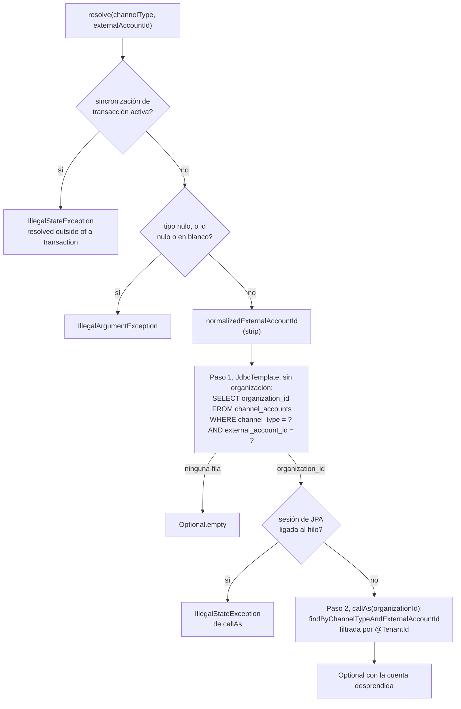
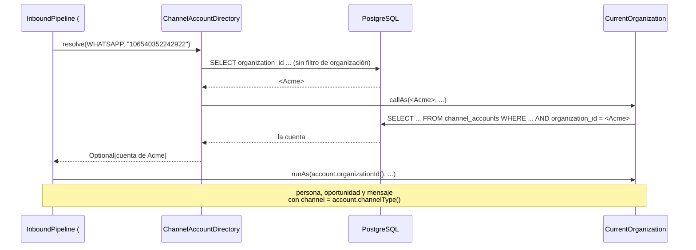
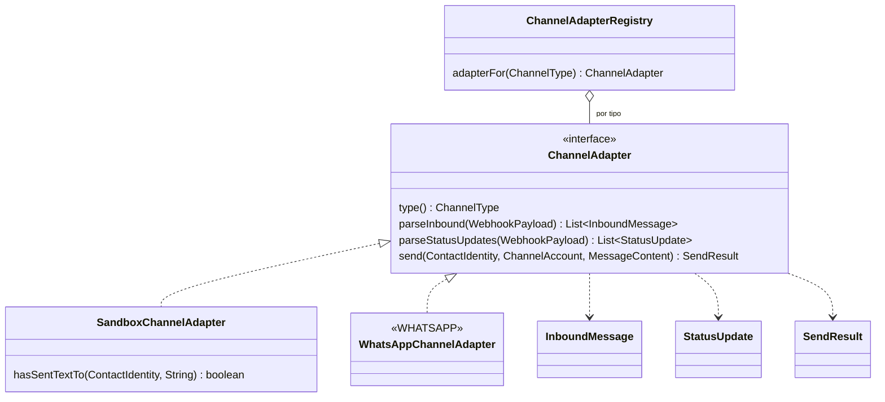
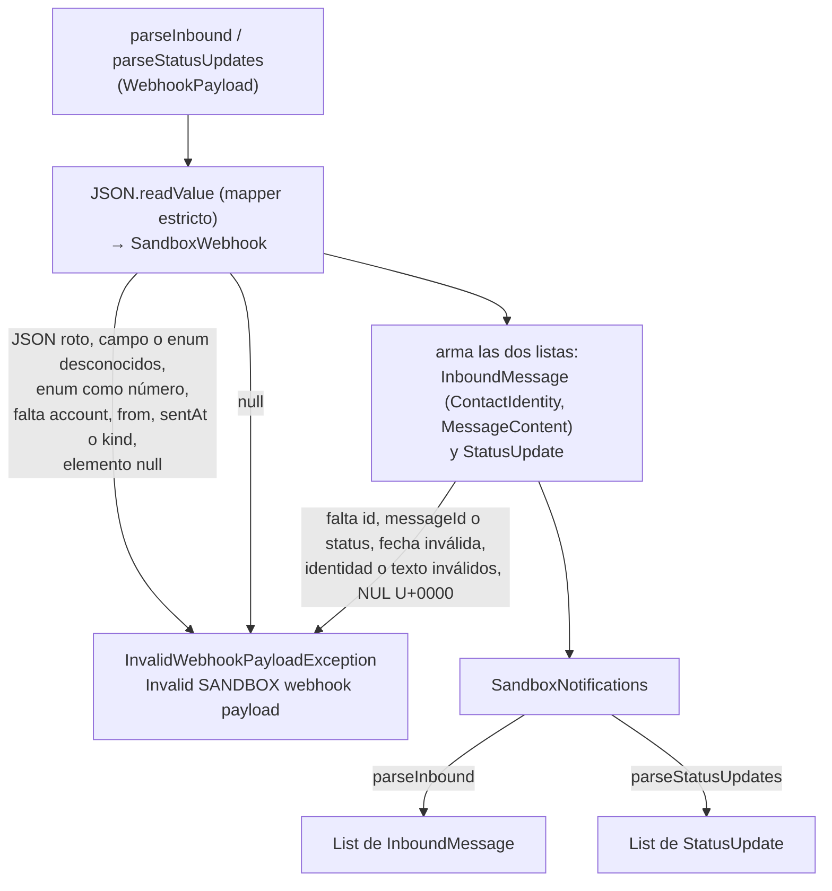
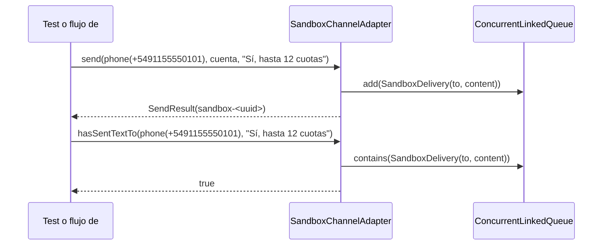
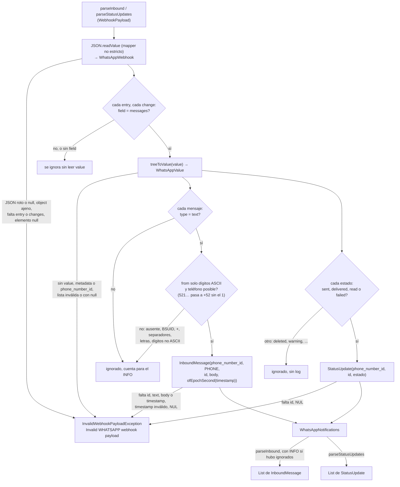
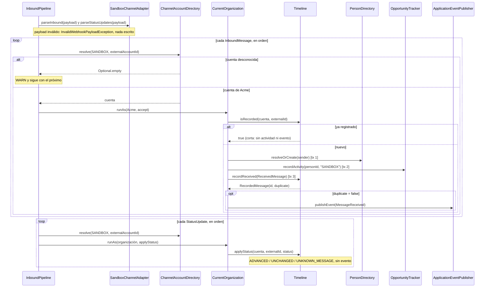

# Canales y cuentas de canal

Issues #42 y #43 (partes de #9), #10 (pipeline de entrada) y #47 (parte de #11, parseo de WhatsApp). Decisiones en
`docs/decisiones.md`: P-043 (entidad y alcance), P-044 (unicidad global y resolución entre organizaciones), P-045 (FK
de tres columnas desde `messages`, que reemplaza la de dos columnas que anunciaba P-039), P-046 (forma del puerto
`ChannelAdapter`), P-047 (registro de adaptadores), P-048 (adaptador `SANDBOX`), P-049 (ubicación del pipeline y sin
endpoint), P-050 (orden, transacciones y casos borde del pipeline), P-051 (evento `MessageReceived` y listeners), P-052
(forma del adaptador `WHATSAPP`) y P-053 (qué es inválido y qué se ignora en un webhook de WhatsApp). Se apoya en
`docs/multi-tenant.md`, en los mensajes de `docs/mensajes.md`, en las identidades de `docs/personas.md` y en las
oportunidades de `docs/oportunidades.md`.

## Resumen

Una `ChannelAccount` es **nuestra** identidad en un canal: el número de WhatsApp, la página de Facebook, la cuenta de
Instagram o el bot de Telegram por el que una organización recibe y manda mensajes. Es de una sola organización y la
identifica el par **tipo de canal + id que le dio el proveedor** (`externalAccountId`): el `phone_number_id` de
WhatsApp, el id de la página, el id del bot.

Cuando llega un webhook, el proveedor dice a qué cuenta suya iba dirigido, pero no a qué organización. Por eso el
módulo `channels` resuelve la cuenta **sin organización activa**: `ChannelAccountDirectory.resolve(channelType,
externalAccountId)` busca la cuenta en todas las organizaciones y la devuelve con su `organizationId`, para que el
pipeline entrante (`InboundPipeline`, #10) abra el ámbito de esa organización antes de resolver la persona, la
oportunidad y el mensaje.

La base también controla, desde #42, que todo mensaje apunte a una cuenta que existe, que es de su misma organización
y cuyo tipo coincide con el `channel` del mensaje (FK de tres columnas, P-045).

Desde #43, cada canal se habla a través de un **puerto** común, `ChannelAdapter` (`docs/vision.md` §5): convierte el
cuerpo de un webhook en mensajes entrantes (`InboundMessage`) y en reportes de estado (`StatusUpdate`), y manda un
texto a una identidad de contacto desde una cuenta nuestra. `ChannelAdapterRegistry` da el adaptador de cada
`ChannelType`. El primer adaptador es el del canal de prueba `SANDBOX` (`SandboxChannelAdapter`): entiende un JSON
propio (ver «Formato del payload del sandbox») y guarda en memoria lo que «envía», para que los tests afirmen con
`hasSentTextTo(identidad, texto)` sin un proveedor real.

Desde #47, el registro también tiene el adaptador del primer canal real, `WHATSAPP` (`WhatsAppChannelAdapter`):
convierte el webhook de WhatsApp Cloud API (`entry[].changes[].value`) en `InboundMessage` (solo los mensajes de
texto, con el `phone_number_id` como cuenta y el `wa_id` como teléfono E.164) y en `StatusUpdate` (`sent`,
`delivered`, `read`, `failed`). Ignora lo que el dominio todavía no modela (otros tipos de mensaje, otros estados,
otros campos del webhook, remitentes sin teléfono) y rechaza entero el payload que rompe el contrato de Meta en los
campos que usa (ver «Adaptador `WHATSAPP`»). Hoy solo lo llaman los tests: el endpoint con la verificación y la firma
de Meta es de #49.

Desde #10, `InboundPipeline.receive(channelType, payload)` procesa un webhook de punta a punta: parsea con el adaptador
del canal todos los mensajes y estados, y recién después escribe. Por cada mensaje resuelve la cuenta (y con ella la
organización), descarta el reenvío, resuelve o crea la persona, registra la actividad en su oportunidad, guarda el
mensaje y, si no era un duplicado, publica el evento `MessageReceived`. Por cada estado, lo aplica con
`Timeline.applyStatus` al mensaje con ese `externalId` en la cuenta. Un mensaje o estado para una cuenta que no
conocemos se descarta con un WARN. Se va a activar con cada webhook cuando una tarea exponga el endpoint (#49 para
WhatsApp); hoy solo lo llaman los tests (ver «Pipeline de entrada (#10)»).

Fuera de #42, #43, #10 y #47: el endpoint de webhooks de WhatsApp, con la verificación (`hub.challenge`), la firma
`X-Hub-Signature-256`, la ruta pública, el secreto por variable de entorno y la traducción a HTTP de las excepciones
del pipeline (#49, P-049); el nombre visible de la persona (`contacts[].profile.name`, #48, P-030); «tiene bot», alta,
baja y listado de cuentas (#11, sin subissue todavía); el envío por WhatsApp y por cualquier canal, que va a leer
`allowsOutbound`, las fallas de envío, `windowState` y `startConversation` (#12); los mensajes de WhatsApp que no son
texto (imágenes, audio, ubicación, reacciones, botones), que hoy se ignoran (#11, sin subissue todavía); los listeners
de `MessageReceived` y los eventos de `opportunities` que necesiten garantía de entrega (#13 a #15, P-051).

## Piezas

Módulo `channels` (`backend/src/main/java/com/communicatorone/channels/`). Depende solo de tipos públicos de la raíz
de otros módulos: de `messaging`, `ChannelType` (P-038), desde #43 `MessageContent` y `MessageStatus`, y desde #10
`Timeline` y `ReceivedMessage`; de `organizations`, `CurrentOrganization`; de `people`, desde #43 `ContactIdentity`,
`IdentityKind` e `InvalidContactIdentityException`, y desde #10 `PersonDirectory`; y, desde #10, de `opportunities`,
`OpportunityTracker` (dependencia nueva, P-049). No hay ciclo: ni `messaging`, ni `people`, ni `opportunities` conocen
a `channels`. Todo es package-private salvo el evento `MessageReceived` (público desde #10, para que otros módulos lo
escuchen) y vive en el paquete raíz del módulo, sin subpaquetes: el pipeline de #10 vive en el mismo módulo (P-043,
P-049), y los adaptadores van planos en la raíz con el canal como prefijo (`SandboxChannelAdapter` y, desde #47,
`WhatsAppChannelAdapter`; P-046).

Cuentas de canal (#42):

| Clase | Visibilidad | Qué hace |
|---|---|---|
| `ChannelAccount` | package-private | Entidad de la tabla `channel_accounts` (`ChannelAccount.java:16-18`): `id`, `@TenantId organizationId` (`ChannelAccount.java:24-26`), `channelType` guardado por nombre, `externalAccountId`, `displayName` y `allowsOutbound`. Fábrica `register(channelType, externalAccountId, displayName, allowsOutbound)` (`ChannelAccount.java:48-54`), que exige tipo y nombre visible y normaliza el id con `normalizedExternalAccountId` (`strip`, `ChannelAccount.java:56-59`). Accesores `id()`, `organizationId()`, `channelType()` y `allowsOutbound()` (`ChannelAccount.java:61-75`). Sin setters, sin accesor de `displayName` (nadie lo lee todavía) y sin `toString` propio. |
| `ChannelAccountRepository` | package-private | `JpaRepository<ChannelAccount, UUID>` con la consulta derivada `findByChannelTypeAndExternalAccountId` (`ChannelAccountRepository.java:8-10`), filtrada por `@TenantId` como toda consulta derivada. |
| `ChannelAccountDirectory` | package-private | `@Component` con `resolve(ChannelType, String): Optional<ChannelAccount>` (`ChannelAccountDirectory.java:26-34`). Al entrar rechaza la sincronización de transacción activa (`ChannelAccountDirectory.java:27-28`, como `PersonDirectory.resolveOrCreate`, P-029); después busca la organización con `JdbcTemplate` (el privado `organizationOf`, `ChannelAccountDirectory.java:36-42`) y carga la cuenta con `callAs` y la consulta filtrada. Recibe `JdbcTemplate`, `CurrentOrganization` y el repositorio en el constructor package-private (`ChannelAccountDirectory.java:19-24`). Sin `@Transactional`. |

Puerto, registro y adaptador de prueba (#43):

| Clase | Visibilidad | Qué hace |
|---|---|---|
| `ChannelAdapter` | package-private | Interfaz del puerto (`ChannelAdapter.java:8-17`): `type()`, `parseInbound(WebhookPayload)`, `parseStatusUpdates(WebhookPayload)` y `send(ContactIdentity to, ChannelAccount from, MessageContent content)`. Contrato en «Puerto de canal». |
| `WebhookPayload` | package-private | `record (String body)`: el cuerpo del webhook tal como llegó. Exige `body` no nulo (`WebhookPayload.java:7-9`); el cuerpo vacío lo rechaza el adaptador. `toString` devuelve `WebhookPayload[body]`, sin el cuerpo, que trae datos personales (`WebhookPayload.java:11-14`). Sin headers ni bytes crudos (P-046). |
| `InboundMessage` | package-private | `record (externalAccountId, ContactIdentity sender, externalId, MessageContent content, Instant occurredAt)` (`InboundMessage.java:8-9`). El constructor compacto exige los cinco con `Assert` y rechaza U+0000 (NUL) en el id de cuenta, el valor de la identidad, el `externalId` y el texto, con un `Assert.doesNotContain(campo, "\0", …)` por campo (`InboundMessage.java:11-21`, `:17-20`); no recorta (el id de cuenta lo recorta `resolve`). No lleva el tipo de canal: lo da el adaptador o la cuenta resuelta (P-045). |
| `StatusUpdate` | package-private | `record (externalAccountId, externalId, MessageStatus status)` (`StatusUpdate.java:6`), con los tres obligatorios y sin U+0000 (NUL) en el id de cuenta ni en el `externalId`, también con `Assert.doesNotContain` (`StatusUpdate.java:8-14`, `:12-13`). |
| `SendResult` | package-private | `record (String externalId)`: el id que el proveedor le dio al mensaje enviado, obligatorio (`SendResult.java:5-9`). Las fallas de envío las modela #12. |
| `InvalidWebhookPayloadException` | package-private | Unchecked. Mensaje `Invalid <tipo> webhook payload`, sin causa encadenada ni detalle (`InvalidWebhookPayloadException.java:5-10`): el error del parser puede citar fragmentos del payload, como el valor de un teléfono (mismo criterio que `InvalidContactIdentityException`). |
| `ChannelAdapterRegistry` | package-private | `@Component` que recibe todos los beans `ChannelAdapter` (`ChannelAdapterRegistry.java:15-19`) y los indexa por `type()`. `adapterFor(ChannelType)` (`ChannelAdapterRegistry.java:21-27`). Contrato en «Registro de adaptadores». |
| `UnsupportedChannelException` | package-private | Unchecked. Mensaje `No channel adapter handles <tipo>` (`UnsupportedChannelException.java:5-10`). |
| `SandboxChannelAdapter` | package-private | `@Component` del canal `SANDBOX` (`SandboxChannelAdapter.java:22-132`), siempre activo. Parsea el JSON propio del sandbox con records anidados package-private y guarda los envíos en memoria; `hasSentTextTo` es la consulta para los tests. Detalle en «Adaptador `SANDBOX`». |

Adaptador de WhatsApp (#47):

| Clase | Visibilidad | Qué hace |
|---|---|---|
| `WhatsAppChannelAdapter` | package-private | `@Component` del canal `WHATSAPP` (`WhatsAppChannelAdapter.java:25-26`), siempre activo y sin dependencias (P-052). Parsea el webhook de WhatsApp Cloud API con un mapper no estricto y records anidados package-private (`WhatsAppChannelAdapter.java:79-218`); `send` lanza `UnsupportedOperationException` hasta #12 (`WhatsAppChannelAdapter.java:64-67`). Detalle en «Adaptador `WHATSAPP`». |

Pipeline de entrada (#10):

| Clase | Visibilidad | Qué hace |
|---|---|---|
| `InboundPipeline` | package-private | `@Service` sin `@Transactional` (`InboundPipeline.java:16-17`) con un único método, `receive(ChannelType, WebhookPayload)` (`InboundPipeline.java:43-54`). Recibe en el constructor package-private `ChannelAdapterRegistry`, `ChannelAccountDirectory`, `CurrentOrganization`, `PersonDirectory`, `OpportunityTracker`, `Timeline` y el `ApplicationEventPublisher` de Spring (`InboundPipeline.java:31-41`). Privados: `inOrganizationOf` (resolver la cuenta y correr la acción en el `runAs` de su organización, o descartar con WARN), `loggable` (sanear el id para el log) y `accept` (un mensaje). Contrato en «Pipeline de entrada (#10)». |
| `MessageReceived` | **pública** (API) | `record (UUID organizationId, UUID messageId, UUID personId, UUID opportunityId, UUID channelAccountId, ChannelType channel)` (`MessageReceived.java:6-8`): el evento de un mensaje entrante nuevo. Sin texto ni identidad del remitente (datos personales). Semántica en «Evento `MessageReceived`». |

El `package-info.java` con `@ApplicationModule` ya existía desde el scaffold y `ModularStructureTest` ya declaraba
`channels`. #42 suma la migración V7 (ver «Esquema»), que además agrega una restricción a `messages`. #43 no tiene
migración: `channel_accounts.channel_type` y `messages.channel` son `TEXT` sin `CHECK`, así que `SANDBOX`
(`ChannelType.java:11`) entra sin tocar el esquema, y no aparece en `backend/openapi.json` (ningún endpoint lo
expone). #10 tampoco tiene migración ni cambia `SecurityConfiguration`, `ApiExceptionHandler`, `openapi.json` ni el
`pom.xml` (sin `spring-modulith-starter-jpa`, P-009). #47 tampoco: `WHATSAPP` ya era un valor de `ChannelType`
(`ChannelType.java:4`), y `channels` ya dependía de `messaging` y `people`; `@JsonProperty` llega con Jackson 3, que
ya estaba en el classpath.

## Contrato de `resolve` (para #10)

```java
Optional<ChannelAccount> account = directory.resolve(ChannelType.WHATSAPP, "106540352242922");
```

| Entrada | Salida |
|---|---|
| Tipo + id de una cuenta registrada en cualquier organización, sin organización activa | `Optional` con la cuenta (desprendida): su `id`, su `organizationId`, su `channelType` y su `allowsOutbound` |
| Lo mismo, dentro de `callAs` de **otra** organización | La cuenta de su propia organización: la organización activa no influye |
| El id con espacios alrededor (`" 106540352242922  "`) | La misma cuenta: se recorta con la misma función que al registrar |
| Un id que no está registrado para ese tipo (aunque exista en otro tipo) | `Optional.empty()` |
| El mismo id con otro tipo de canal | La cuenta de ese tipo, si existe: `WHATSAPP "777"` y `TELEGRAM "777"` son dos cuentas |
| Tipo nulo, fuera de transacción | `IllegalArgumentException` («A channel account is resolved by its channel type») |
| Id nulo, vacío o en blanco, fuera de transacción | `IllegalArgumentException` («A channel account needs the id its provider gave it») |
| Cualquier entrada (cuenta existente, id desconocido o argumentos inválidos) con sincronización de transacción activa: dentro de una transacción o de un ámbito `SUPPORTS` | `IllegalStateException` («A channel account is resolved outside of a transaction, not inside an open one»), antes de validar argumentos y sin consultar la base |
| Sin sincronización de transacción pero con una sesión de JPA ligada al hilo (OSIV, `SYNCHRONIZATION_NEVER`, `EntityManager` ligado a mano), y la cuenta existe | `IllegalStateException` de `callAs` («The organization cannot be switched inside a transaction or open session»). Sin test propio en `ChannelAccountDirectoryTest` |
| Lo mismo, con un id desconocido | `Optional.empty()`: el chequeo de entrada no mira la sesión y el `callAs` no llega a ejecutarse |

Quien llama a `resolve`:

1. **No tiene una transacción ni una sesión de JPA abierta.** `resolve` no es `@Transactional` porque el segundo paso
   es un `callAs`, que lanza `IllegalStateException` si hay sincronización de transacción activa o una sesión ligada
   al hilo (`CurrentOrganization.java:32-38`, `:47-50`). Es el mismo motivo por el que `OperatorAuthentication.signIn`
   no es transaccional (P-022). Para que el error no dependa de que la cuenta exista, `resolve` comprueba al entrar
   `TransactionSynchronizationManager.isSynchronizationActive()` con `Assert.state`
   (`ChannelAccountDirectory.java:27-28`), igual que `PersonDirectory.resolveOrCreate` (P-029): llamado dentro de una
   transacción o de un ámbito `SUPPORTS`, falla siempre, también con un id desconocido. Ese chequeo no mira la sesión
   ligada al hilo sin sincronización (OSIV, que la app tiene apagado): ese caso lo sigue frenando `callAs`, solo si la
   cuenta existe.
2. **Trata el `Optional.empty()` como «webhook para una cuenta que no conocemos»**: no hay organización a la que
   asignarlo. `InboundPipeline` lo descarta con un WARN y sigue (ver «Cuenta desconocida»).
3. **Después abre el ámbito de la organización de la cuenta** y pasa el tipo de la cuenta como canal del mensaje. Así
   lo hace `InboundPipeline` (`InboundPipeline.java:48`, `:56-62`, `:75-76`):

```java
inOrganizationOf(channelType, inbound.externalAccountId(), account -> accept(account, inbound));
// inOrganizationOf:
accounts.resolve(channelType, externalAccountId).ifPresentOrElse(
        account -> currentOrganization.runAs(account.organizationId(), () -> action.accept(account)),
        () -> log.warn(...));
// dentro de accept:
timeline.recordReceived(new ReceivedMessage(personId, opportunityId, account.id(),
        account.channelType(), inbound.externalId(), inbound.content(), inbound.occurredAt()));
```

Pasar `account.channelType()` (y no un tipo que el pipeline arme por su cuenta) es lo que garantiza que el mensaje
cumpla la FK de tres columnas: si `channel` no coincide con el tipo de la cuenta, la base rechaza el `INSERT`
(`DataIntegrityViolationException`, ver «Esquema»).

`resolve` devuelve la entidad desprendida (la sesión del `callAs` ya se cerró), como
`OperatorAuthentication.operatorWithEmail`. Tiene solo columnas básicas, así que no hay carga perezosa que pueda fallar
después.

## Diagramas

Chequeo de entrada y resolución en dos pasos (`ChannelAccountDirectory.java:26-42`):



Dónde encaja en el flujo entrante de #10:



## Flujo en detalle

### Registro (`ChannelAccount.register`)

1. Exige el tipo con `Assert.notNull` («A channel account needs its channel type») y el nombre visible con
   `Assert.hasText` («A channel account needs a display name», `ChannelAccount.java:50-51`). El nombre se guarda tal
   cual, como `Operator.name`.
2. Normaliza el id con `normalizedExternalAccountId` (`ChannelAccount.java:56-59`): `Assert.hasText` («A channel
   account needs the id its provider gave it») y `strip`. No cambia mayúsculas: el id es opaco y se compara exacto.
   Sigue el patrón de `Operator.register` / `Operator.normalizedEmail`.
3. La organización la asigna Hibernate al guardar, con la organización activa (`@TenantId`, P-018). Hoy solo guarda
   `ChannelsFixture.account` en los tests; en desarrollo, las cuentas se cargan por SQL (ver «Alta de una cuenta en
   desarrollo»).

Ejemplo: `register(WHATSAPP, "  106540352242922 ", "Ventas", true)` guarda `external_account_id = 106540352242922`.

### Resolución (`ChannelAccountDirectory.resolve`)

1. Rechaza la sincronización de transacción activa con `Assert.state` («A channel account is resolved outside of a
   transaction, not inside an open one», `ChannelAccountDirectory.java:27-28`). Va primero: dentro de una transacción
   hasta una llamada con argumentos inválidos da `IllegalStateException`.
2. Valida el tipo (`ChannelAccountDirectory.java:29`) y normaliza el id con la misma función que el registro
   (`ChannelAccountDirectory.java:30`), así que un payload con espacios encuentra la cuenta.
3. **Paso 1** (`ChannelAccountDirectory.java:36-42`): `JdbcTemplate` con `SELECT organization_id FROM channel_accounts
   WHERE channel_type = ? AND external_account_id = ?`. Es la tercera consulta del sistema que cruza organizaciones a
   propósito, después de la del login (P-022) y la del job de cierre (P-037), y como ellas devuelve solo el id de la
   organización (`docs/multi-tenant.md`, `.claude/rules/java.md`). Por el `UNIQUE` global devuelve como mucho una fila.
4. **Paso 2** (`ChannelAccountDirectory.java:31-33`): con esa organización abre `currentOrganization.callAs` y carga
   la cuenta con la consulta derivada, que Hibernate filtra por `@TenantId` como cualquier otra lectura.

Son dos consultas por webhook, las dos sobre el índice único. Se descartó una sola consulta nativa que devuelva la
fila entera (se salta `@TenantId`; la regla es que las consultas que cruzan organizaciones devuelven solo ids de
organización).

## Puerto de canal (`ChannelAdapter`)

`ChannelAdapter.java:8-17`. Es la versión de `docs/vision.md` §5 que hoy hace falta: los dos métodos de parseo y el
envío de texto. `windowState` y `startConversation` llegan con #12, que trae la ventana de conversación y las
plantillas (P-046).

```java
interface ChannelAdapter {
    ChannelType type();
    List<InboundMessage> parseInbound(WebhookPayload payload);
    List<StatusUpdate> parseStatusUpdates(WebhookPayload payload);
    SendResult send(ContactIdentity to, ChannelAccount from, MessageContent content);
}
```

| Método | Contrato |
|---|---|
| `type()` | El `ChannelType` que atiende. Es la clave del registro: dos adaptadores con el mismo tipo impiden arrancar la app. |
| `parseInbound(payload)` | Los mensajes de clientes que trae el webhook, en el orden del payload, como `InboundMessage`. Cada uno lleva el id de **nuestra** cuenta (`externalAccountId`, para `resolve`), la identidad del remitente ya normalizada (`ContactIdentity`), el `externalId` del mensaje, el texto y la hora que informa el proveedor. El `externalId` es único por cuenta y estable entre reenvíos (P-042): parsear dos veces el mismo payload da lo mismo. Si el payload no trae mensajes, lista vacía. Payload inválido: `InvalidWebhookPayloadException`. |
| `parseStatusUpdates(payload)` | Los reportes de estado de mensajes salientes, en el orden del payload, como `StatusUpdate(externalAccountId, externalId, status)`. No deduplica ni reordena: un `READ` seguido de un `DELIVERED` del mismo mensaje sale así, y la regla de avance la aplica `Timeline.applyStatus` con `Message.advanceTo` (P-041). Sin reportes, lista vacía. Payload inválido: `InvalidWebhookPayloadException`. |
| `send(to, from, content)` | Manda el texto a la identidad desde nuestra cuenta y devuelve `SendResult` con el id que le dio el proveedor (el que después llega en los `StatusUpdate`). Las fallas de envío y la validación de la ventana y de `allowsOutbound` son de #12. |

El adaptador no toca la base, no conoce la organización (la saca `InboundPipeline` de la cuenta con `resolve`) ni la
persona: recibe y devuelve value objects (`ContactIdentity`, `MessageContent`) y la cuenta de canal, no la entidad
`Person`, que es interna de `people` (P-019).

`InboundPipeline` usa `registry.adapterFor(tipo)`, `parseInbound` y `parseStatusUpdates`; de cada `InboundMessage`
toma `externalAccountId` para `resolve`, `sender` como identidad para `PersonDirectory.resolveOrCreate`, y
`externalId`, `content` y `occurredAt` para el mensaje (ver «Pipeline de entrada (#10)»).

## Registro de adaptadores (`ChannelAdapterRegistry`)

`@Component` que Spring arma con la lista de todos los beans `ChannelAdapter` (`ChannelAdapterRegistry.java:15-19`):
un mapa inmutable por `type()`.

| Entrada | Salida |
|---|---|
| `new ChannelAdapterRegistry(List.of(sandbox, whatsApp))`, después `adapterFor(SANDBOX)` | El mismo objeto `sandbox` |
| En la app, `adapterFor(WHATSAPP)` (desde #47) | El bean `WhatsAppChannelAdapter` |
| `adapterFor(WHATSAPP)` con un registro armado sin adaptador de WhatsApp (como en `ChannelAdapterRegistryTest`) | `UnsupportedChannelException` («No channel adapter handles WHATSAPP», `ChannelAdapterRegistry.java:23-25`) |
| Dos adaptadores con el mismo `type()` en el constructor | `IllegalStateException` («Channel type SANDBOX has two adapters: SandboxChannelAdapter and AdapterStandIn», `ChannelAdapterRegistry.java:29-32`). En la app, el contexto de Spring no levanta |

Un tipo sin adaptador no impide arrancar: falla recién al pedirlo (hoy tienen adaptador `SANDBOX` y, desde #47,
`WHATSAPP`; `adapterFor(TELEGRAM)` falla). Ninguna de las dos excepciones se traduce a HTTP: no hay endpoint (P-047;
#10 tampoco lo expone, P-049).

## Adaptador `SANDBOX` (`SandboxChannelAdapter`)

Canal de prueba en memoria: sirve como borde falso en los tests de los flujos (#10, y después #12), en lugar de
Meta o Telegram (`.claude/rules/tests.md`), y para probar a mano cuando exista el endpoint de webhooks. Es un bean
siempre activo, sin perfil ni propiedad (P-048).

### Formato del payload del sandbox

Un JSON propio (no imita a ningún proveedor), con un objeto por webhook:

```json
{
  "account": "sandbox-acme",
  "messages": [
    {"id": "in-1", "from": {"kind": "PHONE", "value": "+54 9 11 5555-0101"},
     "text": "Hola, ¿tienen financiación?", "sentAt": "2026-03-02T08:59:20Z"},
    {"id": "in-2", "from": {"kind": "TELEGRAM_USER", "value": "juan_perez"},
     "text": "¿Hacen envíos al interior?", "sentAt": "2026-03-02T09:01:05Z"}
  ],
  "statuses": [
    {"messageId": "sandbox-out-1", "status": "READ"},
    {"messageId": "sandbox-out-1", "status": "DELIVERED"},
    {"messageId": "sandbox-out-2", "status": "FAILED"}
  ]
}
```

| Campo | Regla | Pasa a |
|---|---|---|
| `account` | Obligatorio, no en blanco (`SandboxChannelAdapter.java:71`), sin U+0000 (ver «Parseo y payloads inválidos») | `externalAccountId` de todos los mensajes y estados del payload |
| `messages` | Opcional: ausente o `null` es lista vacía; un elemento `null` es inválido (`SandboxChannelAdapter.java:72-75`) | Un `InboundMessage` por elemento, en orden |
| `messages[].id` | Obligatorio, no en blanco (lo exige `InboundMessage`, `InboundMessage.java:14`), sin U+0000 | `externalId` (único por cuenta, P-042) |
| `messages[].from` | Obligatorio, objeto con `kind` y `value` (`SandboxChannelAdapter.java:90`) | `sender` |
| `messages[].from.kind` | Obligatorio (`SandboxChannelAdapter.java:107`); nombre exacto de `IdentityKind`, en mayúsculas: `PHONE`, `EMAIL`, `INSTAGRAM_USER`, `MESSENGER_USER`, `TELEGRAM_USER`. Un nombre desconocido o un número (`0`) los rechaza Jackson al leer el enum | `sender.kind` |
| `messages[].from.value` | Obligatorio; se normaliza con `new ContactIdentity(kind, value)` (`SandboxChannelAdapter.java:110-112`), que también rechaza el valor nulo o en blanco: teléfono a E.164, email a minúsculas, usuarios recortados (`docs/personas.md`). Sin U+0000, salvo con `PHONE`, donde lo resuelve la normalización (ver «Parseo y payloads inválidos») | `sender.value` |
| `messages[].text` | Obligatorio y no vacío (lo exige `MessageContent`); se aceptan espacios y no se recorta; sin U+0000 | `content` |
| `messages[].sentAt` | Obligatorio (`SandboxChannelAdapter.java:91`); texto con un instante ISO-8601, que se convierte con `Instant.parse` (`SandboxChannelAdapter.java:95`). Un desfase (`2026-03-02T05:59:20-03:00`) pasa a UTC; un número, un epoch como texto (`"1700000000"`) o espacios alrededor se rechazan. No se completa con el reloj | `occurredAt` |
| `statuses` | Opcional, como `messages` | Un `StatusUpdate` por elemento, en orden |
| `statuses[].messageId` | Obligatorio, no en blanco (lo exige `StatusUpdate`, `StatusUpdate.java:10`): el `externalId` que devolvió `send`; sin U+0000 | `externalId` |
| `statuses[].status` | Obligatorio (lo exige `StatusUpdate`, `StatusUpdate.java:11`, que solo pide no nulo); nombre exacto de `MessageStatus`: `SENT`, `FAILED`, `DELIVERED`, `READ`, `DELETED`. El nombre lo controla Jackson al leer el enum, que también rechaza un número (`1`) o un número como texto (`"1"`) | `status` |

Salida del ejemplo (como en `SandboxChannelAdapterTest`):

```java
sandbox.parseInbound(payload);
// [InboundMessage("sandbox-acme", ContactIdentity.phone("+5491155550101"), "in-1",
//          new MessageContent("Hola, ¿tienen financiación?"), Instant.parse("2026-03-02T08:59:20Z")),
//  InboundMessage("sandbox-acme", new ContactIdentity(TELEGRAM_USER, "juan_perez"), "in-2",
//          new MessageContent("¿Hacen envíos al interior?"), Instant.parse("2026-03-02T09:01:05Z"))]

sandbox.parseStatusUpdates(payload);
// [StatusUpdate("sandbox-acme", "sandbox-out-1", READ),
//  StatusUpdate("sandbox-acme", "sandbox-out-1", DELIVERED),
//  StatusUpdate("sandbox-acme", "sandbox-out-2", FAILED)]
```

El mapper es estático y propio, con dos reglas estrictas sobre la configuración por defecto de Jackson 3
(`SandboxChannelAdapter.java:25-28`):

- `DeserializationFeature.FAIL_ON_UNKNOWN_PROPERTIES`: un campo desconocido, en la raíz o en cualquier elemento (por
  ejemplo, `"mesages"` mal escrito o un `"channel"` de más en un mensaje), hace inválido el payload. Así un error de
  tipeo no se convierte en una lista vacía en silencio.
- `EnumFeature.FAIL_ON_NUMBERS_FOR_ENUMS`: `kind` y `status` se escriben solo por nombre. Un número (`"kind": 0`,
  `"status": 1`) o un número como texto (`"status": "1"`) se rechaza en vez de tomarse como posición del enum, que
  cambiaría de significado si se reordena `IdentityKind` o `MessageStatus`.

El formato no depende de la configuración `spring.jackson.*` de la app.

Otros comportamientos de Jackson 3, sin test propio: el texto después del objeto JSON se rechaza, y en los campos de
texto (`account`, `id`, `text`, `value`, `messageId`) un escalar se convierte a texto (`"text": 123` es `"123"`).
`sentAt` no depende de esa conversión: se lee como texto y lo valida `Instant.parse`.

### Parseo y payloads inválidos

`parseInbound` y `parseStatusUpdates` llaman al mismo privado `parsed` (`SandboxChannelAdapter.java:57-66`), que lee
el JSON en records anidados package-private (`SandboxWebhook`, `SandboxMessage`, `SandboxSender`, `SandboxStatus`,
`SandboxChannelAdapter.java:68-125`), y arma **las dos** listas en un `SandboxNotifications`
(`SandboxChannelAdapter.java:61`, `:127-128`). Los records anidados validan solo lo que no valida nadie más: `account`
y que no haya elementos `null` en `SandboxWebhook` (`SandboxChannelAdapter.java:70-76`), `from` y `sentAt` en
`SandboxMessage` (`:90-91`) y `kind` en `SandboxSender` (`:107`). El resto lo rechazan, dentro del mismo `try`,
`Instant.parse` y los constructores de `InboundMessage`, `MessageContent`, `ContactIdentity` y `StatusUpdate` al armar
las listas. Como cada llamada arma las dos
listas, es todo o nada: un estado inválido hace fallar también `parseInbound`, y un mensaje inválido, `parseStatusUpdates`.

Atrapa exactamente `JacksonException`, `IllegalArgumentException`, `InvalidContactIdentityException` y
`DateTimeParseException` (`SandboxChannelAdapter.java:62-65`) y lanza `InvalidWebhookPayloadException(SANDBOX)`: mensaje
«Invalid SANDBOX webhook payload», sin causa encadenada (el error de Jackson, de `ContactIdentity` o de `Instant.parse`
puede citar el payload). No hay `catch (Exception)`: un error que no sea de datos se propaga tal cual.

| Payload | Por qué es inválido |
|---|---|
| `esto no es JSON`, `""` | `JacksonException` |
| `null` (JSON válido) | `readValue` devuelve `null`; lo rechaza `Assert.notNull` (`SandboxChannelAdapter.java:60`) |
| Sin `account`, o `"account": "  "` | `Assert.hasText` de `SandboxWebhook` |
| `"mesages": [...]` (clave mal escrita), un mensaje con `"channel": "WHATSAPP"` de más | Jackson rechaza la propiedad desconocida (`FAIL_ON_UNKNOWN_PROPERTIES`) |
| Mensaje sin `from` o sin `sentAt` | `Assert` de `SandboxMessage` |
| Mensaje sin `id` | `Assert` de `InboundMessage` |
| Mensaje sin `text`, o `"text": ""` | `MessageContent` exige texto no vacío |
| Remitente sin `value` (`"from": {"kind": "PHONE"}`) | `InvalidContactIdentityException` |
| `"kind": "FAX"`, `"status": "SEEN"` | Jackson no conoce ese valor del enum |
| `"kind": 0`, `"status": 1`, `"status": "1"` | Jackson rechaza el número como valor del enum (`FAIL_ON_NUMBERS_FOR_ENUMS`, `InvalidFormatException`) |
| `"value": "+54 12"` con `PHONE`, `"value": "ana.perez"` con `EMAIL` | `InvalidContactIdentityException` |
| `"sentAt": "ayer a la tarde"`, `"sentAt": 1700000000` | `Instant.parse` lanza `DateTimeParseException` (el número llega como el texto `"1700000000"`) |
| `"messages": [null]`, `"statuses": [null]` | `Assert.noNullElements` de `SandboxWebhook` |
| Estado sin `messageId` o sin `status` | `Assert` de `StatusUpdate` |
| Un U+0000 (NUL, `\u0000` en el JSON) en `account`, `messages[].id`, `text`, `statuses[].messageId`, o en `from.value` con `EMAIL` o un usuario de canal | `Assert.doesNotContain` de `InboundMessage` o de `StatusUpdate` (`InboundMessage.java:17-20`, `StatusUpdate.java:12-13`), que lanza `IllegalArgumentException` |
| Un U+0000 en medio de `from.value` con `PHONE` (`"+54911\u00005550101"`) | No llega a `InboundMessage`: libphonenumber no lo reconoce como teléfono y `ContactIdentity` lanza `InvalidContactIdentityException` |

Con `PHONE`, un NUL al principio o al final de `from.value` no invalida el payload: `strip` no lo quita (no es espacio),
pero libphonenumber descarta lo que hay antes del primer `+` o dígito y después del último dígito, así que
`"+5491155550101\u0000"` queda `+5491155550101` en silencio (`ContactIdentity.java:36-38`, `:44-50`). En ningún caso un
NUL llega a la base.

El NUL se rechaza en el parseo porque PostgreSQL no lo acepta en una columna `TEXT`: antes llegaba a la base y fallaba
recién al escribir, con los mensajes anteriores del payload, y del que fallaba la persona y la actividad, ya
confirmados (o los estados anteriores, si el NUL estaba en un estado). Ahora el payload entero se rechaza antes de la
primera escritura. El de `account` se detecta al armar el primer mensaje o estado: un payload sin ninguno no se
rechaza, pero tampoco escribe nada.

`WebhookPayload` con `body` nulo no llega al adaptador: lo rechaza su propio constructor con
`IllegalArgumentException` («A webhook payload needs its body»).

Un `id` repetido dentro del mismo payload no se rechaza: salen dos `InboundMessage` con el mismo `externalId`, y la
deduplicación es la de `Timeline.recordReceived` (P-042).

Los `toString` de los records del parseo no exponen datos personales: `SandboxMessage[<id>]`
(`SandboxChannelAdapter.java:98-101`) y `SandboxSender[<kind>]` (`SandboxChannelAdapter.java:114-117`); los de
`ContactIdentity` y `MessageContent` ya ocultan el valor y el texto.

### Envíos en memoria y `hasSentTextTo`

```java
SendResult result = sandbox.send(ContactIdentity.phone("+5491155550101"), cuentaSandbox,
        new MessageContent("Sí, hasta 12 cuotas"));
// SendResult[externalId=sandbox-6f1c2d3e-…]   (un UUID nuevo por envío)

sandbox.hasSentTextTo(ContactIdentity.phone("+5491155550101"), "Sí, hasta 12 cuotas");   // true
sandbox.hasSentTextTo(ContactIdentity.phone("+5491155550101"), "Hasta 6 cuotas");        // false
sandbox.hasSentTextTo(ContactIdentity.phone("+5491155550202"), "Sí, hasta 12 cuotas");   // false
```

- `send` (`SandboxChannelAdapter.java:47-51`) agrega un `SandboxDelivery(to, content)` a una
  `ConcurrentLinkedQueue` (`SandboxChannelAdapter.java:30`, `:130-131`) y devuelve `sandbox-<UUID aleatorio>`: dos
  envíos iguales tienen ids distintos. No guarda la cuenta `from` ni la valida (ni su tipo ni `allowsOutbound`).
- `hasSentTextTo(to, text)` (`SandboxChannelAdapter.java:53-55`, package-private) busca un envío igual: misma
  identidad (por tipo y valor normalizado, así que `phone("+54 9 11 5555-0101")` también coincide) y mismo texto
  exacto. No mira la cuenta de origen. Un texto vacío da `IllegalArgumentException` (lo construye como
  `MessageContent`).
- No hay método para vaciar los envíos: en un contexto de Spring compartido el bean acumula los de todos los tests,
  así que cada test usa identidades propias.

### Diagramas

Piezas del puerto:



Parseo del sandbox (`SandboxChannelAdapter.java:37-45`, `:57-66`):



Envío y consulta en un test:



## Adaptador `WHATSAPP` (`WhatsAppChannelAdapter`)

`WhatsAppChannelAdapter.java:25-219` (#47, P-052, P-053). Es el primer canal real: convierte el cuerpo de un webhook de
WhatsApp Cloud API en `InboundMessage` y `StatusUpdate`. Es un bean siempre activo, sin perfil, propiedad ni
dependencias, como el sandbox, así que desde #47 `InboundPipeline.receive(WHATSAPP, payload)` funciona. Todavía nadie
fuera de los tests le pasa webhooks: el endpoint, la verificación (`hub.challenge`) y la firma `X-Hub-Signature-256`
son de #49. No toma el nombre de perfil (`contacts[].profile.name`, #48) y no envía: `send` lanza
`UnsupportedOperationException` («Sending through WhatsApp is not supported yet», `WhatsAppChannelAdapter.java:64-67`)
hasta #12.

En una línea: de cada cambio `messages` saca los mensajes de texto con remitente teléfono y los estados `sent`,
`delivered`, `read` y `failed`; ignora lo demás que el dominio no modela, y rechaza el payload entero si rompe el
contrato de Meta en los campos que usa.

### Formato del payload de Meta

El que documenta Meta para el campo `messages` del webhook. Ejemplo
(`backend/src/test/resources/channels/whatsapp/text-message.json`, reordenado):

```json
{
  "object": "whatsapp_business_account",
  "entry": [{
    "id": "102290129340398",
    "changes": [{
      "field": "messages",
      "value": {
        "messaging_product": "whatsapp",
        "metadata": {"display_phone_number": "15550783881", "phone_number_id": "106540352242922"},
        "contacts": [{"profile": {"name": "Ana Pérez"}, "wa_id": "5491155550101"}],
        "messages": [{
          "from": "5491155550101",
          "id": "wamid.HBgNNTQ5MTE1NTU1MDEwMRUCABIYFjNFQjBBMUYyQzk4RDQ3RTVCNjAxAA==",
          "timestamp": "1772441960",
          "type": "text",
          "text": {"body": "Hola, ¿tienen financiación?"}
        }]
      }
    }]
  }]
}
```

Salida (como en `WhatsAppChannelAdapterTest`):

```java
whatsApp.parseInbound(payload);
// [InboundMessage("106540352242922", ContactIdentity.phone("+5491155550101"),
//          "wamid.HBgNNTQ5MTE1NTU1MDEwMRUCABIYFjNFQjBBMUYyQzk4RDQ3RTVCNjAxAA==",
//          new MessageContent("Hola, ¿tienen financiación?"), Instant.parse("2026-03-02T08:59:20Z"))]
whatsApp.parseStatusUpdates(payload);
// []
```

Un `value` con estados (`statuses.json`, abreviado: Meta además manda `conversation`, `pricing` y, en `failed`,
`errors[]`):

```json
"statuses": [
  {"id": "wamid.HBgN…NAA=", "status": "sent",      "timestamp": "1772441960", "recipient_id": "5491155550101"},
  {"id": "wamid.HBgN…NAA=", "status": "read",      "timestamp": "1772442065", "recipient_id": "5491155550101"},
  {"id": "wamid.HBgN…NAA=", "status": "delivered", "timestamp": "1772442010", "recipient_id": "5491155550101"},
  {"id": "wamid.HBgL…NUYA", "status": "failed",    "timestamp": "1772442065", "recipient_id": "34612345678",
   "errors": [...]}
]
```

```java
whatsApp.parseStatusUpdates(payload);
// [StatusUpdate("106540352242922", "wamid.HBgN…NAA=", SENT),
//  StatusUpdate("106540352242922", "wamid.HBgN…NAA=", READ),
//  StatusUpdate("106540352242922", "wamid.HBgN…NAA=", DELIVERED),
//  StatusUpdate("106540352242922", "wamid.HBgL…NUYA", FAILED)]
```

Como el sandbox, no reordena ni deduplica: el `read` antes del `delivered` sale así, y la regla de avance la aplica
`Timeline.applyStatus` (P-041).

### Mapeo

| Payload de Meta | Regla | Pasa a |
|---|---|---|
| `object` | Obligatorio y exactamente `whatsapp_business_account` (`WhatsAppChannelAdapter.java:82`); otro valor o ausente es inválido | — |
| `entry[]`, `entry[].changes[]` | Obligatorios, listas sin `null` (`WhatsAppChannelAdapter.java:83-84`, `:103-104`); vacías dan listas vacías. `entry[].id` y `time` se ignoran | Se recorren en orden (`:87-97`) |
| `changes[].field` distinto de `messages`, o ausente | Se ignora sin leer su `value`, que puede tener cualquier forma (`WhatsAppChannelAdapter.java:111-113`) | — |
| `changes[].value` de un cambio `messages` | Obligatorio: ausente o `null` es inválido (`WhatsAppChannelAdapter.java:114-116`). Se lee como `JsonNode` y se convierte a `WhatsAppValue` solo acá (`:115`) | — |
| `value.metadata.phone_number_id` | Obligatorio, no en blanco (`WhatsAppChannelAdapter.java:129`, `:154`); sin NUL (lo exigen `InboundMessage` y `StatusUpdate`) | `externalAccountId` de cada mensaje y estado de ese cambio (`:138`, `:145`) |
| `value.messages`, `value.statuses` | Opcionales: ausentes o `null` son listas vacías; un elemento `null` es inválido (`WhatsAppChannelAdapter.java:130-133`) | — |
| `contacts[]`, `errors[]`, `messaging_product`, `display_phone_number` | Se ignoran (`profile.name` es de #48) | — |
| `messages[].type` distinto de `text`, o ausente | Se ignora sin validar sus campos (`WhatsAppChannelAdapter.java:161-163`); cuenta para el INFO | — |
| `messages[].from` de un `text` | Se resuelve **primero** (`WhatsAppChannelAdapter.java:164`, `:173-183`). Tiene que ser solo dígitos ASCII (`DIGITS`, `\d+` sin `UNICODE_CHARACTER_CLASS`, `:37`, `:174`), como el `wa_id` que documenta Meta; recién después se aplica el prefijo mexicano y `ContactIdentity.phone("+" + from)`, que exige un teléfono posible. Ausente, en blanco, con algo que no sea un dígito ASCII (un BSUID como `US.13491208655302741918`, un `+` adelante, guiones, espacios, letras de teclado como `1800FLOWERS`, dígitos no ASCII como `٥٤٩…`, un NUL) o que no es un teléfono posible (`"12"`): el mensaje se ignora sin validar el resto y cuenta para el INFO. El chequeo de dígitos va antes porque libphonenumber es laxo: convierte letras de teclado en dígitos, acepta dígitos no ASCII y separadores, y un `from` así terminaba en el teléfono de otra persona | `sender` `PHONE` en E.164 |
| `from` mexicano con el `1` móvil viejo (regex exacta `521\d{10}`, `WhatsAppChannelAdapter.java:38`) | Se pasa `"+52" + from.substring(3)` (`:177`): `5215512345678` da `+525512345678` | `sender` |
| `messages[].id` | Obligatorio, no en blanco y sin NUL (lo exige `InboundMessage`) | `externalId` |
| `messages[].timestamp` | Obligatorio: epoch en segundos como texto, `Instant.ofEpochSecond(Long.parseLong(timestamp))` (`WhatsAppChannelAdapter.java:169-170`). Se acepta lo que acepta `Long.parseLong`, incluido el signo; ausente, no numérico, con espacios o fuera del rango de `Instant` es inválido. Nunca se completa con el reloj | `occurredAt` |
| `messages[].text.body` | `text` obligatorio (`WhatsAppChannelAdapter.java:168`); `body` no vacío (lo exige `MessageContent`), no se recorta, sin NUL | `content` |
| `context`, `referral` y demás campos de un `text` | Se ignoran | — |
| `statuses[].status` | Obligatorio (`WhatsAppChannelAdapter.java:202`). Mapeo exacto, en minúsculas (`:39-43`): `sent`→`SENT`, `delivered`→`DELIVERED`, `read`→`READ`, `failed`→`FAILED`. Otro valor (`deleted`, `warning`, `seen`, `READ`) se ignora sin validar su `id` (`:205-208`) | `status` |
| `statuses[].id` de un estado mapeado | Obligatorio, no en blanco y sin NUL (lo exige `StatusUpdate`) | `externalId` |
| `recipient_id`, `timestamp`, `conversation`, `pricing`, `errors` de un estado | Se ignoran (las fallas de envío son de #12) | — |

### Inválido o ignorado

Se rechaza solo lo que rompe el contrato documentado de Meta en los campos que el adaptador usa; lo que el dominio
todavía no modela se ignora, para no perder los mensajes válidos que llegan en el mismo webhook (P-053). Qué responde
el endpoint en cada caso lo decide #49.

`parseInbound` y `parseStatusUpdates` llaman al mismo privado `parsed` (`WhatsAppChannelAdapter.java:69-77`), que lee
el cuerpo en `WhatsAppWebhook` y arma **las dos** listas en un `WhatsAppNotifications` (`:87-97`, `:216-218`). Como en
el sandbox, es todo o nada: un estado inválido hace fallar también `parseInbound`, y un mensaje inválido,
`parseStatusUpdates`. Atrapa exactamente `JacksonException`, `IllegalArgumentException` (que incluye
`NumberFormatException`) y `DateTimeException` (`Instant.ofEpochSecond` fuera de rango) y lanza
`InvalidWebhookPayloadException(WHATSAPP)`: mensaje «Invalid WHATSAPP webhook payload», sin causa encadenada
(`WhatsAppChannelAdapter.java:74-76`). `InvalidContactIdentityException`, que no es una `IllegalArgumentException`, no
se atrapa ahí: la atrapa la resolución del remitente para ignorar el mensaje (`:178-182`).

| Payload | Resultado |
|---|---|
| `esto no es JSON`, `""`, `[]` | Inválido: `JacksonException` |
| `null` (JSON válido) | Inválido: `readValue` devuelve `null` y lo rechaza `Assert.notNull` (`WhatsAppChannelAdapter.java:72`) |
| Sin `object`, o `"object": "page"` | Inválido: `WhatsAppWebhook` (`:82`) |
| Sin `entry`, `"entry": {}`, `"entry": [null]`, entrada sin `changes`, `"changes": [null]` | Inválido: Jackson o los `Assert` de `WhatsAppWebhook` y `WhatsAppEntry` |
| Cambio `messages` sin `value`, o con `"value": null` | Inválido (`:114`, `:116`) |
| Cambio `messages` sin `metadata`, sin `phone_number_id` o con `"phone_number_id": "  "` | Inválido (`:129`, `:154`) |
| `"messages": {}`, `"statuses": {}`, `"messages": [null]`, `"statuses": [null]` | Inválido: Jackson o `Assert.noNullElements` (`:132-133`) |
| `text` de un teléfono sin `id`, o con un NUL (`\u0000`) en `id` | Inválido: `InboundMessage` |
| `text` de un teléfono sin `timestamp`, con `"ayer"` o con `"99999999999999999"` | Inválido: `NumberFormatException` o `DateTimeException` |
| `text` de un teléfono sin `text`, sin `body`, con `"body": ""` o con un NUL en `body` | Inválido: `Assert.notNull` (`:168`), `MessageContent` o `InboundMessage` |
| Estado sin `status` | Inválido: `WhatsAppStatus` (`:202`) |
| Estado `delivered` sin `id`, o `read` con un NUL en `id` | Inválido: `StatusUpdate` |
| NUL en `phone_number_id` | Inválido **solo si** ese `value` trae algún mensaje o estado convertible, porque lo rechazan `InboundMessage` o `StatusUpdate`; con solo mensajes o estados ignorados, o sin ninguno, pasa sin producir nada |
| `"field": "message_template_status_update"` (u otro), o un cambio sin `field` con cualquier `value` | Ignorado: listas vacías |
| Cambio `messages` sin `messages` ni `statuses` (por ejemplo, solo `errors[]`) | Listas vacías |
| Mensajes `image`, `reaction`, `unsupported`, `system`, o sin `type` | Ignorados, aunque les falten campos |
| `text` con `from` ausente, en blanco o un BSUID (`"US.13491208655302741918"`, aunque le falten `timestamp` y `text`, y `"US.15551234567"`, cuya parte numérica parece un teléfono) | Ignorado (no son solo dígitos); el resto del webhook sigue |
| `text` con `from` `"+5491155550101"`, `"1-555-555-0101"`, `"54 9 11 5555 0101"`, `"1800FLOWERS"` o `"٥٤٩١١٥٥٥٥٠١٠١"` (dígitos arábigo-índicos) | Ignorado: no son solo dígitos ASCII, aunque libphonenumber los aceptaría como teléfono |
| `text` con `from` `"12"` | Ignorado: son dígitos, pero no un teléfono posible (`InvalidContactIdentityException`, atrapada en `:180-182`) |
| `text` con un NUL en el `from` (en cualquier posición) | Ignorado: no son solo dígitos. Sin test propio |
| Estados `deleted`, `warning`, `seen`, `READ`, aunque no tengan `id` | Ignorados, sin log |
| Campos que Meta agrega en cualquier nivel (`api_version`, `event_id`, `verified_name`, `priority`…) | Ignorados: el resultado es el mismo que sin ellos |

Los records validan solo la estructura (que haya `object`, `entry`, `changes`, `value`, `metadata`, `phone_number_id`,
`text` y `status`, y que las listas no tengan `null`); el resto lo rechazan `Long.parseLong`, `Instant.ofEpochSecond`
y los constructores de `InboundMessage`, `MessageContent` y `StatusUpdate` al armar las listas, dentro del mismo `try`.

«Sin validar sus campos» quiere decir que ninguna regla de dominio mira un mensaje ignorado; Jackson igual lee los
cinco campos que declara `WhatsAppMessage` (`from`, `id`, `timestamp`, `type`, `text`;
`WhatsAppChannelAdapter.java:158`), así que un mensaje ignorado con, por ejemplo, un objeto donde va el texto de
`from` haría fallar la lectura. Sin test propio.

**INFO de mensajes ignorados.** `WhatsAppWebhook.notifications` arma las dos listas una sola vez para todo el
webhook y cuenta como ignorados los mensajes recibidos en todos los cambios `messages` que no salieron como
`InboundMessage` (`receivedMessages - inboundMessages.size()`, `WhatsAppChannelAdapter.java:95-96`); `parseInbound`
loguea una vez por llamada si la cantidad es mayor que cero (`:53-55`):

```
Ignored 4 inbound WHATSAPP messages
```

Lleva solo la cantidad: ni tipos, ni ids, ni remitentes. Cuenta tanto los tipos no soportados como los `text` de
remitentes sin teléfono. `parseStatusUpdates` no loguea y los estados ignorados no se cuentan. Con un payload
inválido no hay INFO: la excepción sale antes. Como `InboundPipeline.receive` llama a `parseInbound` una vez, queda un
INFO por webhook.

### Strictness de Jackson

El mapper es estático y propio (`WhatsAppChannelAdapter.java:30-32`), con
`DeserializationFeature.FAIL_ON_UNKNOWN_PROPERTIES` desactivado de forma explícita (es el default de Jackson 3, pero
así queda escrito): Meta suma campos a sus webhooks sin aviso, y un campo nuevo no puede rechazar webhooks reales. Es
lo contrario del sandbox, cuyo formato es propio y estricto para atrapar errores de tipeo (P-048). No depende de
`spring.jackson.*`.

- Sin `EnumFeature`: `status` y `type` se leen como texto y se comparan exacto con las constantes
  (`WhatsAppChannelAdapter.java:34-43`), así que un estado o un tipo nuevo de Meta se ignora en vez de romper.
- Sin estrategia `SNAKE_CASE`: el único nombre con guion bajo que se lee, `phone_number_id`, lleva `@JsonProperty`
  (`WhatsAppChannelAdapter.java:151`).
- El `value` de un cambio es `JsonNode` (`WhatsAppChannelAdapter.java:108`) y se convierte con `JSON.treeToValue` solo
  para `field = messages`: los otros campos del webhook (plantillas, calidad del número, cuenta) tienen otras formas y
  no se validan.
- Como en el sandbox, y sin test propio: en los campos de texto un escalar se convierte a texto
  (`"timestamp": 1772441960` se lee como `"1772441960"`). Un objeto donde va una lista (`"entry": {}`,
  `"messages": {}`) sí falla, y está en los tests.
- Contracara del mapper no estricto: si Meta renombrara un campo que se usa (por ejemplo, `messages`), los webhooks
  darían listas vacías en silencio, no un rechazo.

Los `toString` de los records que llevan datos personales los ocultan (`WhatsAppChannelAdapter.java:120-123`,
`:185-188`, `:193-196`, `:210-213`): `WhatsAppChange[<field>]`, `WhatsAppMessage[<type>]`, `WhatsAppText[body]` y
`WhatsAppStatus[<status>]`.

### Payloads de ejemplo

`backend/src/test/resources/channels/whatsapp/`, con la forma que documenta Meta y datos ficticios (cuenta
`106540352242922`, remitentes `5491155550101` y `34612345678`, timestamps `1772441960` = 2026-03-02T08:59:20Z y
`1772442065` = 09:01:05Z). Los lee `WhatsAppExamples.payload(nombre)` (`src/test`), con `ClassPathResource` en UTF-8;
`WhatsAppExamples.PHONE_NUMBER_ID` y `TEXT_MESSAGE_ID` son la cuenta y el `wamid` de `text-message.json`.
Las variantes inválidas o sintéticas van en text blocks de `WhatsAppChannelAdapterTest`.

| Archivo | Qué trae |
|---|---|
| `text-message.json` | Un mensaje de texto de Ana, con `contacts[]` |
| `text-message-mexico.json` | Un texto de un remitente mexicano con el formato viejo, `5215512345678` |
| `statuses.json` | `sent`, `read` y `delivered` (en ese orden) del mismo saliente, y `failed` con `errors[]` de otro |
| `multiple-entries.json` | Dos entradas: la primera con un texto a la cuenta `106540352242922` y estados de la `107655329956071`; la segunda, con un texto a la `108811223344556` |
| `unsupported-messages.json` | `image`, `reaction`, un `text`, `unsupported` (con `errors[]`) y `system` |
| `template-status-update.json` | Un cambio `message_template_status_update` |
| `errors-only.json` | Un cambio `messages` con `metadata` y solo `errors[]` |

### Diagrama

Parseo de WhatsApp (`WhatsAppChannelAdapter.java:50-62`, `:69-77`, `:87-214`):



Un webhook de WhatsApp en el pipeline, con el reloj fijo (lo prueba
`InboundPipelineTest.whatsAppTextMessageIsRecordedOnTheTimelineOfItsAccount`):

```
pipeline.receive(WHATSAPP, text-message.json con phone_number_id = el de una cuenta WHATSAPP de Acme)

person_identities: kind = PHONE, value = +5491155550101
opportunities:     source = WHATSAPP, status = OPEN, opened_at = last_activity_at = reloj
messages:          channel = WHATSAPP, sender_type = CUSTOMER, status = DELIVERED,
                   external_id = wamid.HBgNNTQ5…AA==, text = Hola, ¿tienen financiación?,
                   occurred_at = 2026-03-02T08:59:20Z, recorded_at = reloj
evento:            MessageReceived(<Acme>, <msg>, <persona>, <op>, <cuenta>, WHATSAPP)
```

## Pipeline de entrada (#10)

`InboundPipeline` (`InboundPipeline.java:16-82`) orquesta un webhook entrante: es el flujo entrante de
`docs/vision.md` §5, pasos 1 a 5, más los reportes de estado de los mensajes salientes. Vive en `channels` porque usa
las piezas package-private del módulo (cuenta, directorio, registro, payload) y porque `messaging` no puede orquestar
sin armar un ciclo (P-038, P-049). No tiene endpoint HTTP: lo expone, con su seguridad y la traducción de las
excepciones, la tarea que abra el endpoint de webhooks (P-049).

### Contrato de `receive`

```java
void receive(ChannelType channelType, WebhookPayload payload)
```

- **Entradas:** el tipo de canal (de la ruta del futuro endpoint) y el cuerpo del webhook tal como llegó. No valida sus
  argumentos: un tipo nulo falla en el mapa del registro (`NullPointerException`), un `WebhookPayload` nulo falla en el
  adaptador (`NullPointerException` de `payload.body()` en `SandboxChannelAdapter.parsed`, que no está entre las
  excepciones que atrapa, `SandboxChannelAdapter.java:59`, `:62-63`, y lo mismo en `WhatsAppChannelAdapter.parsed`,
  `WhatsAppChannelAdapter.java:71`, `:74`; no es `InvalidWebhookPayloadException`) y el
  contenido del payload lo valida el adaptador. Se llama **sin transacción ni sesión de JPA abiertas** y sin
  organización activa: la organización sale de cada cuenta.
- **Salida:** nada. Los efectos son los registros en la base (persona e identidad, oportunidad, mensaje, estado) y el
  evento `MessageReceived` por cada mensaje nuevo.
- **Excepciones que propaga** (no atrapa ninguna):

| Excepción | Cuándo | Qué quedó escrito |
|---|---|---|
| `UnsupportedChannelException` | El tipo no tiene adaptador (`ChannelAdapterRegistry.adapterFor`) | Nada |
| `InvalidWebhookPayloadException` | El adaptador rechaza el payload (todo o nada, P-048), aunque traiga partes válidas | Nada |
| `IllegalStateException` de `resolve` | Se llamó dentro de una transacción o de un ámbito `SUPPORTS`, con al menos un mensaje o estado en el payload | Nada: `resolve` es el primer paso de cada mensaje y de cada estado. Sin test propio |
| Cualquier error de `resolveOrCreate`, `recordActivity`, `recordReceived` o `applyStatus` (por ejemplo, `DataAccessException`) | Falla la base en un mensaje o estado | Los mensajes anteriores del payload y, del que falló, lo que ya confirmó (persona, actividad); ver «Carreras y falla parcial» |

Ninguna de las dos excepciones del canal es pública ni se traduce a HTTP todavía (P-046, P-047, P-049).

Ejemplo, con una cuenta `SANDBOX` de Acme registrada como `sandbox-acme` y el reloj en `2026-03-02T09:00:00Z`:

```json
{
  "account": "sandbox-acme",
  "messages": [
    {"id": "in-1", "from": {"kind": "PHONE", "value": "+54 9 11 5555-0101"},
     "text": "Hola, ¿tienen financiación?", "sentAt": "2026-03-02T08:59:20Z"}
  ],
  "statuses": [
    {"messageId": "sandbox-out-1", "status": "READ"}
  ]
}
```

```
pipeline.receive(SANDBOX, payload);

person_identities: person_id = <Ana>, kind = PHONE, value = +5491155550101
opportunities:     id = <op>, person_id = <Ana>, source = SANDBOX, status = OPEN,
                   opened_at = last_activity_at = 2026-03-02T09:00:00Z
messages:          id = <msg>, person_id = <Ana>, opportunity_id = <op>, channel_account_id = <cuenta>,
                   channel = SANDBOX, sender_type = CUSTOMER, external_id = in-1, status = DELIVERED,
                   occurred_at = 2026-03-02T08:59:20Z, recorded_at = 2026-03-02T09:00:00Z
evento:            MessageReceived(<Acme>, <msg>, <Ana>, <op>, <cuenta>, SANDBOX)
sandbox-out-1:     pasa a READ si es un mensaje de esa cuenta con un estado de rango menor;
                   si no existe en esa cuenta, se ignora
```

| Entrada | Resultado |
|---|---|
| Mensaje de una identidad desconocida | Persona nueva con esa identidad normalizada, oportunidad `OPEN` con `source` = nombre del canal y `openedAt` = `lastActivityAt` = reloj, mensaje `CUSTOMER`/`DELIVERED` ligado a las dos, un `MessageReceived` |
| El mismo payload otra vez (reenvío del proveedor), con el reloj más adelante | Nada nuevo: ni persona, ni actividad (`lastActivityAt` no cambia), ni mensaje, ni evento |
| El mismo `id` dos veces en un payload | Un mensaje y un evento |
| Persona conocida, mensaje nuevo | Misma persona y misma oportunidad, `lastActivityAt` adelantado al reloj, otro mensaje, otro evento |
| Persona que vuelve pasada la ventana de reingreso (N + W) | La oportunidad anterior queda `CLOSED`/`NO_RESPONSE` en `L + N` (cierre al vuelo de `recordActivity`) y el mensaje cae en una oportunidad nueva |
| Dos remitentes en un payload | Dos personas, dos oportunidades, cada mensaje y evento con lo suyo |
| El mismo teléfono a cuentas de Acme y de Globex | Una persona por organización; cada mensaje y evento en la organización de la cuenta que lo recibió |
| La misma persona a dos cuentas de la misma organización | Una persona y una oportunidad, dos mensajes, cada uno con su cuenta |
| Mensaje o estado para una cuenta que no está registrada | WARN y descarte, sin excepción ni escritura en ninguna organización |
| Payload con un teléfono inválido junto a uno válido | `InvalidWebhookPayloadException`; nada guardado, sin evento |
| Payload con un NUL (U+0000) en el texto de un mensaje, o en el id de un estado, junto a partes válidas | `InvalidWebhookPayloadException`; nada guardado ni ningún estado cambiado, sin evento |
| Estado `READ` y después `DELIVERED` del mismo saliente | Queda `READ` (`Message.advanceTo`, P-041); sin evento |
| Estado de un `externalId` que no está en esa cuenta | Ignorado (`UNKNOWN_MESSAGE`), sin error; los demás estados del payload se aplican |

### Parsear todo, después escribir

`receive` (`InboundPipeline.java:43-54`):

1. `adapters.adapterFor(channelType)` (`:44`).
2. `adapter.parseInbound(payload)` y `adapter.parseStatusUpdates(payload)` (`:45-46`), **antes de la primera
   escritura**. Con el sandbox y con WhatsApp, cada parseo arma las dos listas (P-048, P-052), así que un payload
   inválido falla en el primero; pero el orden no depende de eso: un adaptador que validara cada lista por separado
   tampoco dejaría nada a medio escribir.
3. Los mensajes, en el orden del payload (`:47-49`): por cada uno, `inOrganizationOf(channelType,
   externalAccountId, account -> accept(account, inbound))`, que resuelve la cuenta y, si existe, corre `accept` dentro
   de `currentOrganization.runAs(account.organizationId(), ...)`.
4. Después los estados, en el orden del payload (`:50-53`): por cada uno, `inOrganizationOf` con
   `account -> timeline.applyStatus(account.id(), update.externalId(), update.status())`.
   Van después de los mensajes porque un estado del mismo payload puede referirse a un mensaje recién guardado.

Cada mensaje y cada estado resuelve su cuenta y abre su propio `runAs`, aunque el payload del sandbox traiga una sola
cuenta: en el puerto, cada `InboundMessage` y cada `StatusUpdate` trae su propio `externalAccountId` (P-046).

### Un mensaje (`accept`)

Dentro del `runAs` de la organización de la cuenta (`InboundPipeline.java:69-81`), sin transacción propia:

1. `timeline.isRecorded(account.id(), inbound.externalId())` (`:70-72`, transacción de solo lectura). Si ya está,
   corta: un reenvío no crea persona, no cuenta como actividad y no publica evento.
2. `people.resolveOrCreate(inbound.sender())` (`:73`, transacción 1, P-029).
3. `opportunities.recordActivity(personId, account.channelType().name())` (`:74`, transacción 2, P-035). La fuente es
   el nombre del canal de la cuenta (`"SANDBOX"` o `"WHATSAPP"`); solo se usa si se abre una oportunidad nueva.
4. `timeline.recordReceived(new ReceivedMessage(...))` (`:75-76`, transacción 3, P-042), con el canal tomado de la
   cuenta (`account.channelType()`), que es lo que cumple la FK de tres columnas (P-045).
5. Si `!recorded.duplicate()`, `events.publishEvent(new MessageReceived(...))` (`:77-80`), con el `organizationId` de
   la cuenta (el accesor de la entidad, `.claude/rules/java.md`). Se publica fuera de toda transacción: la 3 ya
   confirmó.

Para un mensaje nuevo, `isRecorded` y `recordReceived` hacen la misma búsqueda por cuenta + `externalId`: se acepta esa
consulta repetida, barata (índice único), a cambio de no contar un reenvío como actividad (P-050, `docs/mensajes.md`).

Las tres transacciones están separadas porque `resolveOrCreate`, `recordActivity` y `recordReceived` rechazan una
transacción abierta (en PostgreSQL una violación aborta la transacción en curso, y su reintento o relectura necesita
una limpia), y porque `runAs` tiene que abrirse fuera de toda transacción (`docs/multi-tenant.md`).



### Estados de entrega

Por cada `StatusUpdate`: `resolve` de la cuenta, `runAs` de su organización y `Timeline.applyStatus(account.id(),
externalId, status)` (`InboundPipeline.java:50-53`), que es `@Transactional` y bloquea la fila del mensaje. El
resultado (`ADVANCED`, `UNCHANGED` o `UNKNOWN_MESSAGE`) no se usa: un estado que no hace avanzar (llegó tarde, P-041) o
de un mensaje que no está en esa cuenta se ignora sin error y sin log, y el pipeline sigue con el próximo. Los estados
no publican evento (la notificación del cambio de estado es de #15, `docs/mensajes.md`).

### Cuenta desconocida

`inOrganizationOf` (`InboundPipeline.java:56-62`) llama a `resolve` y, si vuelve vacío, loguea un WARN (`:60-61`) en vez
de abrir el `runAs` (`:59`), así que el mensaje o el estado se descarta sin excepción ni escritura: no hay organización
a la que asignarlo (P-050), y el resto del payload se sigue procesando. El mismo WARN sirve para mensajes y estados:

```
Inbound SANDBOX notification for unknown channel account sandbox-desconocida was discarded
```

Lleva solo el tipo de canal y el id de nuestra cuenta, nunca el remitente ni el texto. El id viene del payload, que
todavía no tiene firma verificada: antes de loguearlo, el privado `loggable` (`InboundPipeline.java:64-67`) lo trunca a
64 caracteres (`MAX_LOGGED_ID_LENGTH`, `:20`) y reemplaza por `_` cada carácter que coincide con `CONTROL_CHARACTERS`
(`[\p{Cc}\p{Cf}\p{Zl}\p{Zp}]`, `:21`): los de control, ASCII y Unicode (CR, LF, TAB, U+0085 NEL); los de formato
(U+200B espacio de ancho cero, U+200E marca de izquierda a derecha, U+202E inversión bidireccional, U+FEFF), y los
separadores de línea (U+2028) y de párrafo (U+2029). Así un payload no puede falsear líneas del log, esconder o
invertir texto en un visor, ni inflarlo. Por ejemplo, `"cuenta\r\nWARN falso"` se loguea como `cuenta__WARN falso`, y
`"cuenta\u202Eosla"` como `cuenta_osla`. Primero trunca y después reemplaza, así que el resultado nunca pasa de 64. Un
NUL no llega hasta acá: con al menos un mensaje o estado, lo rechaza el parseo.

### Carreras y falla parcial

- **Dos copias del mismo webhook en paralelo**: las dos pueden pasar `isRecorded`. La persona converge en una
  (P-029); `recordActivity` serializa las dos actividades sobre la misma oportunidad (P-035), así que solo
  `lastActivityAt` puede quedar en el mayor de dos instantes casi iguales, lo que es inofensivo; `recordReceived`
  inserta un solo mensaje y la otra copia recibe `duplicate = true`. Resultado: un mensaje y un evento (P-050). Lo
  prueba `copyOfTheWebhookRecordedConcurrentlyElsewherePublishesNoEvent`, con la copia rival insertada por SQL sin
  confirmar.
- **Falla dentro de un mensaje**: si falla la transacción 2 o la 3, lo anterior queda confirmado (la persona; con la 3,
  también la actividad, sin mensaje). El reintento del proveedor la encuentra y vuelve a registrar actividad, que
  adelanta otra vez `lastActivityAt` (`docs/oportunidades.md`, «Riesgos»).
- **Falla a mitad de un payload**: la excepción corta el procesamiento; los mensajes anteriores ya están confirmados, y
  los siguientes y todos los estados del payload no se procesan. En el reintento, `isRecorded` saltea los confirmados.
  Un NUL (U+0000) en un texto o un id ya no provoca este caso (PostgreSQL lo rechazaba al escribir): lo rechaza el
  parseo, antes de escribir nada (ver «Parseo y payloads inválidos»).

### Evento `MessageReceived`

```java
public record MessageReceived(UUID organizationId, UUID messageId, UUID personId, UUID opportunityId,
        UUID channelAccountId, ChannelType channel) {}
```

- Lo publica `InboundPipeline` con el `ApplicationEventPublisher` de Spring, **solo si el mensaje no era un duplicado**
  (`InboundPipeline.java:77-80`), dentro del `runAs` pero **fuera de toda transacción**. Un reenvío o una copia que
  perdió la carrera no publica nada.
- Es de `channels` (no de `messaging`, que no orquesta, P-038) y es público para que otros módulos lo escuchen. Lleva
  solo ids y el canal: ni el texto ni la identidad del remitente. No dice si la oportunidad es nueva: eso lo resuelve
  #13 (P-051).
- **Entrega como mucho una vez.** No hay registro de publicaciones (`event_publication`; sin
  `spring-modulith-starter-jpa`, P-009 sigue vigente): si el proceso cae entre la transacción 3 y la publicación, o si
  un listener falla, el evento se pierde, y el reintento del webhook no lo vuelve a publicar porque `isRecorded` corta.
  Lo que necesite garantía (el reparto de #13, el temporizador de #14) va a colgar de un evento de `opportunities`
  publicado dentro de su transacción, y entonces se suma el starter con su migración (P-051).
- **Listeners**: la convención única es `@Async @TransactionalEventListener(fallbackExecution = true)`, sin
  `@Transactional`, con `runAs(event.organizationId(), ...)` (`.claude/rules/java.md`, `docs/multi-tenant.md`). Como
  `MessageReceived` se publica sin transacción, corre en el momento (por `fallbackExecution`) y en otro hilo (por
  `@Async`). Fuera de los tests todavía no hay listeners, ni `@EnableAsync`. Un `@EventListener` síncrono, como el
  colector de los tests, corre en el hilo del webhook dentro del `runAs`, y una excepción suya cortaría el resto del
  payload.

## Esquema

`backend/src/main/resources/db/migration/V7__create_channel_accounts.sql`:

```sql
CREATE TABLE channel_accounts (
    id UUID PRIMARY KEY,
    organization_id UUID NOT NULL REFERENCES organizations (id),
    channel_type TEXT NOT NULL,
    external_account_id TEXT NOT NULL,
    display_name TEXT NOT NULL,
    allows_outbound BOOLEAN NOT NULL,
    CONSTRAINT channel_accounts_channel_type_external_account_id_key UNIQUE (channel_type, external_account_id),
    CONSTRAINT channel_accounts_id_organization_id_channel_type_key UNIQUE (id, organization_id, channel_type)
);

CREATE INDEX channel_accounts_organization_id_idx ON channel_accounts (organization_id);

ALTER TABLE messages
    ADD CONSTRAINT messages_channel_account_id_organization_id_channel_fkey
        FOREIGN KEY (channel_account_id, organization_id, channel)
        REFERENCES channel_accounts (id, organization_id, channel_type);
```

Restricciones:

- `channel_accounts_channel_type_external_account_id_key` (`V7__create_channel_accounts.sql:8`) es **global**, sin
  `organization_id`: un mismo número o página no puede pertenecer a dos organizaciones, porque entonces un webhook no
  sabría a cuál asignarse (P-044). Un intento de registrarla en otra organización falla con
  `DataIntegrityViolationException` que nombra la restricción.
- `channel_accounts_id_organization_id_channel_type_key` (`V7__create_channel_accounts.sql:9`) es redundante con la
  clave primaria, pero hace falta como destino de la FK de tres columnas de `messages`.
- `messages_channel_account_id_organization_id_channel_fkey` (`V7__create_channel_accounts.sql:14-17`) garantiza que la
  cuenta de un mensaje exista, sea de la misma organización y tenga el mismo tipo que su `channel`, aunque alguien
  inserte por SQL (P-045). Implica la FK de dos columnas que anunciaba P-039, así que no se agregó el `UNIQUE (id,
  organization_id)` que esa decisión preveía. Es `NO ACTION`: borrar una cuenta con mensajes, o cambiarle el tipo,
  falla.
- La FK implícita a `organizations` (`V7__create_channel_accounts.sql:3`) rechaza guardar sin organización
  (centinela `UUID(0, 0)`).
- Sin `CHECK` de valores de `channel_type` ni de id recortado o no vacío, como `messages.channel` y `operators.role`:
  lo garantiza `register` y, en el SQL de desarrollo, quien lo escribe.

Índices y las consultas que sirven:

| Índice | Consulta |
|---|---|
| `channel_accounts_channel_type_external_account_id_key` (el `UNIQUE` global) | El paso 1 de `resolve` (`WHERE channel_type = ? AND external_account_id = ?`) y el paso 2, al que Hibernate le agrega `AND organization_id = ?`. |
| `channel_accounts_id_organization_id_channel_type_key` | Destino de la FK de `messages`: el `INSERT` de un mensaje busca la cuenta por `(id, organization_id, channel_type)`. |
| `channel_accounts_organization_id_idx` (`V7__create_channel_accounts.sql:12`) | El lado de `channel_accounts` de la FK a `organizations` y el futuro listado de cuentas de una organización (#11). Lo pide `.claude/rules/flyway.md`. |
| `messages_organization_id_channel_account_id_external_id_key` (de V6) | El lado de `messages` de la FK nueva: al borrar una cuenta o cambiarle la clave, el chequeo busca mensajes por `organization_id` y `channel_account_id`, que son el prefijo de ese `UNIQUE`. No hizo falta un índice nuevo en `messages`. |

Fila de ejemplo después de `ChannelsFixture.account(acme, WHATSAPP, "  106540352242922 ", true)`:

```
channel_accounts: id = <id>, organization_id = <Acme>, channel_type = WHATSAPP,
                  external_account_id = 106540352242922, display_name = Ventas, allows_outbound = true
```

Concurrencia: el `INSERT` de un mensaje toma `FOR KEY SHARE` sobre la fila de su cuenta (chequeo de la FK). No choca
con otros mensajes ni con el rival de `concurrentDuplicatedWebhooksRecordASingleMessage`; solo esperaría a un `DELETE`
de la cuenta o a un cambio de su clave, que hoy nadie hace.

## Alta de una cuenta en desarrollo

No hay endpoint ni servicio de alta (llega con #11). Con el Postgres de compose levantado y las migraciones ya
aplicadas, se carga por SQL. La fila tiene que cumplir lo que garantizaría `ChannelAccount.register`, porque la base no
lo controla:

- `channel_type` con el nombre exacto del enum `ChannelType` (`WHATSAPP`, `INSTAGRAM`, `MESSENGER`, `TELEGRAM`,
  `EMAIL`, `SMS`, `WEBCHAT`, `SANDBOX`; `ChannelType.java:3-12`; un valor distinto rompe la carga de la entidad);
- `external_account_id` no vacío y sin espacios alrededor (si no, `resolve`, que recorta lo que recibe y rechaza un id
  en blanco, no lo encuentra);
- `display_name` no vacío ni en blanco (`register` lo exige con `Assert.hasText`; la columna solo es `NOT NULL`);
- `organization_id` de una organización existente (FK; ver «Alta de un operador en desarrollo» en
  `docs/autenticacion.md` para crear una).

Desde la raíz del repo, con los valores por defecto de `.env.example` y la organización de ejemplo de
`docs/autenticacion.md`:

```bash
docker compose exec -T postgres psql -v ON_ERROR_STOP=1 -U communicator_one -d communicator_one <<'SQL'
INSERT INTO channel_accounts (id, organization_id, channel_type, external_account_id, display_name, allows_outbound)
VALUES (gen_random_uuid(), '11111111-1111-1111-1111-111111111111', 'WHATSAPP', '106540352242922', 'Ventas', true);
SQL
```

Un segundo `INSERT` con el mismo `channel_type` y `external_account_id` falla por
`channel_accounts_channel_type_external_account_id_key`, aunque sea para otra organización.

Una cuenta del canal de prueba es igual, con `channel_type = 'SANDBOX'` y como `external_account_id` el mismo valor
que van a traer los payloads en `account` (por ejemplo, `'sandbox-acme'`). Mientras ninguna tarea exponga un endpoint
de webhooks (#10 no lo hace, P-049; el de WhatsApp es #49), no hay forma de mandarle un payload a la app corriendo,
tampoco a una cuenta `WHATSAPP` cargada así.

## Tests

`backend/src/test/java/com/communicatorone/channels/ChannelAccountTest.java` (sin Spring). 1 método, 7 ejecuciones.

| Test | Qué cubre |
|---|---|
| `channelAccountWithoutTypeExternalIdOrDisplayNameIsRejected` | Parametrizado: tipo nulo; id nulo, `""` y `"   "`; nombre nulo, `""` y `"   "`. Cada uno da `IllegalArgumentException` con su mensaje exacto. |

`backend/src/test/java/com/communicatorone/channels/ChannelAccountDirectoryTest.java` (`@SpringBootTest` con
`RANDOM_PORT` + Testcontainers, sin `@Transactional`). Cada test crea sus organizaciones con `ChannelsFixture`, que
registra cuentas con `callAs` + `ChannelAccount.register` (nombre «Ventas») y compara con el record
`ChannelsFixture.RegisteredAccount(id, organizationId, channelType, allowsOutbound)`. Como la base es compartida y el
`UNIQUE` es global, los ids externos llevan un sufijo al azar (`ChannelsFixture.externalAccountId(prefix)`). 9 métodos,
12 ejecuciones con los parametrizados.

| Test | Qué cubre |
|---|---|
| `eachAccountResolvesToItsOwnOrganizationWithoutAnActiveOrganization` | Acme (`allowsOutbound = true`) y Globex (`false`) con cuentas `WHATSAPP`: sin ámbito ni usuario, cada id resuelve a su cuenta con id, organización, tipo y `allowsOutbound`. |
| `unknownExternalAccountIdResolvesNothing` | Con una cuenta en Acme, otro id del mismo tipo da vacío. |
| `sameExternalAccountIdOnAnotherChannelIsAnotherAccount` | El mismo id en `WHATSAPP` (Acme) y en `TELEGRAM` (Globex): se registran las dos y cada tipo resuelve a la suya. |
| `externalAccountIdCannotBelongToTwoOrganizations` | Registrar en Globex el id `WHATSAPP` de Acme da `DataIntegrityViolationException` con `channel_accounts_channel_type_external_account_id_key` en el mensaje; Globex queda con 0 cuentas y `resolve` sigue devolviendo la de Acme. |
| `channelAccountOfAnotherOrganizationIsNotVisible` | Bajo `callAs(globex)`, `findById` y `findByChannelTypeAndExternalAccountId` de la cuenta de Acme dan vacío; bajo `callAs(acme)` la encuentran (control). |
| `accountRegisteredWithSurroundingSpacesResolvesByItsTrimmedId` | Registrada con espacios alrededor: la resuelven el id recortado y el id con otros espacios. |
| `resolutionIgnoresAnotherActiveOrganization` | `resolve` dentro de `callAs(globex)` devuelve la cuenta de Acme. |
| `resolvingWithoutChannelTypeOrExternalAccountIdIsRejected` | Parametrizado: `(null, "123")`, `(WHATSAPP, null)` y `(WHATSAPP, "  ")` dan `IllegalArgumentException` con su mensaje. |
| `channelAccountCannotBeResolvedInsideAnOpenTransactionalScope` | Parametrizado con `Propagation.REQUIRED` (transacción real) y `Propagation.SUPPORTS` (ámbito sin transacción): `resolve` de un id `WHATSAPP` que no está registrado da `IllegalStateException` con el mensaje exacto. Usa un id desconocido a propósito: así prueba que el chequeo es al entrar y no depende de llegar al `callAs`. |

`backend/src/test/java/com/communicatorone/messaging/TimelineTest.java` suma tres tests de la FK nueva (detalle en
`docs/mensajes.md`, «Tests»): `messageCannotPointToAChannelAccountOfAnotherOrganization`,
`messageCannotPointToAnUnknownChannelAccount` y `messageOnAChannelOtherThanItsAccountTypeIsRejected`. Los tres afirman
`DataIntegrityViolationException`, ninguna fila con ese `externalId` y, en la salida, el nombre de
`messages_channel_account_id_organization_id_channel_fkey`. Para eso, `MessagingFixture.channelAccount` ahora inserta
por SQL una cuenta real (`WHATSAPP` por defecto, o del tipo que se le pase; `MessagingFixture.java:61-73`), sin
depender de clases de `channels`.

`backend/src/test/java/com/communicatorone/channels/ChannelAdapterRegistryTest.java` (#43, unitario, sin Spring ni
base). Usa el `SandboxChannelAdapter` real y un adaptador de mentira declarado en el propio test,
`AdapterStandIn(ChannelType)`, que solo responde `type()`. 3 métodos, 3 ejecuciones.

| Test | Qué cubre |
|---|---|
| `registryReturnsTheAdapterOfItsChannelType` | Con el sandbox y uno de WhatsApp, `adapterFor` devuelve la misma instancia de cada tipo. |
| `channelTypeWithoutAdapterIsRejected` | Solo con el sandbox, `adapterFor(WHATSAPP)` da `UnsupportedChannelException` con el mensaje exacto. |
| `twoAdaptersForTheSameChannelTypeAreRejected` | Dos adaptadores `SANDBOX` en el constructor dan `IllegalStateException` con el mensaje exacto, que nombra las dos clases. |

`backend/src/test/java/com/communicatorone/channels/SandboxChannelAdapterTest.java` (#43, unitario, sin Spring ni
base). Los payloads van en text blocks del propio test (formato propio, P-048), no en `src/test/resources`. `send`
usa `ChannelAccount.register(SANDBOX, "sandbox-acme", "Pruebas", true)` sin persistir. 8 métodos, 71 ejecuciones
(el parametrizado corre 32 payloads en los dos métodos de parseo).

| Test | Qué cubre |
|---|---|
| `sandboxPayloadBecomesInboundMessagesOfItsAccount` | El payload de ejemplo da dos `InboundMessage` iguales a los esperados, en orden: teléfono con espacios normalizado a E.164, usuario de Telegram, cuenta del payload, `externalId`, texto y hora. |
| `reparsingTheSamePayloadGivesTheSameMessages` | Parsear dos veces el mismo payload da listas iguales, con los `externalId` `in-1` e `in-2` (idempotencia de #10, P-042). |
| `sandboxPayloadBecomesStatusUpdatesOfItsAccountInTheOrderTheyArrived` | Tres estados, con `READ` antes que `DELIVERED` para el mismo mensaje: salen tal cual y en el orden del payload (el parser no reordena ni deduplica). |
| `payloadWithOnlyStatusesHasNoInboundMessages` | Sin `messages`: `parseInbound` da vacío y `parseStatusUpdates`, el estado. |
| `payloadWithOnlyMessagesHasNoStatusUpdates` | Sin `statuses`: `parseStatusUpdates` da vacío y `parseInbound`, el mensaje. |
| `malformedSandboxPayloadIsRejected` | Parametrizado, cada caso en `parseInbound` y en `parseStatusUpdates`: no JSON, vacío, `null`, sin `account` o en blanco, clave `messages` mal escrita, mensaje con un campo desconocido, `sentAt` numérico, mensaje sin `id`, `from`, `text` o `sentAt`, remitente sin `value`, texto vacío, `kind` desconocido o numérico, teléfono y email inválidos, fecha mal formada, mensaje `null`, estado sin `messageId` o sin `status`, `status` desconocido, numérico o como texto numérico, estado `null`, y un NUL (`\u0000`) en cada campo que lo rechaza: la cuenta de un mensaje, el id de un mensaje, el valor de un remitente `TELEGRAM_USER` (un usuario solo se recorta, así que el NUL llega a `InboundMessage`), el texto, la cuenta de un estado y el `messageId` de un estado. Afirma `InvalidWebhookPayloadException`, el mensaje exacto y que no tiene causa. |
| `sendingRecordsTheTextForItsRecipient` | `send` devuelve un id `sandbox-…`; `hasSentTextTo` da `true` para ese destinatario y texto, y `false` con otro texto o con otro destinatario. |
| `eachSendGetsItsOwnExternalId` | Dos envíos iguales a un email tienen ids distintos. |

Sin test en #43: los comportamientos de Jackson marcados «sin test propio» en «Formato del payload del sandbox», y el
`sentAt` con desfase horario, con epoch como texto o con espacios alrededor. El registro armado por Spring con los
beans reales lo cubre desde #10 `InboundPipelineTest`, que usa el `InboundPipeline` del contexto.

`backend/src/test/java/com/communicatorone/channels/WhatsAppChannelAdapterTest.java` (#47, unitario, sin Spring ni
base: `new WhatsAppChannelAdapter()`). Los payloads reales salen de `src/test/resources/channels/whatsapp/` con
`WhatsAppExamples.payload` (ver «Payloads de ejemplo»), que además da las constantes del ejemplo
`PHONE_NUMBER_ID` y `TEXT_MESSAGE_ID`; las variantes, de text blocks armados con los helpers `withMessage`,
`withStatus`, `webhook` y `webhookWithValue` y la constante `METADATA`. Los mensajes esperados son las constantes
`ANA_ASKS_FOR_FINANCING` y `JUAN_ASKS_ABOUT_SHIPPING`, y los casos inválidos son `Named` (`malformedPayloads()`,
cruzado con los dos parseos en `malformedPayloadsInBothParsings`). Cada escenario afirma las dos listas. 13 métodos, 88
ejecuciones (el de payloads inválidos corre 33 casos en los dos métodos de parseo; el de remitentes sin teléfono, 11).

| Test | Qué cubre |
|---|---|
| `metaTextMessageBecomesInboundMessageOfTheReceivingPhoneNumber` | `text-message.json` da exactamente el `InboundMessage` esperado: cuenta = `phone_number_id`, `PHONE` `+5491155550101`, el `wamid`, el texto y `2026-03-02T08:59:20Z`; sin estados. |
| `mexicanSenderWithTheOldMobilePrefixKeepsTheirE164PhoneWithoutTheOne` | `text-message-mexico.json` (`from` `5215512345678`) da la identidad `+525512345678`. |
| `metaStatusesBecomeStatusUpdatesWithTheDomainStatusInTheOrderTheyArrived` | `statuses.json` da `SENT`, `READ`, `DELIVERED` y `FAILED`, en el orden del payload; sin mensajes. |
| `webhookWithSeveralEntriesAndChangesReturnsEverythingInPayloadOrder` | `multiple-entries.json`: los dos textos, cada uno con su cuenta, y los dos estados con la cuenta de su cambio. |
| `unsupportedMessageTypesAreIgnoredWithoutInventingMessages` | `unsupported-messages.json`: solo sale el `text`. |
| `messagesOfUnsupportedOrMissingTypeAreIgnoredWithoutCheckingTheirFields` | Un `image` sin `from`, `id` ni `timestamp` y un mensaje sin `type` entre dos textos válidos: salen los dos válidos. |
| `messageFromSenderWithoutPhoneIsIgnoredAndTheRestOfTheWebhookIsKept` | Parametrizado, 11 remitentes entre dos textos válidos y con un estado: BSUID, `"12"`, en blanco, ausente, BSUID de un `text` sin `timestamp` ni `text`, BSUID con parte numérica de teléfono (`US.15551234567`), con `+` adelante, con guiones, con espacios, con letras de teclado (`1800FLOWERS`) y con dígitos no ASCII. Salen los dos textos y el estado. |
| `metaStatusesWithoutDomainEquivalentAreIgnored` | `deleted` (con y sin `id`), `delivered`, `warning`, `READ` y `seen`: solo sale el `DELIVERED`. |
| `changesOfOtherWebhookFieldsAreIgnored` | `template-status-update.json`: dos listas vacías. |
| `changesWithoutFieldAreIgnoredWhateverTheirValue` | Tres cambios sin `field` (uno con mensajes, uno con formas que no son las de `messages`, uno con `value: null`) y uno `messages`: solo sale el texto del último. |
| `messagesChangeWithoutMessagesOrStatusesHasNothingToReport` | `errors-only.json`: dos listas vacías. |
| `fieldsMetaAddsLaterDoNotBreakParsing` | Campos nuevos en la raíz, la entrada, el cambio, el `value`, `metadata`, el mensaje, `text` y el estado: el mismo mensaje y estado que sin ellos. |
| `malformedMetaPayloadIsRejected` | Parametrizado, cada caso en `parseInbound` y en `parseStatusUpdates`: no JSON, vacío, `null`, `[]`; sin `object` y `object` `page`; sin `entry`, `entry` que no es lista, entrada `null`, entrada sin `changes`, cambio `null`; cambio `messages` sin `value` y con `value: null`; sin `metadata`, sin `phone_number_id`, en blanco y con NUL (con un texto en el `value`); `messages` y `statuses` que no son listas; mensaje `null`; texto sin `id` o con NUL en él, sin `timestamp`, con `"ayer"` y fuera de rango, sin `text`, sin `body`, `body` vacío o con NUL; estado `null`, `delivered` sin `id`, `read` con NUL en el `id`, y estado sin `status`. Afirma `InvalidWebhookPayloadException`, el mensaje exacto y que no tiene causa. |

Sin test en #47: `send` (lanza `UnsupportedOperationException`), el INFO de ignorados (se ve en la salida del test,
pero no se afirma), el NUL en el `from`, la conversión de escalares a texto, el `timestamp` con signo y un
mensaje ignorado con un campo de forma incorrecta.

`backend/src/test/java/com/communicatorone/channels/InboundPipelineTest.java` (#10). `@SpringBootTest` con
`RANDOM_PORT`, para compartir el contexto de Spring con los demás tests de `channels` (`ChannelAccountDirectoryTest`
usa lo mismo), + `@Import(TestcontainersConfiguration.class)` + `@TestConstructor(ALL)`, sin `@Transactional`. Corre
el pipeline real del contexto (registro con `SandboxChannelAdapter` y, desde #47, `WhatsAppChannelAdapter`,
directorio, `PersonDirectory`, `OpportunityTracker`, `Timeline`) con payloads del sandbox y, en un test, uno de
WhatsApp; el único fake es el reloj (`MutableClock`, fijado en
`@BeforeEach`). Piezas de apoyo:

- `ChannelsFixture.sandboxAccount(organizationId)`: registra una cuenta `SANDBOX` con id externo al azar y devuelve
  `SandboxAccount(id, organizationId, externalAccountId)`.
- `InboundPipelineFixture`: arma los payloads (`messagesTo`, `statusesTo`, text block con el formato de P-048; desde
  #47, `whatsAppTextTo(phoneNumberId)`, que toma `text-message.json`, verifica que contenga
  `WhatsAppExamples.PHONE_NUMBER_ID` y lo reemplaza como texto por el de la cuenta del test), siembra una
  conversación (`conversationWith`, con `resolveOrCreate` + `recordActivity`) y un saliente (`operatorReplied`, con
  `Timeline.recordSent`), y consulta la base con `JdbcTemplate` filtrando por organización (`identitiesOf`,
  `opportunitiesOf`, `messagesOf`) o en todas (`identitiesInAnyOrganizationWithValue`,
  `messagesInAnyOrganizationWithExternalId`). Para la carrera, `rivalStartsRecordingMessage` inserta por SQL un mensaje
  sin confirmar y `anotherSessionIsWaitingToWriteMessages` mira `pg_stat_activity`. Las filas se comparan enteras con
  los records `StoredIdentity`, `StoredOpportunity` y `StoredMessage` (las fábricas `StoredOpportunity.open` y
  `StoredMessage.received` usan `SANDBOX` por defecto y, desde #47, tienen una sobrecarga que recibe el canal), y el
  evento esperado sale de la fila guardada con `StoredMessage.event(organizationId)`.
- `ReceivedMessages`: `@Component` de `src/test` con un `@EventListener` síncrono que junta los `MessageReceived` en
  una `ConcurrentLinkedQueue`; se vacía en `@BeforeEach` y se consulta por organización (`in`) o entera (`all`). No se
  usa `@RecordApplicationEvents` porque está ligado al hilo del test, y la carrera publica desde otro.

17 métodos, 17 ejecuciones.

| Test | Qué cubre |
|---|---|
| `messageFromUnknownIdentityCreatesPersonWithOpenOpportunityAndRecordsTheMessage` | Punta a punta con el teléfono escrito con espacios: una identidad `PHONE` en E.164; oportunidad `OPEN` con `source = SANDBOX` y `openedAt` = `lastActivityAt` = reloj; mensaje `CUSTOMER`/`DELIVERED` en el canal y la cuenta, con `externalId`, texto, `occurredAt` = `sentAt` y `recordedAt` = reloj, ligado a la persona y la oportunidad; exactamente un `MessageReceived` con esos ids. |
| `duplicatedWebhookDoesNotDuplicateMessageNorCountAsActivity` | El mismo payload dos veces, con el reloj 5 minutos adelante: una identidad, una oportunidad con `lastActivityAt` del primer instante, un mensaje, un evento. |
| `repeatedMessageInsideOneWebhookIsRecordedOnce` | El mismo `id` dos veces en un payload: una identidad, una oportunidad, un mensaje, un evento. |
| `knownPersonWritingAgainAddsTheMessageToHerOpenOpportunity` | Segundo webhook 2 horas después, con otro `id`: una persona, una oportunidad con `lastActivityAt` adelantado, dos mensajes en ella, dos eventos. |
| `personReturningAfterReentryWindowGetsNewOpportunityWithTheMessage` | Con los defaults (N = 7, W = 3 días), vuelve en `NOW + N + W`: la anterior `CLOSED`/`NO_RESPONSE` en `NOW + N`, una nueva `OPEN` con el segundo mensaje; cada evento con su oportunidad. |
| `webhookWithMessagesFromTwoPeopleRecordsEachOnItsOwnTimeline` | Dos remitentes en un payload: dos personas, dos oportunidades, cada mensaje y evento con su persona y oportunidad, en el orden del payload. |
| `messageIsRecordedInTheOrganizationOfTheAccountThatReceivedIt` | El mismo teléfono a una cuenta de Acme y a una de Globex: una persona distinta por organización, cada mensaje, oportunidad y evento en la suya, nada cruzado. |
| `samePersonWritingToTwoAccountsOfTheOrganizationKeepsOneOpportunity` | Dos cuentas `SANDBOX` de Acme: una persona, una oportunidad con `lastActivityAt` adelantado, dos mensajes con su cuenta cada uno, dos eventos. |
| `messageForUnknownChannelAccountIsDiscardedWithoutTouchingAnyOrganization` | Cuenta no registrada: sin excepción; ninguna identidad con ese teléfono ni mensaje con ese `externalId` en ninguna organización; Acme sin identidades ni oportunidades; ningún evento. |
| `invalidWebhookPayloadIsRejectedWithoutRecordingAnything` | Un teléfono sin `+` junto a uno válido: `InvalidWebhookPayloadException`; Acme sin identidades, oportunidades ni mensajes; ningún evento. |
| `webhookWithNulCharacterInAMessageIsRejectedWithoutRecordingAnything` | Un mensaje válido de Ana seguido de uno de Juan con `hola\u0000`: `InvalidWebhookPayloadException`; Acme sin identidades, oportunidades ni mensajes (tampoco los de Ana, que va primero); ningún evento. |
| `webhookWithNulCharacterInAStatusIsRejectedWithoutChangingAnyStatus` | Un saliente con un `DELIVERED` válido seguido de un `READ` con el `externalId` terminado en `\u0000`: `InvalidWebhookPayloadException`; el saliente queda igual que antes (tampoco aplica el `DELIVERED`); ningún evento. |
| `copyOfTheWebhookRecordedConcurrentlyElsewherePublishesNoEvent` | La persona ya tiene conversación; un rival inserta el mismo `externalId` sin confirmar; el pipeline corre en otro hilo y se espera a que quede bloqueado en el `INSERT`; el rival confirma. Una identidad, la misma oportunidad, un solo mensaje (el del rival) y ningún evento. |
| `deliveryReportArrivingAfterTheReadReportDoesNotMoveTheStatusBack` | Un saliente recibe `READ` en un webhook y `DELIVERED` en otro: queda `READ`; ningún evento. |
| `statusForUnknownMessageIsIgnoredWithoutFailingTheWebhook` | Un estado de un `externalId` que no existe, seguido de uno válido: sin excepción, el saliente pasa a `DELIVERED`; ningún evento. |
| `statusForUnknownChannelAccountIsDiscarded` | Un estado a una cuenta no registrada con el `externalId` de un saliente real: sin excepción, el saliente sigue `SENT` sin cambios; ningún evento. |
| `whatsAppTextMessageIsRecordedOnTheTimelineOfItsAccount` | (#47) Una cuenta `WHATSAPP` de Acme y `text-message.json` con su `phone_number_id`, por `receive(WHATSAPP, …)`: identidad `PHONE` `+5491155550101`; oportunidad `OPEN` con `source = WHATSAPP` y `openedAt` = `lastActivityAt` = reloj; mensaje `CUSTOMER`/`DELIVERED` con `channel = WHATSAPP`, la cuenta, el `wamid`, el texto, `occurredAt` = `2026-03-02T08:59:20Z` y `recordedAt` = reloj; exactamente un `MessageReceived` con esos ids. Es la prueba del registro armado por Spring con el adaptador de WhatsApp. |

Sin test en #10: el canal sin adaptador (lo cubre `ChannelAdapterRegistryTest.channelTypeWithoutAdapterIsRejected`,
con un registro armado a mano; desde #47 `WHATSAPP` tiene adaptador en la app, así que un test de punta a punta
tendría que usar otro tipo, como `TELEGRAM`), la llamada dentro de una transacción (la frena `resolve`, probado en
`ChannelAccountDirectoryTest`), una falla de la base a mitad de un payload, y el texto y el saneamiento del WARN de
cuenta desconocida. El NUL se prueba de punta a punta solo en el texto de un mensaje y en el id de un estado; los seis
campos que lo rechazan tienen su caso en `SandboxChannelAdapterTest.malformedSandboxPayloadIsRejected`.

`TenantIsolationTest.everyBusinessEntityBelongsToAnOrganization` cubre que `ChannelAccount` lleve `@TenantId`, y
`ModularStructureTest` que `channels` no use internos de `messaging`, `organizations`, `people` ni `opportunities`.

El caso de una sesión de JPA ligada al hilo sin sincronización de transacción (OSIV) no tiene test en
`ChannelAccountDirectoryTest`: lo frena `callAs`, probado en
`TenantIsolationTest.organizationCannotBeSwitchedWhileASessionIsOpen`.

Comando: `./mvnw test -Dtest='ChannelAccount*Test,TimelineTest'` desde `backend/` (skill `run-tests`); los de #43, sin
Docker: `./mvnw test -Dtest='ChannelAdapterRegistryTest,SandboxChannelAdapterTest'`; el de #10, con Docker:
`./mvnw test -Dtest=InboundPipelineTest`; el de #47, sin Docker: `./mvnw test -Dtest=WhatsAppChannelAdapterTest`.

## Riesgos y pendientes

- **El `UNIQUE` global revela que la cuenta existe en otra organización.** Cuando haya alta de cuentas (#11), una
  organización que intente registrar un número que ya es de otra va a recibir un error de unicidad, y con eso sabe que
  ese número está dado de alta en el sistema. P-031 oculta el `DETAIL` (los valores) en el log, pero el rechazo en sí
  es la señal. #11 decide qué responde (por ejemplo, un error genérico) y si exige verificar la propiedad de la cuenta.
- **Una cuenta con mensajes no se puede borrar** (ni cambiarle el tipo): la FK de `messages` es `NO ACTION`. La baja
  tiene que ser un estado (activa/inactiva), no un `DELETE` (#11).
- **Visibilidad: resuelta con paquete plano.** #43 dejó el puerto, el registro y el sandbox en la raíz de
  `channels`, todo package-private (P-046), así que `ChannelAccount` y `ChannelAccountDirectory` siguen sin ser
  `public`. Los próximos adaptadores van en la misma raíz con prefijo, como `WhatsAppChannelAdapter` (#47). #10
  quedó en el mismo módulo (P-049), así que tampoco hizo falta un record público de la cuenta; lo único público es el
  evento `MessageReceived`.
- **Sin control de valores en la base**: un `INSERT` por SQL con un `channel_type` que no existe en el enum rompe la
  carga de la entidad, y uno con espacios en el id no se resuelve.
- **La V7 valida las filas existentes de `messages`** al agregar la FK: una base local con mensajes insertados a mano
  (con cuentas al azar, como en #8) hace fallar la migración. Se recrea con `docker compose down -v && docker compose
  up -d`. El `ALTER TABLE messages` toma `SHARE ROW EXCLUSIVE` sin `lock_timeout`; riesgo bajo mientras no haya
  producción (la misma mitigación que en `docs/mensajes.md`, «Riesgos»).
- **Webhooks repetidos y desordenados: resuelto en #10.** El mismo webhook dos veces, un `id` repetido en un payload
  y un `DELIVERED` después de un `READ` se prueban de punta a punta en `InboundPipelineTest`. El parser sigue sin
  rechazar un `id` repetido: lo deduplica `Timeline`.
- **Datos personales en memoria sin tope.** `SandboxChannelAdapter` es un bean siempre activo y guarda cada envío
  (identidad y texto) en una cola que nunca se vacía. Hoy no pasa nada porque nadie le envía fuera de los tests, pero
  con una cuenta `SANDBOX` cargada en un servidor de larga vida, los envíos a esa cuenta se acumulan en memoria. El
  freno (perfil, propiedad o bean solo de test) lo decide la tarea que exponga un endpoint para `SANDBOX` (P-048,
  ajustada en #10).
- **Excepciones package-private.** `InvalidWebhookPayloadException` y `UnsupportedChannelException` no son públicas y
  no se traducen a HTTP, y `InboundPipeline.receive` las propaga. La tarea que exponga el endpoint de webhooks decide
  qué responde al proveedor y, si las traduce en `ApiExceptionHandler` (paquete raíz), las hace públicas en la raíz de
  `channels` (P-046, P-047, P-049).
- **El pipeline no tiene endpoint** (P-049): hoy nadie fuera de los tests puede mandarle un webhook. La ruta, su
  seguridad (pública y con firma del proveedor, `.claude/rules/java.md`) y la respuesta ante payload inválido o canal
  sin adaptador quedan para la tarea que lo exponga.
- **`MessageReceived` se entrega como mucho una vez** (P-051): sin registro de publicaciones, una caída entre el
  guardado del mensaje y la publicación, o un listener que falla, pierden el evento, y el reenvío del webhook no lo
  repite. Sirve para notificar (WebSocket, #15); lo que necesite garantía cuelga de un evento de `opportunities`.
- **Sin `@EnableAsync`**: hasta que la tarea del primer listener la agregue, `@Async` no tiene efecto y un listener de
  `MessageReceived` correría en el hilo del webhook, donde una excepción suya cortaría el resto del payload (ver
  «Evento `MessageReceived`»).
- **Falla parcial de un payload**: una falla de la base a mitad de un payload deja confirmados los mensajes anteriores
  y no procesa los siguientes ni los estados; el reintento del proveedor saltea los confirmados. Un mensaje que falla
  entre `recordActivity` y `recordReceived` deja la actividad sin mensaje (`docs/oportunidades.md`). El caso del NUL
  (U+0000), que PostgreSQL rechaza en `TEXT` y antes fallaba a mitad de camino, quedó cerrado en #10: lo rechaza el
  parseo, todo o nada.
- **`WebhookPayload` es solo el cuerpo como texto**, sin headers ni bytes crudos. La firma `X-Hub-Signature-256` de
  Meta se calcula sobre los bytes exactos del cuerpo: #49 reevalúa si suma headers o `byte[]`, o si verifica la firma
  antes de armar el `WebhookPayload` (P-046). #47 no lo cambió.
- **Remitentes de WhatsApp sin teléfono se pierden.** Un `text` con un BSUID (el id de usuario que WhatsApp manda
  cuando no comparte el teléfono) o con un `from` que no es solo dígitos ASCII o no es un teléfono posible se ignora:
  no crea persona ni mensaje
  y solo suma a la cantidad del INFO (P-053). El reenvío del webhook no lo recupera. Queda así hasta que exista
  `WHATSAPP_USER` (P-027, `docs/personas.md`, «Riesgos»).
- **Mensajes de WhatsApp que no son texto se pierden.** Imágenes, audio, video, documentos, ubicación, contactos,
  reacciones, botones y respuestas interactivas se ignoran sin registrar el mensaje, sin crear la persona y sin contar
  como actividad de la oportunidad (una persona que solo manda un audio no abre oportunidad). Son de #11 y todavía
  no tienen subissue (`docs/mensajes.md`, «Solo texto»).
- **El INFO de ignorados no distingue el motivo**: suma tipos no soportados y remitentes sin teléfono. Para
  distinguirlos hay que mirar el payload, que el log no trae a propósito.
- **`send` de WhatsApp no está soportado**: `adapterFor(WHATSAPP).send(...)` lanza `UnsupportedOperationException`
  hasta #12. Hoy nadie llama a `send`.
- **Mapper no estricto**: si Meta renombrara o moviera un campo que el adaptador usa (`messages`, `statuses`,
  `phone_number_id` en otro nivel), los webhooks darían listas vacías o un rechazo según el campo, sin aviso previo.
  Los ejemplos de `src/test/resources/channels/whatsapp/` son la referencia para comparar con la documentación de
  Meta.
- **Un NUL en `phone_number_id` pasa si no hay nada convertible**: lo rechazan `InboundMessage` y `StatusUpdate`, así
  que un `value` con solo mensajes o estados ignorados no se rechaza, pero tampoco escribe nada (mismo criterio que el
  `account` del sandbox).
- **#10 (pipeline entrante): hecho.** Llama a `resolve` fuera de transacción, descarta con WARN la cuenta
  desconocida, abre `runAs(account.organizationId(), ...)` pasando `account.channelType()` como canal, usa el registro
  y los dos métodos de parseo, y aplica los estados (ver «Pipeline de entrada (#10)»).
- **#11**, dividido en subissues:
  - **#47 (parseo de mensajes y estados): hecho.** `WhatsAppChannelAdapter`, con payloads de Meta en
    `src/test/resources/channels/whatsapp/` (ver «Adaptador `WHATSAPP`»).
  - **#48**: el nombre visible de la persona (`contacts[].profile.name`, P-030 ajustada en #10), que suma un campo al
    puerto (`InboundMessage`) y una columna en `people`.
  - **#49**: el endpoint de webhooks de WhatsApp, con la verificación (`hub.challenge`), la firma
    `X-Hub-Signature-256` sobre el cuerpo crudo, el secreto por variable de entorno, la ruta pública y la traducción a
    HTTP de las excepciones del pipeline (P-049).
  - Sin subissue todavía: «tiene bot», alta, baja (como estado) y listado de cuentas; los mensajes de WhatsApp que no
    son texto (adjuntos, ubicación, reacciones, botones…), que #47 ignora.
- **#12**: el envío lee `allowsOutbound`, que hoy solo leen los tests; modela las fallas de envío y suma al puerto
  `windowState` y `startConversation` (`docs/vision.md` §5). Además: `Timeline.applyStatus` no distingue la dirección
  del mensaje, así que un estado con el `externalId` de un **entrante** de esa cuenta lo haría avanzar (por ejemplo, de
  `DELIVERED` a `READ`). Con los proveedores reales los ids de entrantes y salientes no chocan, y el sandbox no tiene
  endpoint; #12 decide si `applyStatus` se limita a los salientes.
