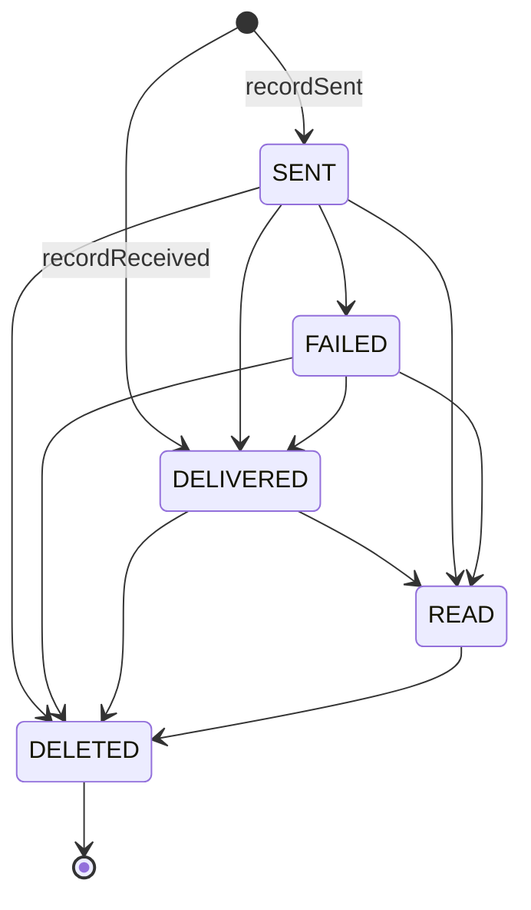
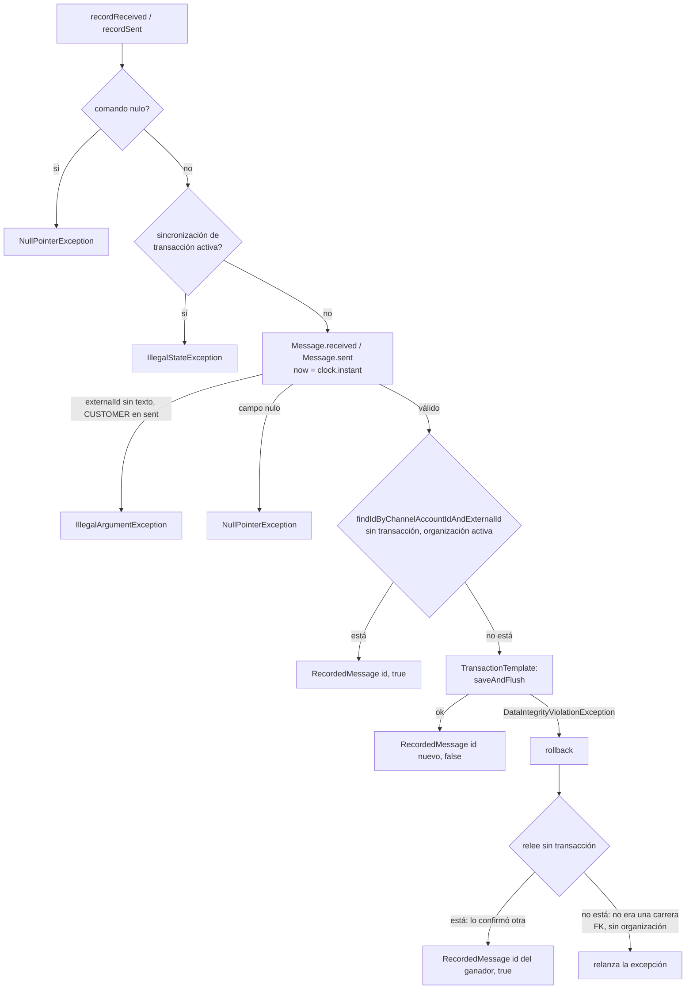
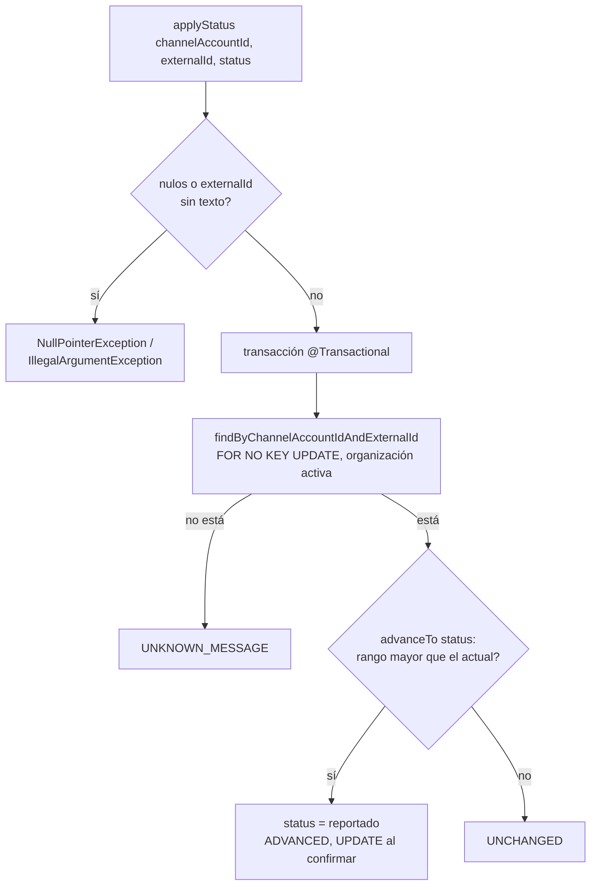
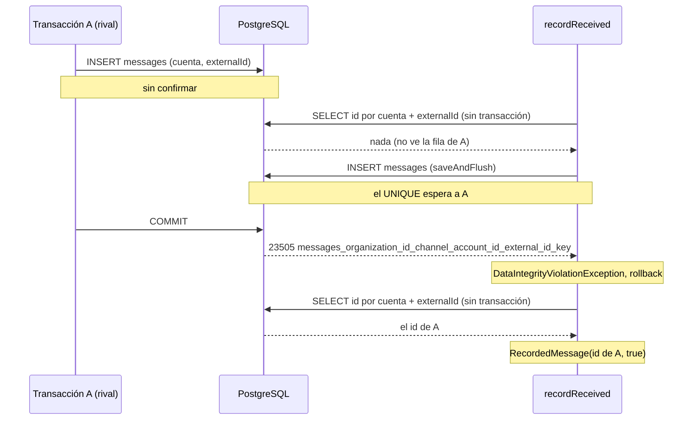
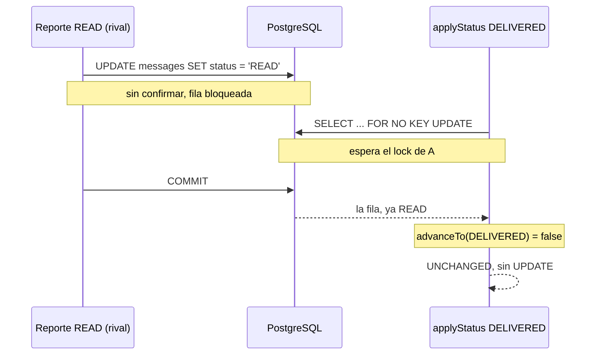

# Mensajes y línea de tiempo

Issue #8. Decisiones: D-001 (cada mensaje queda asociado a la persona y a la oportunidad abierta en ese momento) y
P-038 (módulo y API), P-039 (cuenta de canal sin FK todavía), P-040 (modelo), P-041 (estados), P-042 (idempotencia y
concurrencia) en `docs/decisiones.md`. Se apoya en `docs/multi-tenant.md`, en las personas de `docs/personas.md` y en
las oportunidades de `docs/oportunidades.md`.

## Resumen

Un `Message` es un mensaje de la línea de tiempo de una persona: lo que escribió ella (entrante) o lo que le mandó la
organización (saliente, de un operador, un bot o el sistema). Cada mensaje guarda la persona, la oportunidad en la que
cayó, la cuenta de canal por la que pasó (nuestro número, página o bot), el canal, el id que le dio el proveedor
(`externalId`), el texto y el estado de entrega.

El módulo `messaging` expone un único servicio, `Timeline`, con cuatro operaciones:

- `recordReceived(ReceivedMessage)`: registra un mensaje entrante. Nace `DELIVERED`, fechado con la hora que informa el
  proveedor.
- `recordSent(SentMessage)`: registra un saliente que el proveedor ya aceptó (ya devolvió su id). Nace `SENT`, fechado
  con el reloj.
- `applyStatus(channelAccountId, externalId, status)`: aplica un reporte de estado del proveedor (entregado, leído,
  fallido, borrado). El estado solo avanza: un reporte que llega tarde no lo hace retroceder.
- `isRecorded(channelAccountId, externalId)`: dice si ese mensaje ya está registrado, para que #10 descarte un webhook
  repetido antes de contar actividad en la oportunidad.

Registrar es **idempotente por cuenta de canal + `externalId`**: los proveedores reenvían webhooks, y el mismo mensaje
registrado dos veces (también en paralelo) da una sola fila. La respuesta, `RecordedMessage(id, duplicate)`, dice si el
mensaje ya estaba; eso es lo que #10 usa para publicar el evento «mensaje recibido» una sola vez.

Se va a activar desde el flujo entrante (#10), con cada webhook de mensaje; desde el flujo saliente (#12), al enviar; y
con cada webhook de estado. Hoy nadie la llama fuera de los tests.

Fuera de #8: el adaptador de canal y la tabla `channel_accounts` (#9), el pipeline entrante y la llamada a
`recordActivity` (#10), adjuntos, plantillas y ubicación (#11, #12), la ventana de conversación y el envío (#12), la
consulta de la línea de tiempo, REST, WebSocket y los no leídos del operador (#15), y los eventos (P-009).

## Piezas

Módulo `messaging` (`backend/src/main/java/com/communicatorone/messaging/`). No depende de ningún otro módulo: la
persona, la oportunidad y la cuenta de canal llegan como `UUID` (P-019), y la base controla que sean coherentes con FK
compuestas; la organización la asigna y filtra Hibernate con `@TenantId` (P-018). Es un módulo base: `channels`
(adaptadores, #9) va a depender de él, y la orquestación de entrada (#10) y de salida (#12) vive en `channels` o en un
módulo por encima, nunca en `messaging`, porque eso armaría un ciclo (P-038).

| Clase | Visibilidad | Qué hace |
|---|---|---|
| `Timeline` | pública (API) | `@Service` con `recordReceived` (`Timeline.java:27-31`), `recordSent` (`Timeline.java:33-37`), `applyStatus`, `@Transactional` (`Timeline.java:39-49`), e `isRecorded` (`Timeline.java:51-55`). El registro lo hace el privado `record` (`Timeline.java:62-74`). Recibe `MessageRepository`, el bean `TransactionTemplate` de Spring Boot y `Clock` en el constructor package-private (`Timeline.java:21-25`). |
| `ReceivedMessage` | pública (API) | `record (personId, opportunityId, channelAccountId, ChannelType channel, String externalId, MessageContent content, Instant occurredAt)` (`ReceivedMessage.java:6-7`). Sin validación propia: la hace `Message`. |
| `SentMessage` | pública (API) | `record (personId, opportunityId, channelAccountId, ChannelType channel, SenderType senderType, String externalId, MessageContent content)` (`SentMessage.java:5-6`). Sin hora: la pone el reloj. |
| `MessageContent` | pública (API) | `record (String text)`; el constructor compacto exige texto con `Assert.hasLength` («A message needs its text», `MessageContent.java:7-9`): rechaza nulo y vacío, acepta espacios y no recorta. `toString` devuelve `MessageContent[text]`, sin el texto (`MessageContent.java:11-14`). Hoy es solo texto. |
| `RecordedMessage` | pública (API) | `record (UUID id, boolean duplicate)` (`RecordedMessage.java:5`): el id del mensaje y si ya estaba registrado. |
| `ChannelType` | pública (API) | `WHATSAPP`, `INSTAGRAM`, `MESSENGER`, `TELEGRAM`, `EMAIL`, `SMS`, `WEBCHAT` (`ChannelType.java:3-11`). Vive en `messaging` para que `channels` dependa de `messaging` y no al revés. |
| `SenderType` | pública (API) | `CUSTOMER`, `OPERATOR`, `BOT`, `SYSTEM` (`SenderType.java:3-8`). `CUSTOMER` es el único entrante; no hay columna de dirección. |
| `MessageStatus` | pública (API) | `SENT(0)`, `FAILED(1)`, `DELIVERED(2)`, `READ(3)`, `DELETED(4)`, con el rango en un campo `progress` (`MessageStatus.java:3-14`) e `isAheadOf(other)`: `true` si el rango es mayor (`MessageStatus.java:16-18`). |
| `StatusUpdateOutcome` | pública (API) | `ADVANCED`, `UNCHANGED`, `UNKNOWN_MESSAGE` (`StatusUpdateOutcome.java:3-7`). |
| `Message` | package-private | Entidad de la tabla `messages`: `id`, `@TenantId organizationId`, `personId`, `opportunityId`, `channelAccountId`, `channel`, `senderType` y `status` (guardados por nombre), `externalId`, `text`, `occurredAt`, `recordedAt` (`Message.java:17-50`). Fábricas `received(ReceivedMessage, now)` (`Message.java:71-76`) y `sent(SentMessage, now)` (`Message.java:78-85`), que pasan por el constructor privado que valida (`Message.java:55-69`); regla `advanceTo(MessageStatus)` (`Message.java:87-94`). Sin setters. |
| `MessageRepository` | package-private | `findIdByChannelAccountIdAndExternalId`, JPQL que devuelve solo el id (`MessageRepository.java:13-15`), y `findByChannelAccountIdAndExternalId` con `@Lock(PESSIMISTIC_WRITE)` (`MessageRepository.java:17-18`). Las dos pasan por `@TenantId`. |

El `package-info.java` con `@ApplicationModule` ya existía desde el scaffold y `ModularStructureTest` ya declaraba
`messaging`. #8 suma la migración V6 (ver «Esquema»), que además agrega una restricción a `opportunities`.

Los nombres `InboundMessage` y `StatusUpdate` quedan para lo que devuelve el adaptador de canal (#9, `docs/vision.md`
§5); `ReceivedMessage` y `SentMessage` son los comandos de `messaging`.

## API y contrato

```java
RecordedMessage recorded = timeline.recordReceived(new ReceivedMessage(personId, opportunityId, channelAccountId,
        ChannelType.WHATSAPP, "wamid.HBgNNTQ5MTE1NTU1MDEwMRUCABIYFjNFQjBDMEEz", new MessageContent("Hola, ¿tienen financiación?"),
        Instant.parse("2026-03-02T08:59:20Z")));
// RecordedMessage[id=7c1f…, duplicate=false]

timeline.recordSent(new SentMessage(personId, opportunityId, channelAccountId, ChannelType.WHATSAPP,
        SenderType.OPERATOR, "wamid.HBgNNTQ5MTE1NTU1MDEwMRUCABEYEjk4", new MessageContent("Sí, hasta 12 cuotas")));

StatusUpdateOutcome outcome = timeline.applyStatus(channelAccountId, "wamid.HBgNNTQ5MTE1NTU1MDEwMRUCABEYEjk4",
        MessageStatus.READ);
// ADVANCED

boolean known = timeline.isRecorded(channelAccountId, "wamid.HBgNNTQ5MTE1NTU1MDEwMRUCABIYFjNFQjBDMEEz");
// true
```

Pasar del payload del proveedor (por ejemplo, un `statuses[].status = "delivered"` de WhatsApp) a estos comandos es
trabajo del adaptador (#9, #11): `messaging` no conoce payloads.

| Operación y entrada | Salida |
|---|---|
| `recordReceived`, cuenta + `externalId` nuevos | `RecordedMessage(id nuevo, false)`; fila `CUSTOMER`, `DELIVERED`, `occurred_at` = hora del proveedor, `recorded_at` = reloj |
| `recordReceived`, cuenta + `externalId` ya registrados | `RecordedMessage(id existente, true)`; no escribe nada y descarta el contenido nuevo (gana la primera escritura) |
| `recordReceived`, mismo `externalId` en otra cuenta de canal | otro mensaje, `duplicate = false` |
| `recordReceived`, el mismo mensaje registrándose en paralelo | espera a la otra transacción; si confirma, `RecordedMessage(id del ganador, true)`; si se deshace, inserta el suyo (`false`) |
| `recordSent` con `OPERATOR`, `BOT` o `SYSTEM` | `RecordedMessage(id nuevo, false)`; fila `SENT`, `occurred_at` = `recorded_at` = reloj. Repetido: `(id existente, true)` |
| `recordSent` con `CUSTOMER` | `IllegalArgumentException` («A sent message comes from the organization, not the customer»), sin tocar la base |
| `record*` con `externalId` nulo, vacío o en blanco | `IllegalArgumentException` («A message needs the id its provider gave it»), sin tocar la base |
| `record*` con persona, oportunidad, cuenta, canal, tipo de remitente, contenido u `occurredAt` nulos | `NullPointerException` con el nombre del campo, sin tocar la base |
| `new MessageContent(null)` o `new MessageContent("")` | `IllegalArgumentException` («A message needs its text»), antes de llamar |
| `record*` con sincronización de transacción activa | `IllegalStateException` («A message is recorded in its own transaction, not inside an open one»), sin tocar la base |
| `record*` sin organización activa | `DataIntegrityViolationException` (FK `messages_organization_id_fkey` contra el centinela), nada guardado |
| `record*` con una persona o una oportunidad de otra organización | `DataIntegrityViolationException` (FK compuestas), nada guardado |
| `record*` con una oportunidad de otra persona de la misma organización | `DataIntegrityViolationException` (`messages_opportunity_id_person_id_organization_id_fkey`), nada guardado |
| `applyStatus` con un estado de rango mayor al actual | `ADVANCED`; el estado cambia al confirmar |
| `applyStatus` con el mismo estado o uno de rango menor | `UNCHANGED`, sin cambios |
| `applyStatus` de un mensaje que no está (otra cuenta, otra organización o sin organización) | `UNKNOWN_MESSAGE`, sin cambios; el reporte se descarta |
| `applyStatus` con cuenta o estado nulos | `NullPointerException` |
| `applyStatus` con `externalId` sin texto | `IllegalArgumentException` («A status report needs the id the provider gave the message») |
| `isRecorded` de un mensaje registrado en esa cuenta y organización | `true` |
| `isRecorded` de otro `externalId`, otra cuenta u otra organización | `false` |
| `isRecorded` con cuenta nula o `externalId` sin texto | `NullPointerException` / `IllegalArgumentException` («A message is recognized by the id its provider gave it») |

Quien llama a `recordReceived` o `recordSent`:

1. **No tiene una transacción abierta.** La operación abre la suya; con sincronización de transacción activa (una
   transacción real o un ámbito `SUPPORTS`) lanza `IllegalStateException` (`Timeline.java:57-60`). Es la misma
   comprobación que `PersonDirectory.resolveOrCreate` (P-029) y `OpportunityTracker.recordActivity` (P-035): en
   PostgreSQL una violación aborta la transacción en curso, y la relectura del duplicado necesita una transacción
   limpia.
2. **Tiene organización activa**: `currentOrganization.callAs(organizationId, ...)` o un request con operador
   autenticado. #9/#10 tienen que ligar la organización (resuelta desde la cuenta de canal) **antes** de llamar. Sin
   organización, el resolver devuelve el centinela `UUID(0, 0)` (`OrganizationTenantResolver.java:13`, `:23`):
   registrar falla por la FK de `organization_id` y `applyStatus` devuelve `UNKNOWN_MESSAGE`, porque la búsqueda filtra
   por el centinela.
3. **Pasa una persona y una oportunidad coherentes**: la persona de `PersonDirectory.resolveOrCreate` y la oportunidad
   que devolvió `OpportunityTracker.recordActivity` para esa persona. La base rechaza una oportunidad de otra persona u
   organización, pero no controla que esté abierta.
4. **Pasa un `externalId` único por cuenta de canal** (contrato del puerto, P-042). Si el id del proveedor solo es
   único dentro de un chat, el adaptador lo compone: por ejemplo, Telegram `chatId:messageId`.
5. **Pasa el canal de la cuenta.** `channel` repite el tipo de la `ChannelAccount` y hoy nada controla que coincidan
   (P-039); lo valida #9.

`applyStatus` es `@Transactional` con la propagación por defecto: si el llamador tiene una transacción, se une a ella y
el lock de la fila dura hasta que esa transacción termine. `isRecorded` no abre transacción.

Flujo entrante (#10), en tres transacciones (persona, oportunidad, mensaje):

```java
currentOrganization.callAs(organizationId, () -> {
    var personId = personDirectory.resolveOrCreate(identity);                     // tx 1
    if (timeline.isRecorded(channelAccountId, externalId)) {                      // sin transacción
        return null;                                                              // reenvío: no cuenta como actividad
    }
    var opportunityId = opportunityTracker.recordActivity(personId, source);      // tx 2
    var recorded = timeline.recordReceived(new ReceivedMessage(personId, opportunityId, channelAccountId,
            channel, externalId, content, occurredAt));                           // tx 3
    // #10 publica «mensaje recibido» solo si !recorded.duplicate()
    return recorded;
});
```

`isRecorded` no es autoritativo: dos copias del mismo webhook en paralelo pueden pasar las dos el chequeo y llamar las
dos a `recordActivity`. Lo autoritativo es `RecordedMessage.duplicate`: una sola de las dos recibe `false`.

## Reglas

### Estados

El estado refleja **solo lo que informa el proveedor**. El leído o no leído del operador (#15) es otro concepto y no va
en `status`.

Cada estado tiene un rango y un reporte se aplica solo si su rango es mayor que el del estado actual
(`Message.java:87-94`, `MessageStatus.java:16-18`). Así un reporte que llega tarde o repetido no cambia nada, sin
importar el orden en que el proveedor mande los webhooks.

| Estado | Rango | Cómo se llega | Reportes posteriores que lo mueven | Reportes posteriores que se ignoran |
|---|---|---|---|---|
| `SENT` | 0 | Saliente al registrarse (`recordSent`) | `FAILED`, `DELIVERED`, `READ`, `DELETED` | `SENT` |
| `FAILED` | 1 | Reporte de falla de un saliente | `DELIVERED`, `READ`, `DELETED` (el proveedor reintentó y entregó) | `SENT`, `FAILED` |
| `DELIVERED` | 2 | Reporte de entrega; los entrantes nacen así (`recordReceived`) | `READ`, `DELETED` | `SENT`, `FAILED` (falla tardía tras la entrega), `DELIVERED` |
| `READ` | 3 | Reporte de lectura | `DELETED` | `SENT`, `FAILED`, `DELIVERED` (entrega que llega después de la lectura), `READ` |
| `DELETED` | 4 | Reporte de borrado | ninguno: es terminal | todos |



- **El rango aplica igual a entrantes y salientes**: `applyStatus` no mira la dirección. Un entrante nace `DELIVERED`
  (interpretación propia: si llegó, está entregado), así que solo puede pasar a `READ` o `DELETED`.
- **Mensaje desconocido**: el reporte se descarta y devuelve `UNKNOWN_MESSAGE`; no hay tabla de pendientes. Ver
  «Riesgos» (estados que llegan antes que el saliente).

### Registro

- **Idempotencia por cuenta + `externalId`** dentro de la organización (`UNIQUE (organization_id, channel_account_id,
  external_id)`). El mismo `externalId` en otra cuenta es otro mensaje.
- **Gana la primera escritura**: un duplicado devuelve el id del que ya estaba y descarta su propio contenido, hora,
  persona y oportunidad, aunque difieran. Tampoco mira la dirección: un saliente con el mismo `externalId` que un
  entrante de la misma cuenta se toma como duplicado de ese entrante.
- **Horas**: el entrante guarda `occurred_at` = la hora que informa el proveedor (sin validar) y `recorded_at` = el
  reloj; el saliente guarda las dos con el reloj (`Message.java:71-85`). El orden de la línea de tiempo es
  `occurred_at`, `recorded_at`, `id` (índice de V6; la consulta llega con #15).
- **El saliente se registra después de enviar**, cuando el proveedor ya devolvió su id: `external_id` es `NOT NULL`.
- **Solo texto**, sin recortar y sin límite de largo. `MessageContent.toString` no muestra el texto, para que loguear un
  comando no filtre datos personales.
- **Validación antes de la base**: `Message` valida en el constructor (`Message.java:58-68`) y `recordSent` rechaza
  `CUSTOMER` (`Message.java:80-82`) antes de buscar el duplicado; un comando inválido nunca toca la base.

## Diagramas

`recordReceived` / `recordSent` (`Timeline.java:27-37`, `:62-74`):



`applyStatus` (`Timeline.java:39-49`):



Carrera de duplicados, como la reproduce `concurrentDuplicatedWebhooksRecordASingleMessage`:



Carrera de estados, como la reproduce `deliveryReportArrivingWhileAReadReportIsBeingAppliedDoesNotMoveTheStatusBack`
(ahí A es un hilo rival que hace el `UPDATE` a `READ` sin confirmar):



## Flujo en detalle

### Registro (`Timeline.record`)

`recordReceived` y `recordSent` (`Timeline.java:27-37`):

1. Rechazan el comando nulo (`NullPointerException`) y la sincronización de transacción activa
   (`Timeline.java:28-29`, `:34-35`).
2. Leen el reloj una vez y arman el `Message` con `Message.received` o `Message.sent` (`Timeline.java:30`, `:36`). El
   constructor privado valida `externalId` con `Assert.hasText` y el resto con `Objects.requireNonNull`
   (`Message.java:58-68`); `sent` rechaza antes el remitente `CUSTOMER` (`Message.java:80-82`).

`record` (`Timeline.java:62-74`):

1. Busca el id por cuenta + `externalId` **sin transacción** (`Timeline.java:63-66`): el JPQL
   (`MessageRepository.java:13-15`) pasa por `@TenantId`, así que solo ve mensajes de la organización activa. Si
   encuentra, devuelve `RecordedMessage(id, true)` sin abrir transacción de escritura y sin WARN: es el camino de cada
   reenvío del proveedor.
2. Si no encuentra, hace `saveAndFlush` dentro del `TransactionTemplate` (`Timeline.java:67-68`). Hibernate asigna
   `organization_id` y el `flush` hace que una violación salga ahí mismo como `DataIntegrityViolationException`.
3. Si el `INSERT` choca, la transacción ya se deshizo entera y relee con la misma consulta sin transacción
   (`Timeline.java:69-73`). Con READ COMMITTED ve el mensaje que confirmó la otra transacción y devuelve
   `RecordedMessage(id del ganador, true)`. Si no hay nada, la violación no era una carrera (FK de persona u
   oportunidad, sin organización) y relanza la excepción original.

### Estado (`Timeline.applyStatus`)

`applyStatus` (`Timeline.java:39-49`), en una transacción:

1. Valida la cuenta, el `externalId` y el estado (`Timeline.java:41-43`).
2. Trae el mensaje con `findByChannelAccountIdAndExternalId` con `@Lock(PESSIMISTIC_WRITE)`
   (`MessageRepository.java:17-18`), que en PostgreSQL Hibernate traduce a `FOR NO KEY UPDATE` (es lo que espera
   `MessagingFixture.anotherSessionIsWaitingToLockTheMessage`, `MessagingFixture.java:111-113`). `@TenantId` agrega el
   filtro por organización.
3. Si no está, `UNKNOWN_MESSAGE`. Si está, `advanceTo` decide (`Message.java:87-94`) y devuelve `ADVANCED` o
   `UNCHANGED` (`Timeline.java:44-48`). El cambio lo guarda el dirty checking al confirmar; no hay `UPDATE` masivo.

## Concurrencia

- **Duplicados**: el `UNIQUE (organization_id, channel_account_id, external_id)` garantiza una sola fila. La búsqueda
  previa (y `isRecorded`) evita trabajo en el caso común, pero no es autoritativa: dos registros en paralelo pueden no
  encontrar nada y llegar los dos al `INSERT`. El segundo espera al índice, falla con 23505 cuando el primero confirma y
  relee fuera de transacción (diagrama de arriba). Si el primero se deshace, el segundo inserta el suyo.
- **Estados**: el lock `FOR NO KEY UPDATE` serializa los reportes de un mismo mensaje. El que espera obtiene la fila ya
  confirmada (en READ COMMITTED, `SELECT ... FOR NO KEY UPDATE` devuelve la última versión confirmada de la fila
  bloqueada) y `advanceTo` decide sobre ella, así que el resultado no depende del orden de llegada. Si cada reporte va
  en su propia transacción, cada `applyStatus` bloquea una sola fila y no hay deadlocks entre reportes. Como
  `applyStatus` se une a la transacción del llamador, varios reportes aplicados en una misma transacción acumulan locks
  hasta el commit, y dos de esas transacciones que tomen mensajes en distinto orden pueden trabarse (deadlock, que
  PostgreSQL resuelve abortando una).
- **Registro frente a oportunidades**: el `INSERT` en `messages` toma `FOR KEY SHARE` sobre la fila de la oportunidad y
  la de la persona (chequeo de las FK). Es compatible con el `FOR NO KEY UPDATE` de `recordActivity` y del job de cierre
  (`docs/oportunidades.md`, «La oportunidad vigente»): registrar un mensaje no espera a esos locks ni ellos al registro.
- **Estado frente a registro**: un reporte que llega antes de que el mensaje esté registrado devuelve
  `UNKNOWN_MESSAGE` y se pierde (ver «Riesgos»).

**WARN de Hibernate.** En la carrera de duplicados, Hibernate deja un WARN (`org.hibernate.orm.jdbc.error`) con el
SQLState 23505 y el nombre de la restricción. Con `logServerErrorDetail: false` (P-031) no lleva los valores en
conflicto; el test afirma que la salida nombra `messages_organization_id_channel_account_id_external_id_key` y no
contiene el texto del mensaje. Un duplicado que encuentra la búsqueda previa no deja WARN.

Descartadas (P-041, P-042): `INSERT … ON CONFLICT` (SQL nativo, se salta `@TenantId`); `UPDATE` nativo condicional
para el estado; `@Version`; tabla de estados pendientes.

## Esquema

`backend/src/main/resources/db/migration/V6__create_messages.sql`:

```sql
ALTER TABLE opportunities
    ADD CONSTRAINT opportunities_id_person_id_organization_id_key UNIQUE (id, person_id, organization_id);

CREATE TABLE messages (
    id UUID PRIMARY KEY,
    organization_id UUID NOT NULL REFERENCES organizations (id),
    person_id UUID NOT NULL,
    opportunity_id UUID NOT NULL,
    channel_account_id UUID NOT NULL,
    channel TEXT NOT NULL,
    sender_type TEXT NOT NULL,
    external_id TEXT NOT NULL,
    text TEXT NOT NULL,
    status TEXT NOT NULL,
    occurred_at TIMESTAMPTZ NOT NULL,
    recorded_at TIMESTAMPTZ NOT NULL,
    CONSTRAINT messages_person_id_organization_id_fkey
        FOREIGN KEY (person_id, organization_id) REFERENCES people (id, organization_id),
    CONSTRAINT messages_opportunity_id_person_id_organization_id_fkey
        FOREIGN KEY (opportunity_id, person_id, organization_id)
        REFERENCES opportunities (id, person_id, organization_id),
    CONSTRAINT messages_organization_id_channel_account_id_external_id_key
        UNIQUE (organization_id, channel_account_id, external_id)
);

CREATE INDEX messages_person_id_occurred_at_recorded_at_id_idx
    ON messages (person_id, occurred_at DESC, recorded_at DESC, id DESC);
CREATE INDEX messages_person_id_channel_account_id_occurred_at_customer_idx
    ON messages (person_id, channel_account_id, occurred_at DESC) WHERE sender_type = 'CUSTOMER';
CREATE INDEX messages_opportunity_id_person_id_organization_id_idx
    ON messages (opportunity_id, person_id, organization_id);
```

Restricciones:

- `opportunities_id_person_id_organization_id_key` (`V6__create_messages.sql:1-2`) es redundante con la clave primaria
  de `opportunities`, pero hace falta como destino de la FK de tres columnas. Es un cambio sobre una tabla de otro
  módulo, como el `UNIQUE` que V4 agregó a `operators`.
- `messages_opportunity_id_person_id_organization_id_fkey` (`V6__create_messages.sql:19-21`) garantiza que la
  oportunidad sea **de la misma persona** y de la misma organización que el mensaje, aunque alguien inserte por SQL.
  No controla que esté abierta.
- `messages_person_id_organization_id_fkey` (`V6__create_messages.sql:17-18`) es defensa en profundidad: la FK de tres
  columnas ya implica que la persona es de la organización (la oportunidad lo garantiza con su propia FK a `people`),
  pero esta no depende de eso.
- `messages_organization_id_fkey` (implícita, `V6__create_messages.sql:6`) es la que rechaza registrar sin
  organización (centinela).
- `channel_account_id` no tiene FK: la tabla `channel_accounts` llega con #9, que agrega la FK
  `(channel_account_id, organization_id)` (P-039).
- `channel`, `sender_type` y `status` son `TEXT` sin `CHECK` de valores, como `operators.role`.

Índices y las consultas que sirven (Hibernate agrega `organization_id = ?` por `@TenantId` a toda consulta de la
entidad):

| Índice | Consulta |
|---|---|
| `messages_organization_id_channel_account_id_external_id_key` (el `UNIQUE`, `V6__create_messages.sql:22-23`) | La idempotencia, y las dos búsquedas por cuenta + `externalId` de `MessageRepository` (`WHERE organization_id = ? AND channel_account_id = ? AND external_id = ?`): la del duplicado y la de `applyStatus`. Va a servir también a la FK `(channel_account_id, organization_id)` de #9. Como empieza por `organization_id`, no hace falta un índice aparte por organización (`.claude/rules/flyway.md`). |
| `messages_person_id_occurred_at_recorded_at_id_idx` (`V6__create_messages.sql:26-27`) | La línea de tiempo de una persona (#15): `WHERE person_id = ? ORDER BY occurred_at DESC, recorded_at DESC, id DESC`, con paginación. Por empezar en `person_id`, también sirve al chequeo de la FK a `people`. |
| `messages_person_id_channel_account_id_occurred_at_customer_idx` (parcial, `V6__create_messages.sql:28-29`) | La ventana de conversación (#12): el último mensaje del cliente en una cuenta, `WHERE person_id = ? AND channel_account_id = ? AND sender_type = 'CUSTOMER' ORDER BY occurred_at DESC LIMIT 1`. El planner usa un índice parcial solo si puede probar el predicado, así que `sender_type = 'CUSTOMER'` va como literal, no como parámetro. |
| `messages_opportunity_id_person_id_organization_id_idx` (`V6__create_messages.sql:30-31`) | La FK a `opportunities` (chequeos al cambiar claves o borrar oportunidades, por ejemplo en una fusión de personas) y las consultas por oportunidad (métricas, #15). |

Los índices van con `CREATE INDEX` común, no `CONCURRENTLY`: `messages` es nueva y `opportunities` todavía no tiene
datos productivos (ver «Riesgos»).

Fila de ejemplo después de `recordReceived` con ámbito Acme, con el reloj en `MutableClock.INITIAL_INSTANT`
(`TimelineTest.receivedMessageIsRecordedInThePersonTimeline`):

```
messages: id = <id>, organization_id = <Acme>, person_id = <persona>, opportunity_id = <oportunidad>,
          channel_account_id = <cuenta>, channel = WHATSAPP, sender_type = CUSTOMER, external_id = wamid.<uuid>,
          text = Hola, ¿tienen financiación?, status = DELIVERED,
          occurred_at = 2026-03-02 08:59:20+00, recorded_at = 2026-03-02 09:00:00+00
```

## Tests

`backend/src/test/java/com/communicatorone/messaging/MessageTest.java` (sin Spring; reloj en
`MutableClock.INITIAL_INSTANT`). Prueba la regla de estados y las fábricas de `Message`.

| Test | Qué cubre |
|---|---|
| `deliveryAndReadReportsAdvanceASentMessage` | Un saliente `SENT` pasa a `DELIVERED` y después a `READ`; las dos llamadas devuelven `true`. |
| `deliveryReportArrivingAfterTheReadReportDoesNotMoveTheStatusBack` | Con el mensaje en `READ`, un `DELIVERED` tardío devuelve `false` y deja `READ`. |
| `repeatedStatusReportChangesNothing` | Un `DELIVERED` repetido devuelve `false`. |
| `failureReportedAfterDeliveryIsIgnored` | Un `FAILED` después de `DELIVERED` devuelve `false` y deja `DELIVERED`. |
| `deliveryReportedAfterAFailureWins` | Un `DELIVERED` después de `FAILED` devuelve `true`. |
| `deletedMessageStaysDeletedWhateverIsReportedLater` | Parametrizado con los cuatro estados distintos de `DELETED`: ninguno mueve un mensaje borrado. |
| `receivedMessageArrivesDeliveredAndOnlyMovesForwardFromThere` | Un entrante nace `DELIVERED`; `FAILED` se ignora y `READ` se aplica: el rango vale igual que para los salientes. |
| `messageCannotBeSentAsTheCustomer` | `Message.sent` con `CUSTOMER` lanza `IllegalArgumentException` con su mensaje. |
| `messageTextIsNotRevealedWhenItsContentIsLogged` | `String.valueOf(new MessageContent("Mi DNI es 30111222"))` no contiene el número. |

`backend/src/test/java/com/communicatorone/messaging/TimelineTest.java` (`@SpringBootTest` con `RANDOM_PORT` +
Testcontainers, sin `@Transactional`; reloj fijo en `MutableClock.INITIAL_INSTANT`, el entrante fechado 40 s antes).
Cada test crea sus organizaciones y llama con `callAs` (`receiveIn`, `sendIn`, `applyStatusIn`, `isRecordedIn`). Las
filas se leen con `MessagingFixture` (`JdbcTemplate`), que compara la fila entera (`StoredMessage`), filtrando por
`organization_id` salvo `messagesInAnyOrganizationWithExternalId`, que cuenta en todas. La persona sale de
`PersonDirectory`, la oportunidad de `OpportunityTracker.recordActivity` y la cuenta de canal es un `UUID` al azar
(`MessagingFixture.channelAccount`, `MessagingFixture.java:61-63`).

| Test | Qué cubre |
|---|---|
| `receivedMessageIsRecordedInThePersonTimeline` | Fila entera: `CUSTOMER`, `DELIVERED`, `occurred_at` del proveedor, `recorded_at` del reloj; `duplicate = false`. |
| `duplicatedWebhookDoesNotDuplicateMessage` | El mismo entrante dos minutos después devuelve `(id del primero, true)` y la fila sigue con el `recorded_at` original. |
| `sameExternalIdOnAnotherChannelAccountIsADifferentMessage` | El mismo `externalId` en otra cuenta crea otro mensaje. |
| `concurrentDuplicatedWebhooksRecordASingleMessage` | La carrera del diagrama, determinista: un hilo rival inserta sin confirmar (`MessagingFixture.rivalStartsRecordingMessage`), el registro corre en otro hilo, Awaitility espera en `pg_stat_activity` una sesión bloqueada en `insert into messages` (`anotherSessionIsWaitingToWriteMessages`) y recién ahí confirma el rival. Afirma `(id del rival, true)`, una sola fila, y que la salida nombra la restricción sin el texto. |
| `sentMessageIsRecordedAsSent` | Parametrizado con `OPERATOR`, `BOT` y `SYSTEM`: fila `SENT` con `occurred_at` = `recorded_at` = reloj. |
| `sentMessageAcknowledgedTwiceIsRecordedOnce` | El mismo saliente registrado dos veces da `(id del primero, true)` y una fila. |
| `deliveryReportArrivingAfterTheReadReportDoesNotMoveTheStatusBack` | `READ` da `ADVANCED`, el `DELIVERED` tardío da `UNCHANGED`, y la fila queda `READ`. |
| `statusReportForAnUnknownMessageIsIgnored` | Otro `externalId` da `UNKNOWN_MESSAGE` y el mensaje existente no cambia. |
| `statusReportForTheSameExternalIdOnAnotherChannelAccountIsIgnored` | El mismo `externalId` en otra cuenta da `UNKNOWN_MESSAGE`. |
| `statusReportCannotChangeAMessageOfAnotherOrganization` | Globex aplicando `READ` con la cuenta y el `externalId` de Acme da `UNKNOWN_MESSAGE`; el de Acme no cambia y Globex no tiene filas. |
| `deliveryReportArrivingWhileAReadReportIsBeingAppliedDoesNotMoveTheStatusBack` | La carrera de estados: un rival hace `UPDATE` a `READ` sin confirmar (`rivalStartsChangingStatus`), `applyStatus(DELIVERED)` corre en otro hilo, Awaitility espera una sesión bloqueada en `from messages … for no key update` (`anotherSessionIsWaitingToLockTheMessage`) y confirma el rival. Afirma `UNCHANGED` y la fila en `READ`. |
| `alreadyRecordedMessageIsRecognized` | `isRecorded` da `true` para un mensaje registrado. |
| `messageNotYetRecordedIsNotRecognized` | `false` para otro `externalId`. |
| `messageRecordedOnAnotherChannelAccountIsNotRecognized` | `false` para el mismo `externalId` en otra cuenta. |
| `messageRecordedInAnotherOrganizationIsNotRecognized` | `false` desde Globex para un mensaje de Acme. |
| `messageOfAPersonOfAnotherOrganizationIsRejected` | Persona de Globex en un mensaje de Acme: `DataIntegrityViolationException` y ninguna fila con ese `externalId` en ninguna organización. |
| `messageCannotPointToAnOpportunityOfAnotherOrganization` | Oportunidad de Globex en un mensaje de Acme: `DataIntegrityViolationException` (FK de tres columnas) y ninguna fila. |
| `messageCannotPointToAnOpportunityOfAnotherPerson` | Oportunidad de otra persona de Acme: `DataIntegrityViolationException`, ninguna fila, y la salida nombra `messages_opportunity_id_person_id_organization_id_fkey`. |
| `messageCannotBeRecordedWithoutOrganization` | Sin ámbito ni usuario: `DataIntegrityViolationException` y ninguna fila en ninguna organización. |
| `messageCannotBeRecordedInsideAnOpenTransactionalScope` | Parametrizado con `Propagation.REQUIRED` (transacción real) y `Propagation.SUPPORTS` (ámbito sin transacción): `IllegalStateException` y nada guardado. |
| `receivedMessageWithoutExternalIdOrTextIsRejected` | Parametrizado: `externalId` nulo, vacío o en blanco, y texto nulo o vacío, dan `IllegalArgumentException` y nada guardado. |

`TenantIsolationTest.everyBusinessEntityBelongsToAnOrganization` cubre que `Message` lleve `@TenantId`, y
`ModularStructureTest` que `messaging` no dependa de internos de otros módulos.

Comando: `./mvnw test -Dtest='MessageTest,TimelineTest'` desde `backend/` (skill `run-tests`).

## Riesgos y pendientes

- **Estados que llegan antes que el saliente se pierden.** El saliente se registra después de que el proveedor devolvió
  su id; si el webhook de entregado o leído llega antes que esa escritura, `applyStatus` devuelve `UNKNOWN_MESSAGE` y
  el reporte se descarta. Mitigación probable en #12: registrar el saliente **antes** de enviar, con `external_id`
  nulo, y completarlo con la respuesta. `ALTER COLUMN external_id DROP NOT NULL` es seguro: el `UNIQUE` trata los
  `NULL` como distintos.
- **Messenger e Instagram informan la lectura por watermark** (todo lo anterior a una hora está leído), no por id de
  mensaje: hace falta una operación aparte, que `applyStatus` no cubre.
- **Saliente proactivo sin oportunidad abierta**: `opportunity_id` es `NOT NULL` (D-001). #12 tiene que resolver qué
  oportunidad usa un mensaje que la organización inicia (por ejemplo, abrir una o usar la última).
- **`channel` duplica el tipo de la `ChannelAccount`** y nada controla que coincidan (P-039). #9 lo valida en el
  pipeline o con una FK que incluya el tipo.
- **La FK no controla que la oportunidad esté abierta**: garantiza que sea de la misma persona y organización, pero el
  llamador tiene que pasar la que devolvió `recordActivity`.
- **Gana la primera escritura**: un duplicado con contenido distinto (un proveedor que reenvía editado) conserva el
  original. Tampoco se distingue la dirección (un saliente con el `externalId` de un entrante de la misma cuenta es su
  duplicado).
- **`occurred_at` del proveedor sin validar**: una hora futura o muy vieja desordena la línea de tiempo.
- **Entrante `DELIVERED` es interpretación propia**: ningún proveedor lo informa.
- **Solo texto**: adjuntos, plantillas y ubicación llegan con #11/#12, sin `jsonb` por ahora.
- **Índices antes que sus consultas**: el de la línea de tiempo y el de la ventana no los usa nadie hasta #15 y #12.
  #12 tiene que escribir la consulta de la ventana con `sender_type = 'CUSTOMER'` literal para que use el índice
  parcial.
- **V6 toca `opportunities`** (tabla del módulo `opportunities`) para el destino de la FK de tres columnas. El
  `ALTER TABLE opportunities ADD CONSTRAINT … UNIQUE` toma `ACCESS EXCLUSIVE` y construye el índice con ese lock, sin
  `lock_timeout`: si espera detrás de una transacción abierta sobre `opportunities`, encola detrás de él también las
  lecturas de la tabla. Riesgo bajo mientras no haya producción; mitigación futura: `SET lock_timeout` al inicio de la
  migración o `spring.flyway.init-sqls`. Con datos, el patrón es `CREATE UNIQUE INDEX CONCURRENTLY` en una migración
  propia y después `ADD CONSTRAINT … UNIQUE USING INDEX`; esa corrida necesita
  `spring.flyway.postgresql.transactional-lock=false`, porque con el lock transaccional de Flyway el `CONCURRENTLY`
  puede quedar colgado (`.claude/rules/flyway.md`).
- **El `CREATE TABLE messages` también espera locks**: al crear sus FK toma `SHARE ROW EXCLUSIVE` sobre `people`,
  `organizations` y `opportunities`, sin `lock_timeout`. Ese lock bloquea las escrituras en esas tablas (no las
  lecturas) mientras dure la migración, y la migración espera detrás de cualquier transacción que esté escribiendo en
  ellas. Riesgo bajo, como el del `ALTER`, y con la misma mitigación.
- **Una base local que corrió una V6 anterior** (de una versión previa de esta rama) falla la validación de Flyway por
  el checksum. Se recrea con `docker compose down -v && docker compose up -d`, no con `flyway repair` (que marcaría
  como aplicado un esquema distinto del de la V6 actual).
- **La fusión de personas (P-030)** cambia el `person_id` de oportunidades y mensajes. Con la FK de tres columnas, mover
  una oportunidad a otra persona rompe la FK de sus mensajes en el medio del `UPDATE`: hará falta declarar las FK
  `DEFERRABLE` o `ON UPDATE CASCADE`.
- **WARN de Hibernate en las carreras**: cada carrera de duplicados deja un WARN con el SQLState y el nombre de la
  restricción (sin valores, P-031). Ruido esperable en los logs.
- **Fixtures de test duplicados**: `MessagingFixture` es la tercera copia de `organization(name)` y del patrón «rival
  que escribe sin confirmar» (`PeopleFixture`, `OpportunitiesFixture`). A futuro, un helper de test compartido.
- Los tests de las carreras dependen de `pg_stat_activity` (PostgreSQL).

## Pendiente: #9, #10, #12, #15

- **#9 (canales y cuentas)**: crea `channel_accounts` con `UNIQUE (id, organization_id)` y agrega en V7 la FK
  `(channel_account_id, organization_id)` de `messages`. La rama de #9 se apila sobre la de #8 (V7 depende de V6).
  Tiene que cambiar `MessagingFixture.channelAccount` (`MessagingFixture.java:61-63`), que hoy devuelve un `UUID` al
  azar, para que cree una cuenta real; validar que `channel` coincida con el tipo de la cuenta; agregar `SANDBOX` a
  `ChannelType` si lo necesita; y garantizar que el adaptador entregue un `externalId` único por cuenta (Telegram:
  `chatId:messageId`).
- **#9 y #10**: ligar la organización de la cuenta de canal con `currentOrganization.callAs` **antes** de llamar a
  `Timeline`. Sin organización, registrar falla por `messages_organization_id_fkey` y `applyStatus` devuelve
  `UNKNOWN_MESSAGE` en silencio.
- **#10 (flujo entrante)**: vive en `channels` (o en un módulo por encima), no en `messaging`. Descarta el reenvío con
  `isRecorded` antes de `recordActivity`, registra con `recordReceived` y publica «mensaje recibido» solo si
  `RecordedMessage.duplicate` es `false`.
- **#12 (envío y ventana)**: vive fuera de `messaging`. Decide el registro antes del envío (riesgo de estados que llegan
  antes), la oportunidad del saliente proactivo, y escribe la consulta de la ventana sobre el índice parcial.
- **#15 (vista unificada)**: la consulta de la línea de tiempo, REST, WebSocket y los no leídos del operador (otro
  concepto que `status`). Amplía el retorno de `applyStatus` a un record con el resultado y el id del mensaje, para
  notificar el cambio.
