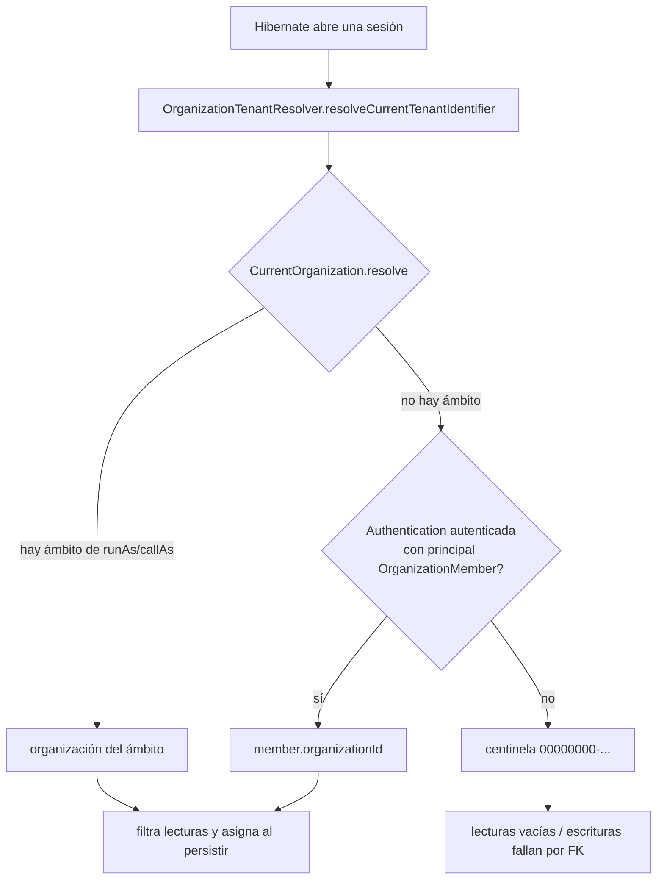

# Organizaciones y multi-tenant

Issue #4. Decisiones: P-018 (mecanismo), P-019 (ids y nombres), P-020 (cómo se prueba) en `docs/decisiones.md`.

## Resumen

Cada empresa cliente es una `Organization`, y todo dato de negocio pertenece a una sola organización. El aislamiento
no depende de que cada consulta se acuerde de filtrar: lo hace Hibernate con `@TenantId`. En cada sesión, Hibernate
pregunta cuál es la organización activa y con eso:

- **filtra** las lecturas (JPQL, Criteria, consultas derivadas de Spring Data y `findById`) por `organization_id`;
- **asigna** `organization_id` al persistir una entidad nueva.

La organización activa la resuelve `CurrentOrganization`, en este orden:

1. El ámbito explícito abierto con `runAs`/`callAs`, para procesos sin usuario (webhooks, jobs, listeners).
2. El principal de la `Authentication` del `SecurityContextHolder`, si está autenticada y el principal implementa
   `OrganizationMember`. Lo va a cargar el JWT del issue #5.
3. Ninguna: el resolver devuelve un centinela (`00000000-0000-0000-0000-000000000000`) que no es ninguna organización.
   Las lecturas vuelven vacías y las escrituras fallan por la FK a `organizations`.

Se activa sola: cualquier sesión de Hibernate que se abra consulta al resolver. Todavía no hay entidades de negocio,
endpoints ni alta de organizaciones; el módulo deja el mecanismo y el contrato para los que vienen.

## Piezas

Módulo `organizations` (`backend/src/main/java/com/communicatorone/organizations/`):

| Clase | Visibilidad | Qué hace |
|---|---|---|
| `CurrentOrganization` | pública (API del módulo) | `runAs(UUID, Runnable)` y `callAs(UUID, Supplier<T>)` abren el ámbito de una organización (`CurrentOrganization.java:16`, `:20`); `resolve()` da la organización activa (`:24`). |
| `OrganizationMember` | pública (API del módulo) | Contrato del principal autenticado: `UUID organizationId()` (`OrganizationMember.java:7`). |
| `OrganizationTenantResolver` | package-private | `CurrentTenantIdentifierResolver<UUID>` de Hibernate y `HibernatePropertiesCustomizer` que se registra a sí mismo (`OrganizationTenantResolver.java:11`, `:33`). |
| `Organization` | package-private | Entidad de la tabla `organizations`; `Organization.named(name)` rechaza nombres nulos o en blanco (`Organization.java:27`). No lleva `@TenantId`: es el tenant. |

Esquema (`backend/src/main/resources/db/migration/V1__create_organizations.sql:1`):

```sql
CREATE TABLE organizations (
    id UUID PRIMARY KEY,
    name TEXT NOT NULL,
    CONSTRAINT organizations_id_not_sentinel_check CHECK (id <> '00000000-0000-0000-0000-000000000000')
);
```

El `CHECK` (`V1__create_organizations.sql:4`) impide crear la organización centinela (ver «Sin organización»).

Una entidad de negocio se declara así (como `IsolationProbe`,
`backend/src/test/java/com/communicatorone/organizations/IsolationProbe.java:22`):

```java
@TenantId
@Column(name = "organization_id")
private UUID organizationId;
```

sin setter, y su tabla lleva `organization_id UUID NOT NULL REFERENCES organizations (id)` con índice
(`.claude/rules/flyway.md`).

## Diagramas

Resolución de la organización activa en cada sesión de Hibernate:



Proceso sin usuario (patrón para webhooks, jobs y listeners):

```mermaid
sequenceDiagram
    participant P as Webhook / job / listener
    participant CO as CurrentOrganization
    participant S as Servicio @Transactional
    participant H as Hibernate
    P->>CO: runAs(organizationId, ...)
    Note over CO: sin transacción activa;<br/>si la hay, IllegalStateException
    CO->>S: dentro del ámbito
    S->>H: abre sesión y transacción
    H->>CO: resolve() → organizationId
    S->>H: consultas filtradas, inserts con organization_id
    S-->>P: commit al salir del servicio
```

## Flujo en detalle

### Ámbito explícito: `runAs` / `callAs`

`runAs` y `callAs` pasan por `scopeOf` (`CurrentOrganization.java:31`), que:

1. rechaza una organización nula con `NullPointerException` (`:32`), antes de correr la acción;
2. lanza `IllegalStateException("The organization cannot be switched inside a transaction")` si hay sincronización de
   transacción activa (`TransactionSynchronizationManager.isSynchronizationActive()`, `:33`). Eso cubre una
   transacción real y también un ámbito `SUPPORTS` sin transacción, porque la sesión, y con ella la organización, se
   fija al abrirse;
3. liga la organización a un `ScopedValue<UUID>` (`:14`, `:36`) mientras dura la acción.

Por eso el `runAs` va **afuera** y el `@Transactional` **adentro**. Un `@ApplicationModuleListener` ya corre en una
transacción `REQUIRES_NEW`, así que no puede hacer `runAs`: el listener que toca datos de una organización no lleva
transacción propia, hace `runAs(event.organizationId(), ...)` y llama a un servicio `@Transactional`. Tampoco sirve un
`@TransactionalEventListener(phase = AFTER_COMMIT)` síncrono: corre con la sincronización todavía activa y el guard
lanza `IllegalStateException`. El listener tiene que ser `@Async` + `@TransactionalEventListener`, sin
`@Transactional`, y eso requiere `@EnableAsync`, que la app todavía no tiene.

El aislamiento supone `spring.jpa.open-in-view: false` (`backend/src/main/resources/application.yml:11`). Con OSIV, el
`EntityManager` se abriría al empezar el request con la organización del usuario, y un `runAs` dentro del request la
usaría en silencio, sin que el guard salte.

El `ScopedValue` no cruza hilos: `@Async`, executors y `CompletableFuture` arrancan sin ámbito (ni `SecurityContext`) y
tienen que abrir su propio `runAs`.

### Usuario autenticado

Sin ámbito explícito, `authenticatedMemberOrganization` (`CurrentOrganization.java:39`) mira el `SecurityContextHolder`:
solo cuenta una `Authentication` con `isAuthenticated()` verdadero cuyo principal implementa `OrganizationMember`
(`:41`). Un token sin autenticar con el mismo principal no da organización. El ámbito explícito gana sobre el usuario
(`:25`): un usuario de Globex dentro de `runAs(acme, ...)` ve lo de Acme.

Contrato para #5: después de validar el JWT, dejar en el contexto una `Authentication` autenticada cuyo principal
implemente `OrganizationMember`.

### Sin organización

`OrganizationTenantResolver.resolveCurrentTenantIdentifier()` devuelve `resolve().orElse(NO_ORGANIZATION)`
(`OrganizationTenantResolver.java:23`), con `NO_ORGANIZATION = new UUID(0, 0)` (`:13`). Nunca devuelve `null`, porque
Hibernate no abre sesiones sin tenant cuando hay entidades con `@TenantId`, y así la app arranca y `Organization` se
puede leer y escribir sin organización activa. El `CHECK` de `V1__create_organizations.sql` impide que exista una
organización con el id del centinela. El costo: un job que se olvida el `runAs` no falla al leer, ve vacío.

### Lo que no cubre `@TenantId`

SQL nativo y `JdbcTemplate` van directo a la base: filtran por `organization_id` a mano. Los `UPDATE`/`DELETE`
masivos por JPQL no están verificados por ningún test: hasta que lo estén, no dar por hecho que se filtran. Las
búsquedas que tienen que cruzar organizaciones a propósito (el operador por email en el login de #5, la
`ChannelAccount` de un webhook en #9) se deciden en esas tareas.

## Ejemplos

Ámbito explícito (`TenantIsolationTest.java:97`): se guarda sin indicar organización y queda en la del ámbito.

```java
var newRecord = currentOrganization.callAs(acme,
        () -> probes.save(IsolationProbe.labeled("New Acme record")).id());
```

```
SELECT organization_id FROM isolation_probes WHERE id = :newRecord;
-- organization_id = <id de Acme>
```

Errores:

| Situación | Resultado |
|---|---|
| `save` sin organización activa | `DataIntegrityViolationException` (FK de `organization_id` contra el centinela) |
| `runAs`/`callAs` dentro de `transactionTemplate.executeWithoutResult(...)` o de un ámbito `SUPPORTS` | `IllegalStateException`, no se guarda nada |
| `runAs(null, ...)` / `callAs(null, ...)` | `NullPointerException`, la acción no corre |
| `Organization.named(null)`, `""` o `"   "` | `IllegalArgumentException` |

## Tests

`backend/src/test/java/com/communicatorone/organizations/TenantIsolationTest.java` (`@SpringBootTest` +
Testcontainers, sin `@Transactional` de clase). Cada test crea dos organizaciones nuevas, Acme y Globex, con un
registro de `IsolationProbe` cada una (`:59`), insertado por `JdbcTemplate` en `storedRecordOf` (`:235`), y limpia
el `SecurityContextHolder` al final (`:67`).

| Test | Línea | Qué cubre |
|---|---|---|
| `organizationSeesOnlyItsOwnRecords` | `:73` | Con ámbito Acme, `findAll` y `count` solo ven lo de Acme. |
| `recordOfAnotherOrganizationIsNotFoundById` | `:84` | `findById` del registro de Globex da vacío con ámbito Acme. |
| `newRecordBelongsToTheOrganizationInScope` | `:95` | Un registro guardado sin organización queda con la del ámbito (leído por `JdbcTemplate`). |
| `authenticatedMemberSeesOnlyTheirOrganizationRecords` | `:105` | Un usuario autenticado de Globex solo ve lo de Globex. |
| `unauthenticatedMemberSeesNoRecords` | `:117` | Un token sin autenticar con principal de Globex no ve nada. |
| `explicitScopeTakesPrecedenceOverAuthenticatedMember` | `:129` | Usuario de Globex dentro de `callAs(acme)` ve solo lo de Acme. |
| `withoutOrganizationNoRecordIsVisible` | `:141` | Sin ámbito ni usuario, `findAll` vacío. |
| `recordCannotBeStoredWithoutOrganization` | `:150` | Sin organización, `save` lanza `DataIntegrityViolationException` y no queda nada. |
| `organizationCannotBeSwitchedInsideATransaction` | `:160` | `runAs` dentro de una transacción lanza `IllegalStateException` y no guarda. |
| `organizationCannotBeSwitchedInsideATransactionalScopeWithoutActualTransaction` | `:172` | Lo mismo dentro de un ámbito `SUPPORTS`. |
| `organizationIsRequiredToRunInItsScope` | `:188` | `runAs`/`callAs` con `null` lanzan `NullPointerException` sin correr la acción. |
| `everyBusinessEntityBelongsToAnOrganization` | `:206` | Recorre el metamodelo de Hibernate y exige `@TenantId` en toda entidad de `com.communicatorone` salvo `Organization`. Cubre las entidades futuras. |

`backend/src/test/java/com/communicatorone/organizations/OrganizationTest.java:15`
(`organizationWithoutNameIsRejected`, sin Spring): nombre nulo, vacío o en blanco.

Fixtures de test (P-020): `IsolationProbe` e `IsolationProbeRepository` en el mismo paquete de test, y la tabla
`isolation_probes` en `backend/src/test/resources/db/migration/R__create_isolation_probe.sql`, migración repetible
que Flyway toma del classpath en todos los tests y que no se empaqueta.
