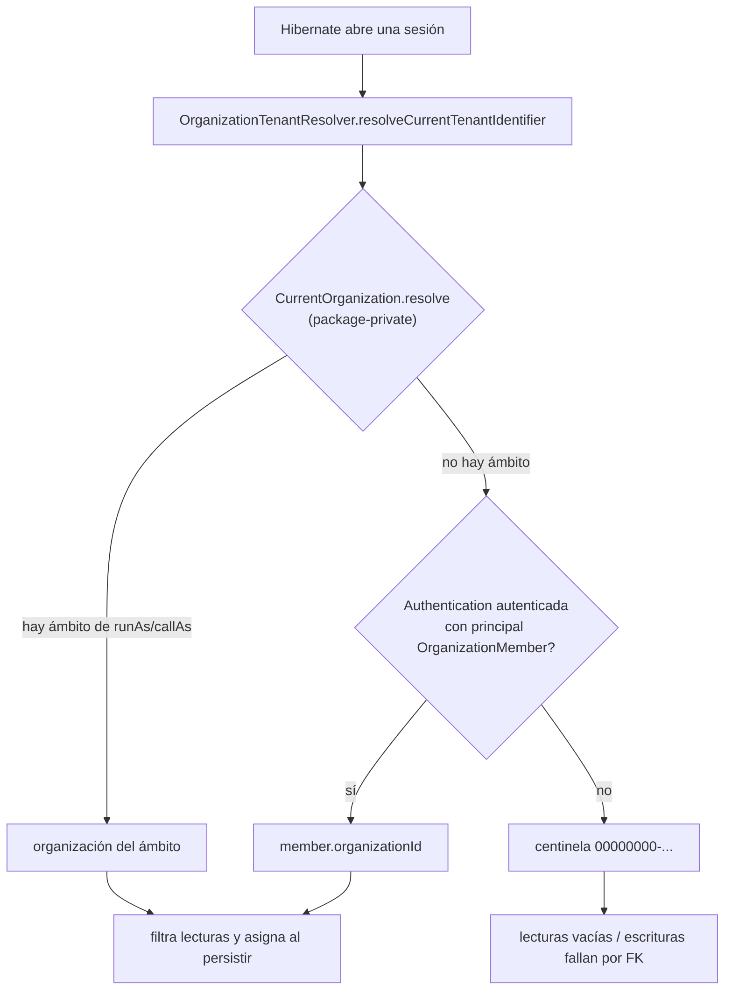

# Organizaciones y multi-tenant

Issue #4. Decisiones: P-018 (mecanismo), P-019 (ids y nombres), P-020 (cómo se prueba) en `docs/decisiones.md`.

## Resumen

Cada empresa cliente es una `Organization`, y todo dato de negocio pertenece a una sola organización. El aislamiento
no depende de que cada consulta se acuerde de filtrar: lo hace Hibernate con `@TenantId`. En cada sesión, Hibernate
pregunta cuál es la organización activa y con eso:

- **filtra** las lecturas (JPQL, Criteria, consultas derivadas de Spring Data y `findById`) por `organization_id`;
- **asigna** `organization_id` al persistir una entidad nueva.

La organización activa la resuelve `CurrentOrganization`, en este orden:

1. El ámbito explícito abierto con `runAs`/`callAs`, para procesos sin usuario (webhooks, jobs, listeners).
2. El principal de la `Authentication` del `SecurityContextHolder`, si está autenticada y el principal implementa
   `OrganizationMember`. Lo carga el JWT desde el issue #5 (`AuthenticatedOperator`, ver `docs/autenticacion.md`).
3. Ninguna: el resolver devuelve un centinela (`00000000-0000-0000-0000-000000000000`) que no es ninguna organización.
   Las lecturas vuelven vacías y las escrituras fallan por la FK a `organizations`.

Se activa sola: cualquier sesión de Hibernate que se abra consulta al resolver. Todavía no hay endpoints ni alta de
organizaciones; la primera entidad de negocio es `Operator` (#5), y después vienen `Person` y `PersonIdentity` (#6,
`docs/personas.md`), `Opportunity` y `OpportunitySettings` (#36, `docs/oportunidades.md`), `Message` (#8,
`docs/mensajes.md`) y `ChannelAccount` (#42, `docs/canales.md`).

## Piezas

Módulo `organizations` (`backend/src/main/java/com/communicatorone/organizations/`):

| Clase | Visibilidad | Qué hace |
|---|---|---|
| `CurrentOrganization` | pública (API del módulo) | `runAs(UUID, Runnable)` y `callAs(UUID, Supplier<T>)` abren el ámbito de una organización. Es lo único público de la clase. |
| `OrganizationMember` | pública (API del módulo) | Contrato del principal autenticado: `UUID organizationId()`. |
| `CurrentOrganization.resolve()` | package-private | Da la organización activa (ámbito o usuario). Solo la llama `OrganizationTenantResolver`; los otros módulos no la ven. |
| `OrganizationTenantResolver` | package-private | `CurrentTenantIdentifierResolver<UUID>` de Hibernate y `HibernatePropertiesCustomizer` que se registra a sí mismo (`customize`). |
| `Organization` | package-private | Entidad de la tabla `organizations`; `Organization.named(name)` rechaza nombres nulos o en blanco. No lleva `@TenantId`: es el tenant. |

La API pública del módulo es `CurrentOrganization.runAs`/`callAs` y `OrganizationMember`. Ningún otro módulo pregunta
«cuál es la organización activa»: abre un ámbito, o deja que Hibernate asigne y filtre.

Esquema (`backend/src/main/resources/db/migration/V1__create_organizations.sql`):

```sql
CREATE TABLE organizations (
    id UUID PRIMARY KEY,
    name TEXT NOT NULL,
    CONSTRAINT organizations_id_not_sentinel_check CHECK (id <> '00000000-0000-0000-0000-000000000000')
);
```

El `CHECK` `organizations_id_not_sentinel_check` impide crear la organización centinela (ver «Sin organización»).

Una entidad de negocio se declara así (como el fixture de test `IsolationProbe`):

```java
@TenantId
@Column(name = "organization_id")
private UUID organizationId;
```

sin setter, y su tabla lleva `organization_id UUID NOT NULL REFERENCES organizations (id)` con índice
(`.claude/rules/flyway.md`).

Si el código necesita la organización de un registro (por ejemplo, para el `organizationId` de un evento de dominio),
la saca del accesor de la propia entidad, cuyo valor asignó Hibernate al persistir, y no de `resolve()`, que es
package-private. Por ejemplo, `Operator.organizationId()`, que usa `OperatorTokens` para el claim `organization_id`.

## Diagramas

Resolución de la organización activa en cada sesión de Hibernate:



Proceso sin usuario (patrón para webhooks, jobs y listeners). El primer job que lo usa es `OpportunityClosingJob`
(#37, `docs/oportunidades.md`): hace un `runAs` por organización y adentro llama a `InactiveOpportunityClosing`, que
es `@Transactional`.

```mermaid
sequenceDiagram
    participant P as Webhook / job / listener
    participant CO as CurrentOrganization
    participant S as Servicio @Transactional
    participant H as Hibernate
    P->>CO: runAs(organizationId, ...)
    Note over CO: sin sincronización de transacción<br/>ni sesión de JPA ligada al hilo;<br/>si hay alguna, IllegalStateException
    CO->>S: dentro del ámbito
    S->>H: abre sesión y transacción
    H->>CO: OrganizationTenantResolver → resolve() → organizationId
    S->>H: consultas filtradas, inserts con organization_id
    S-->>P: commit al salir del servicio
```

## Flujo en detalle

### Ámbito explícito: `runAs` / `callAs`

`CurrentOrganization.runAs` delega en `CurrentOrganization.callAs`, que:

1. rechaza una organización nula con `NullPointerException`, antes de correr la acción;
2. lanza `IllegalStateException` si ya hay una sesión que fijó su organización. La sesión de Hibernate resuelve la
   organización al abrirse y no la vuelve a preguntar, así que abrir un ámbito con una sesión viva lo ignoraría en
   silencio. El guard mira dos cosas:
   - **sincronización de transacción activa** (`TransactionSynchronizationManager.isSynchronizationActive()`): cubre
     una transacción real y también un ámbito `SUPPORTS` sin transacción;
   - **sesión de JPA ligada al hilo** (`TransactionSynchronizationManager.hasResource(entityManagerFactory)`): cubre
     OSIV, una transacción con `SYNCHRONIZATION_NEVER` (que liga el `EntityManager` sin activar la sincronización) y
     un `EntityManager` abierto y ligado a mano. El test ejercita el caso OSIV
     (`organizationCannotBeSwitchedWhileASessionIsOpen`);
3. liga la organización a un `ScopedValue<UUID>` mientras dura la acción.

Por eso el `runAs` va **afuera** y el `@Transactional` **adentro**. Un `@ApplicationModuleListener` ya corre en una
transacción `REQUIRES_NEW`, así que no puede hacer `runAs`: el listener que toca datos de una organización no lleva
transacción propia, hace `runAs(event.organizationId(), ...)` y llama a un servicio `@Transactional`. Tampoco sirve un
`@TransactionalEventListener(phase = AFTER_COMMIT)` síncrono: corre con la sincronización todavía activa y el guard
lanza `IllegalStateException`. El listener tiene que ser `@Async` + `@TransactionalEventListener`, sin
`@Transactional`, y eso requiere `@EnableAsync`, que la app todavía no tiene.

La app corre con `spring.jpa.open-in-view: false` (`backend/src/main/resources/application.yml`). Con OSIV, el
`EntityManager` se abriría al empezar el request con la organización del usuario y quedaría ligado al hilo; un `runAs`
dentro del request no podría cambiarla, y el guard lo rechaza con `IllegalStateException` en vez de dejar que use la
del usuario en silencio.

El `ScopedValue` no cruza hilos: `@Async`, executors y `CompletableFuture` arrancan sin ámbito (ni `SecurityContext`) y
tienen que abrir su propio `runAs`.

### Usuario autenticado

Sin ámbito explícito, `CurrentOrganization.resolve` mira el `SecurityContextHolder` (método privado
`authenticatedMemberOrganization`): solo cuenta una `Authentication` con `isAuthenticated()` verdadero cuyo principal
implementa `OrganizationMember`. Un token sin autenticar con el mismo principal no da organización. El ámbito explícito
gana sobre el usuario: un usuario de Globex dentro de `runAs(acme, ...)` ve lo de Acme.

Contrato para #5, ya cumplido: después de validar el JWT, `OperatorTokens.convert` deja en el contexto una
`Authentication` autenticada cuyo principal, `AuthenticatedOperator`, implementa `OrganizationMember`
(`docs/autenticacion.md`).

### Sin organización

`OrganizationTenantResolver.resolveCurrentTenantIdentifier()` devuelve `resolve().orElse(NO_ORGANIZATION)`, con
`NO_ORGANIZATION = new UUID(0, 0)`. Nunca devuelve `null`, porque Hibernate no abre sesiones sin tenant cuando hay
entidades con `@TenantId`, y así la app arranca y `Organization` se puede leer y escribir sin organización activa.
El `CHECK` de `V1__create_organizations.sql` impide que exista una organización con el id del centinela. El costo: un
job que se olvida el `runAs` no falla al leer, ve vacío.

### Lo que no cubre `@TenantId`

SQL nativo y `JdbcTemplate` van directo a la base: filtran por `organization_id` a mano. Los `UPDATE`/`DELETE`
masivos por JPQL no están verificados por ningún test: hasta que lo estén, no dar por hecho que se filtran. Las
búsquedas que tienen que cruzar organizaciones a propósito se deciden en su tarea. Hay tres, y las tres devuelven solo
ids de organización:

- **El operador por email en el login** (#5, P-022): `OperatorEmailDirectory` devuelve solo el `organization_id` y el
  operador se carga con `callAs` y la lectura filtrada (`docs/autenticacion.md`).
- **Las organizaciones con oportunidades abiertas, en el job de cierre** (#37, P-037): `OpportunityClosingJob` lista
  con `JdbcTemplate` (`SELECT DISTINCT organization_id FROM opportunities WHERE status = 'OPEN' ORDER BY
  organization_id`) y, por cada una, hace `runAs(organizationId, ...)` y llama a un servicio `@Transactional` que lee
  con el filtro de `@TenantId` de siempre. Si una organización falla, se loguea y sigue con la siguiente
  (`docs/oportunidades.md`).
- **La cuenta de canal de un webhook** (#42, P-044): `ChannelAccountDirectory.resolve` busca con `JdbcTemplate`
  (`SELECT organization_id FROM channel_accounts WHERE channel_type = ? AND external_account_id = ?`) y carga la cuenta
  con `callAs` y la consulta derivada filtrada. El pipeline entrante (#10) la llama fuera de transacción y después abre
  `runAs(account.organizationId(), ...)` (`docs/canales.md`).

## Ejemplos

Ámbito explícito (`TenantIsolationTest.newRecordBelongsToTheOrganizationInScope`): se guarda sin indicar organización
y queda en la del ámbito.

```java
var newRecord = currentOrganization.callAs(acme,
        () -> probes.save(IsolationProbe.labeled("New Acme record")).id());
```

```
SELECT organization_id FROM isolation_probes WHERE id = :newRecord;
-- organization_id = <id de Acme>
```

Errores:

| Situación | Resultado |
|---|---|
| `save` sin organización activa | `DataIntegrityViolationException` (FK de `organization_id` contra el centinela) |
| `runAs`/`callAs` dentro de `transactionTemplate.executeWithoutResult(...)` o de un ámbito `SUPPORTS` | `IllegalStateException`, no se guarda nada |
| `runAs`/`callAs` con una sesión de JPA ligada al hilo (OSIV, `SYNCHRONIZATION_NEVER`, `EntityManager` ligado a mano; probado con OSIV) | `IllegalStateException`, no se guarda nada |
| `save` de una entidad con el id de un registro de otra organización | `DataAccessException`; el registro de la otra organización no cambia y no se crea uno nuevo |
| `runAs(null, ...)` / `callAs(null, ...)` | `NullPointerException`, la acción no corre |
| `Organization.named(null)`, `""` o `"   "` | `IllegalArgumentException` |

## Tests

`backend/src/test/java/com/communicatorone/organizations/TenantIsolationTest.java` (`@SpringBootTest` con
`RANDOM_PORT` + Testcontainers, sin `@Transactional` de clase). Cada test crea dos organizaciones nuevas, Acme y
Globex, con un registro de `IsolationProbe` cada una (`createTwoOrganizationsWithOneRecordEach`), insertado por
`JdbcTemplate` en `storedRecordOf`, y limpia el `SecurityContextHolder` al final (`signOut`).

| Test | Qué cubre |
|---|---|
| `organizationSeesOnlyItsOwnRecords` | Con ámbito Acme, `findAll` y `count` solo ven lo de Acme. |
| `recordOfAnotherOrganizationIsNotFoundById` | `findById` del registro de Globex da vacío con ámbito Acme. |
| `recordOfAnotherOrganizationCannotBeDeletedById` | Con ámbito Acme, `deleteById` del registro de Globex no lo borra: sigue en la base con su etiqueta y su organización (leído por `JdbcTemplate`). |
| `recordOfAnotherOrganizationCannotBeOverwritten` | Con ámbito Acme, un `save` de una entidad con el id del registro de Globex (fábrica de test `IsolationProbe.existing`) lanza `DataAccessException`, no cambia la etiqueta ni la organización de ese registro y no crea uno nuevo. |
| `newRecordBelongsToTheOrganizationInScope` | Un registro guardado sin organización queda con la del ámbito (leído por `JdbcTemplate`). |
| `authenticatedMemberSeesOnlyTheirOrganizationRecords` | Un usuario autenticado de Globex solo ve lo de Globex. |
| `unauthenticatedMemberSeesNoRecords` | Un token sin autenticar con principal de Globex no ve nada. |
| `explicitScopeTakesPrecedenceOverAuthenticatedMember` | Usuario de Globex dentro de `callAs(acme)` ve solo lo de Acme. |
| `withoutOrganizationNoRecordIsVisible` | Sin ámbito ni usuario, `findAll` vacío. |
| `recordCannotBeStoredWithoutOrganization` | Sin organización, `save` lanza `DataIntegrityViolationException` y no queda nada. |
| `organizationCannotBeSwitchedInsideATransaction` | `runAs` dentro de una transacción lanza `IllegalStateException` y no guarda. |
| `organizationCannotBeSwitchedInsideATransactionalScopeWithoutActualTransaction` | Lo mismo dentro de un ámbito `SUPPORTS`. |
| `organizationCannotBeSwitchedWhileASessionIsOpen` | Simula OSIV con `OpenEntityManagerInViewInterceptor` (`preHandle` liga el `EntityManager` al hilo, sin transacción): un `runAs` anidado lanza `IllegalStateException` y no guarda. |
| `organizationIsRequiredToRunInItsScope` | `runAs`/`callAs` con `null` lanzan `NullPointerException` sin correr la acción. |
| `everyBusinessEntityBelongsToAnOrganization` | Recorre el metamodelo de Hibernate y exige `@TenantId` en toda entidad de `com.communicatorone` salvo `Organization`. Cubre las entidades futuras. |

`OrganizationTest.organizationWithoutNameIsRejected` (mismo paquete de test, sin Spring): nombre nulo, vacío o en
blanco.

Fixtures de test (P-020): `IsolationProbe` e `IsolationProbeRepository` en el mismo paquete de test, y la tabla
`isolation_probes` en `backend/src/test/resources/db/migration/R__create_isolation_probe.sql`, migración repetible
que Flyway toma del classpath en todos los tests y que no se empaqueta.
