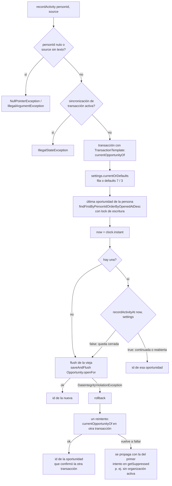
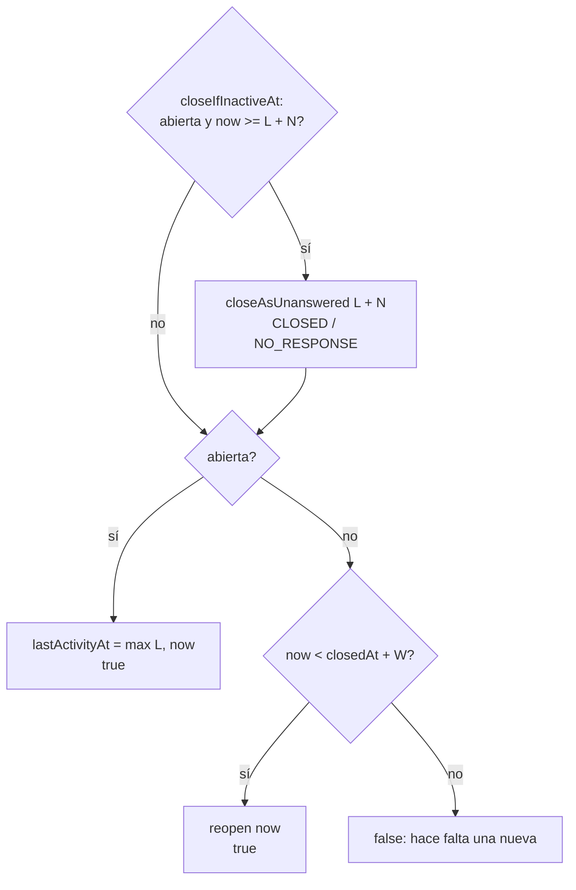
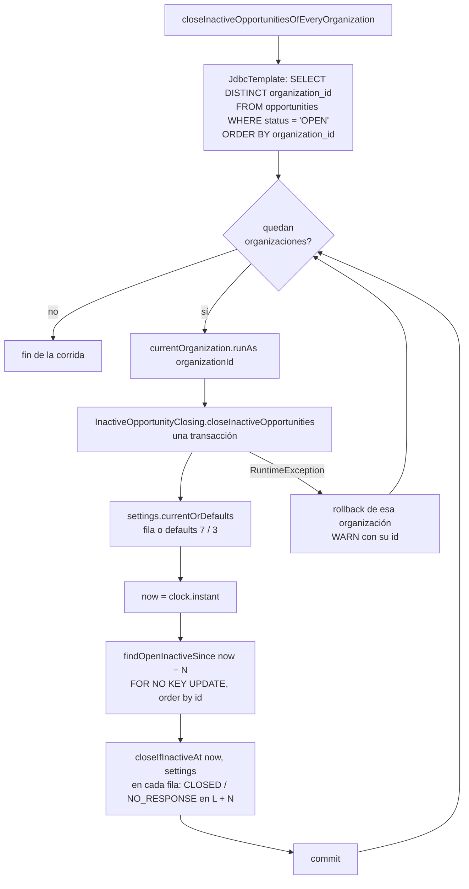
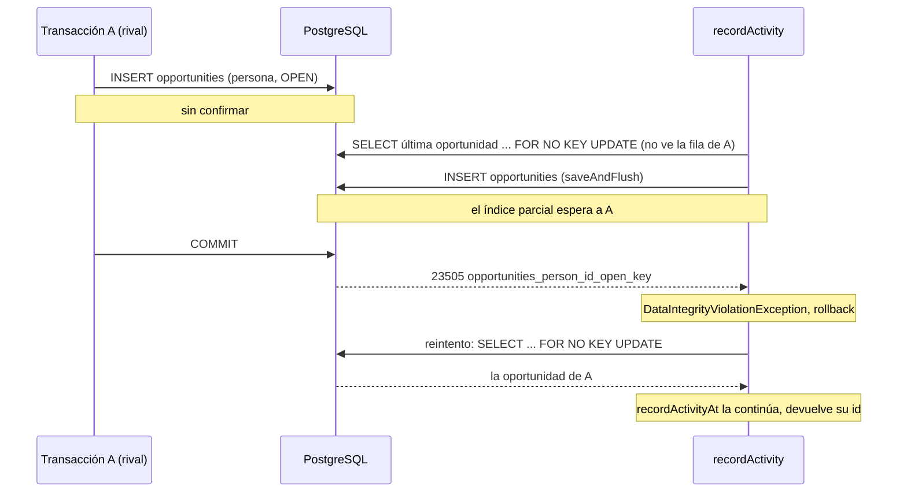
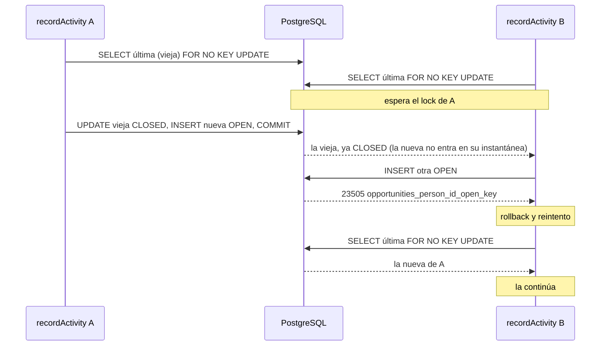
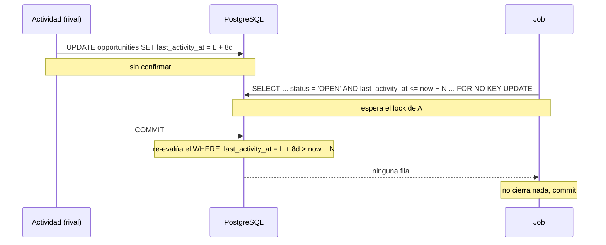
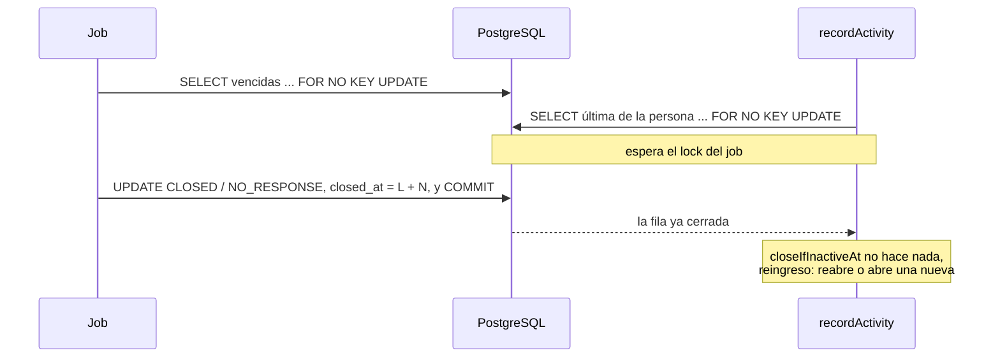

# Oportunidades

Issues #36 y #37 (subissues 1 y 2 de #7). Decisiones: D-001 (persona permanente, oportunidades con ciclo de vida),
D-002 (duración configurable) y P-032 (módulo y API), P-033 (modelo), P-034 (reglas), P-035 (unicidad y
concurrencia), P-036 (configuración), P-037 (job de cierre) en `docs/decisiones.md`. Se apoya en
`docs/multi-tenant.md` y en las personas de `docs/personas.md`.

## Resumen

Una `Opportunity` es un episodio de una persona con la organización: se abre cuando la persona escribe y no tiene una
oportunidad vigente, sigue abierta mientras haya actividad y se cierra sola después de N días sin actividad
(`NO_RESPONSE`). Si la persona vuelve poco después del cierre (dentro de la ventana de reingreso), se reabre la misma;
si vuelve más tarde, se abre una nueva. Una persona tiene a lo sumo una oportunidad abierta.

El módulo `opportunities` expone una sola operación: `OpportunityTracker.recordActivity(personId, source)`. Registra
la actividad de la persona y devuelve el id de su oportunidad vigente: la que ya estaba abierta, la cerrada que se
reabre o una nueva. El cierre por inactividad se evalúa en esa misma llamada («al vuelo») y se fecha en
`última actividad + N`, así que el resultado no depende de que haya corrido un job.

Además, `OpportunityClosingJob` corre cada hora (cron configurable) y persiste el cierre de las oportunidades vencidas
que nadie toca, con la misma regla y la misma fecha: recorre las organizaciones con oportunidades abiertas y, en una
transacción por organización, cierra las que llevan N días o más sin actividad (ver «Job de cierre»).

`recordActivity` se va a activar con cada mensaje entrante: el flujo entrante (#10) resuelve la persona, registra la
actividad y guarda el mensaje con el id de la oportunidad (#8). En #36, «actividad» es un mensaje entrante; si los
salientes cuentan se decide con su tarea. Hoy nadie la llama fuera de los tests.

Fuera de #36 y #37: el responsable y el reparto (#13; la columna `owner_id` existe pero queda nula), el cierre manual
con `WON`/`LOST` (#15), eventos y endpoints REST.

## Piezas

Módulo `opportunities` (`backend/src/main/java/com/communicatorone/opportunities/`). Su única dependencia en código es
`organizations`, por su API pública `CurrentOrganization`, que usa el job para abrir el ámbito de cada organización
(#37). No depende de `people`: la persona llega como `UUID` (P-019) y la base controla que sea de la misma
organización; la organización la asigna y filtra Hibernate con `@TenantId` (P-018).

| Clase | Visibilidad | Qué hace |
|---|---|---|
| `OpportunityTracker` | pública (API) | `@Service` con `recordActivity(UUID, String): UUID` (`OpportunityTracker.java:29-45`), que valida, abre su transacción con el bean `TransactionTemplate` y reintenta una vez ante `DataIntegrityViolationException`. El trabajo lo hace `currentOpportunityOf` (`OpportunityTracker.java:47-56`). Recibe repositorios, `TransactionTemplate` y `Clock` en el constructor (`OpportunityTracker.java:21-27`). |
| `OpportunityClosingJob` | package-private | `@Component` con el método `@Scheduled` `closeInactiveOpportunitiesOfEveryOrganization()` (`OpportunityClosingJob.java:28-31`): lista por `JdbcTemplate` las organizaciones con oportunidades abiertas (`OpportunityClosingJob.java:33-37`) y para cada una corre `InactiveOpportunityClosing` dentro de `currentOrganization.runAs`; si falla, deja un WARN y sigue (`OpportunityClosingJob.java:39-45`). |
| `InactiveOpportunityClosing` | package-private | `@Service` con `closeInactiveOpportunities()`, `@Transactional` (`InactiveOpportunityClosing.java:21-27`): cierra las oportunidades vencidas de la organización activa. Recibe repositorios y `Clock` en el constructor (`InactiveOpportunityClosing.java:14-19`). |
| `Opportunity` | package-private | Entidad de la tabla `opportunities`: `id`, `@TenantId organizationId`, `personId`, `ownerId`, `source`, `status` y `result` (guardados por nombre), `openedAt`, `lastActivityAt`, `closedAt` (`Opportunity.java:17-45`). Fábrica `openFor(personId, source, now)` (`Opportunity.java:58-62`), regla `recordActivityAt(now, settings)` (`Opportunity.java:64-77`) y `closeIfInactiveAt(now, settings)` (`Opportunity.java:79-84`), el cierre por inactividad que comparten el cierre al vuelo y el job; privados `closeAsUnanswered` y `reopen` (`Opportunity.java:118-129`). Sin setters. |
| `OpportunityStatus` | package-private | `OPEN`, `CLOSED` (`OpportunityStatus.java:3-6`). |
| `OpportunityResult` | package-private | `WON`, `LOST`, `NO_RESPONSE` (`OpportunityResult.java:3-7`). En #36 solo se usa `NO_RESPONSE`. |
| `OpportunitySettings` | package-private | Entidad de la tabla `opportunity_settings`: `id`, `@TenantId organizationId`, `inactivityDaysToClose`, `reentryWindowDays` (`OpportunitySettings.java:22-32`). `of(int, int)` valida (`OpportunitySettings.java:42-46`), `defaults()` da 7 y 3 sin persistir (`OpportunitySettings.java:19-20`, `:48-50`), `inactivityEndsAt` (L + N), `inactivityCutoffAt` (ahora − N, el corte de la consulta del job) y `allowsReentryAt` hacen las cuentas (`OpportunitySettings.java:52-62`). |
| `OpportunityRepository` | package-private | `findFirstByPersonIdOrderByOpenedAtDesc(UUID)` con `@Lock(PESSIMISTIC_WRITE)`: la última oportunidad de la persona, bloqueada para escritura (`OpportunityRepository.java:14-15`). `findOpenInactiveSince(Instant cutoff)`, JPQL con `@Lock(PESSIMISTIC_WRITE)`: las abiertas con `lastActivityAt <= cutoff`, ordenadas por id (`OpportunityRepository.java:17-23`). |
| `OpportunitySettingsRepository` | package-private | `findCurrent()`, un JPQL sin filtro (`select s from OpportunitySettings s`) que `@TenantId` limita a la fila de la organización activa (`OpportunitySettingsRepository.java:10-11`), y el método `default` `currentOrDefaults()`, que devuelve esa fila o, si no hay, `OpportunitySettings.defaults()` (`OpportunitySettingsRepository.java:13-15`). Lo usan `OpportunityTracker` e `InactiveOpportunityClosing`. |

El `package-info.java` con `@ApplicationModule` ya existía desde el scaffold y `ModularStructureTest` ya declaraba
`opportunities`. #37 sumó, fuera del módulo, `SchedulingConfiguration` en el paquete raíz (`@EnableScheduling`,
`SchedulingConfiguration.java:6-9`), la propiedad `communicator-one.opportunities.closing-cron` (ver «Configuración»)
y la migración V5 (ver «Esquema»).

## API y contrato

```java
UUID opportunityId = opportunityTracker.recordActivity(personId, "whatsapp");
```

| Entrada | Salida |
|---|---|
| Persona sin oportunidades | id de una oportunidad nueva, abierta, con esa fuente |
| Persona con una abierta y activa | el id de esa misma, con `lastActivityAt` = ahora si es posterior (la fuente no cambia) |
| Persona cuya última se cerró (o quedó inactiva) hace menos de W días | el id de esa misma, reabierta |
| Persona cuya última se cerró hace W días o más | id de una nueva; la vieja queda `CLOSED`/`NO_RESPONSE` |
| `personId` nulo | `NullPointerException` |
| `source` nula, vacía o en blanco | `IllegalArgumentException`, sin tocar la base |
| Llamada con sincronización de transacción activa | `IllegalStateException`, sin tocar la base |
| Sin organización activa, o persona de otra organización | `DataIntegrityViolationException` (con la del primer intento en `getSuppressed()`), nada guardado |

Quien llama a `recordActivity`:

1. **No tiene una transacción abierta.** La operación abre la suya; si hay sincronización de transacción activa (una
   transacción real o un ámbito `SUPPORTS`), lanza `IllegalStateException` («Activity is recorded in its own
   transaction, not inside an open one», `OpportunityTracker.java:32-33`). Es la misma comprobación que
   `PersonDirectory.resolveOrCreate` (P-029): en PostgreSQL una violación aborta la transacción en curso y el reintento
   necesita una transacción limpia.
2. **Tiene organización activa:** `currentOrganization.callAs(organizationId, ...)` o un request con operador
   autenticado. Sin organización, la inserción falla por la FK de `organization_id` contra el centinela.
3. **Pasa una persona de la organización activa**, resuelta antes con `PersonDirectory.resolveOrCreate`.
4. **Pasa la fuente** como etiqueta opaca (por ejemplo, el canal o la campaña). Se valida que tenga texto y se guarda
   tal cual, sin recortar; solo se usa al abrir una oportunidad nueva. Una actividad que continúa o reabre no la cambia.
5. **Descarta antes los duplicados**: #10 descarta el mensaje repetido por `externalId` antes de llamar, porque cada
   llamada cuenta como actividad nueva.

Flujo entrante (#10), en tres transacciones (persona, oportunidad, mensaje):

```java
currentOrganization.callAs(organizationId, () -> {
    var personId = personDirectory.resolveOrCreate(identity);               // tx 1
    // #10 descarta acá el duplicado por externalId
    var opportunityId = opportunityTracker.recordActivity(personId, source); // tx 2
    return messages.record(personId, opportunityId, message);                // tx 3 (#8)
});
```

Si la tercera falla, la actividad ya quedó registrada (la oportunidad abierta o con `lastActivityAt` adelantado) sin
mensaje. El reintento del webhook vuelve a llamar a `recordActivity`, que continúa la misma oportunidad.

## Reglas

Con L = última actividad, N = `inactivityDaysToClose`, W = `reentryWindowDays`, C = cierre:

- **Inactiva** cuando `ahora >= L + N` (límite inclusive). El cierre se fecha en `C = L + N`, no a la hora en que se
  detecta.
- **Inactividad desde la última actividad**, no desde la apertura: cada actividad corre el límite.
- **Reingreso medido desde el cierre**: si `ahora < C + W`, se reabre la misma oportunidad; desde `C + W`, se abre una
  nueva. Con `W = 0`, nunca se reabre.
- **Cierre al vuelo**: `recordActivity` cierra la oportunidad vencida antes de decidir, así que el resultado es el
  mismo haya corrido el job o no.
- **Cierre por el job**: cada hora, el job cierra en la base las abiertas con `L <= ahora − N`, que es la misma
  condición `ahora >= L + N`, con la misma regla (`closeIfInactiveAt`) y la misma fecha `C = L + N`, aunque corra
  horas o días después. Cerrar una ya cerrada no cambia nada.
- **Reapertura**: vuelve a `OPEN`, borra resultado y `closedAt`, pone `lastActivityAt` = ahora y conserva fuente,
  responsable y `openedAt` (`Opportunity.java:124-129`). Aplica sea cual sea el resultado del cierre (D-002 literal);
  ver «Riesgos».
- **Días de 24 h en UTC** (`Duration.ofDays`, `OpportunitySettings.java:53`, `:57`, `:61`): no se ajustan por horario de
  verano ni por la zona de la organización.
- **Hora de procesamiento**: la actividad se fecha con `clock.instant()`, no con la hora que informa el proveedor.
- **`lastActivityAt` no retrocede**: al continuar, solo avanza si `ahora` es posterior (`Opportunity.java:67-69`); una
  actividad fechada antes (un nodo con el reloj atrasado) cuenta como actividad, pero deja la última como estaba.

### Línea de tiempo

Defaults (N = 7, W = 3), L = 2026-03-02 09:00 UTC (el `MutableClock.INITIAL_INSTANT` de los tests):

```
L = 2026-03-02 09:00          L + 7d = C = 2026-03-09 09:00     C + 3d = L + 10d = 2026-03-12 09:00
|---- abierta: la continúa ----|---- reingreso: cierra y reabre ----|---- cierra y abre una nueva ---->
```

| La persona escribe en | Resultado | Test |
|---|---|---|
| L + 7d − 1s | Sigue la misma; `lastActivityAt` = L + 7d − 1s | `activityWithinTheInactivityPeriodContinuesTheOpenOpportunity` |
| L + 5d y después L + 11d | Sigue la misma: el segundo mensaje está a 6 días del primero | `inactivityIsCountedFromTheLastActivityNotFromTheOpening` |
| L + 10d − 1s | Se cierra al vuelo en L + 7d y se reabre: misma id, `openedAt` y fuente | `personReturningJustBeforeTheReentryWindowEndsGetsTheSameOpportunityBack` |
| L + 10d | La vieja queda `CLOSED`/`NO_RESPONSE` con `closedAt` = L + 7d y se abre una nueva | `personReturningWhenTheReentryWindowEndsNeedsANewOpportunity` |
| L + 7d, con W = 0 | La vieja cerrada en L + 7d, y una nueva | `withoutReentryWindowAPersonReturningAfterTheInactivityPeriodNeedsANewOpportunity` |

Filas después de que una persona de Acme escribe por WhatsApp en L y vuelve por Instagram en L + 10d
(`OpportunityTrackerTest.personReturningAfterTheReentryWindowGetsANewOpportunity`):

```
id      | source    | status | result      | opened_at        | last_activity_at | closed_at        | owner_id
<vieja> | whatsapp  | CLOSED | NO_RESPONSE | 2026-03-02 09:00 | 2026-03-02 09:00 | 2026-03-09 09:00 | null
<nueva> | instagram | OPEN   | null        | 2026-03-12 09:00 | 2026-03-12 09:00 | null             | null
```

Si hubiera vuelto en L + 10d − 1s, quedaría una sola fila: `<vieja>`, `whatsapp`, `OPEN`, sin resultado ni
`closed_at`, `opened_at` = L y `last_activity_at` = L + 10d − 1s.

## Diagramas

`recordActivity`:



`Opportunity.recordActivityAt` (`Opportunity.java:64-77`); el primer paso es `closeIfInactiveAt`
(`Opportunity.java:79-84`), lo único que hace el job sobre cada fila:



`OpportunityClosingJob.closeInactiveOpportunitiesOfEveryOrganization` (cada hora, en el hilo del scheduler):



## Flujo en detalle

### Validación y transacción (`OpportunityTracker.recordActivity`)

`recordActivity` (`OpportunityTracker.java:29-45`):

1. Rechaza `personId` nulo (`NullPointerException`) y una fuente sin texto (`Assert.hasText`,
   `IllegalArgumentException` «Activity needs the source it came from»), antes de todo (`OpportunityTracker.java:30-31`).
   Así, una fuente vacía se rechaza igual aunque la persona tenga una oportunidad abierta, en la que la fuente no se usa.
2. Rechaza la sincronización de transacción activa (`OpportunityTracker.java:32-33`).
3. Corre `currentOpportunityOf` en una transacción del `TransactionTemplate` (`OpportunityTracker.java:34-36`). Si sale
   `DataIntegrityViolationException`, la transacción ya se deshizo entera y se corre una vez más, en una transacción
   nueva (`OpportunityTracker.java:37-39`). Si el reintento también falla, se propaga su excepción con la del primer
   intento agregada en `getSuppressed()` (`OpportunityTracker.java:40-43`), para no perder la causa original.

### La oportunidad vigente (`currentOpportunityOf`)

`currentOpportunityOf` (`OpportunityTracker.java:47-56`):

1. Lee la configuración de la organización activa o, si no tiene fila, los defaults, con `settings.currentOrDefaults()`
   (`OpportunityTracker.java:48`).
2. Trae la última oportunidad de la persona (por `openedAt` descendente, la primera) con lock pesimista de escritura
   (`OpportunityTracker.java:49`). El filtro de `@TenantId` limita la búsqueda a la organización activa; el índice
   `opportunities_person_id_opened_at_idx` sirve a esta consulta. El SQL que genera Hibernate (con
   `spring.jpa.show-sql` en una corrida de `OpportunityTrackerTest`) es:

   ```sql
   select o1_0.id, ..., o1_0.status from opportunities o1_0
   where o1_0.organization_id = ? and o1_0.person_id = ?
   order by o1_0.opened_at desc fetch first ? rows only for no key update of o1_0
   ```

   `FOR NO KEY UPDATE` choca consigo mismo y con `FOR UPDATE`, así que dos `recordActivity` de la misma persona se
   serializan igual; no bloquea los `FOR KEY SHARE` que toman las FK de otras tablas que apunten a la oportunidad (por
   ejemplo, al insertar mensajes de #8).
3. Recién entonces lee el reloj (`OpportunityTracker.java:50`). En un mismo nodo, una transacción que esperó el lock
   lee una hora posterior a la de la que lo tenía. Con relojes desfasados entre nodos eso no alcanza, y lo cubre el
   dominio: `recordActivityAt` nunca hace retroceder `lastActivityAt`.
4. Si hay oportunidad y `recordActivityAt` devuelve `true` (continuada o reabierta), devuelve su id
   (`OpportunityTracker.java:51-53`). Los cambios los guarda el dirty checking al confirmar.
5. Si no hay oportunidad, o la última quedó cerrada y fuera del reingreso, hace `flush` (la vieja se escribe ya
   cerrada) y después `saveAndFlush(Opportunity.openFor(personId, source, now))`, y devuelve el id nuevo
   (`OpportunityTracker.java:54-55`).

### La regla (`Opportunity.recordActivityAt`)

`recordActivityAt(now, settings)` (`Opportunity.java:64-77`) devuelve `true` si la oportunidad sigue vigente y `false`
si hace falta una nueva (y entonces queda cerrada):

1. Llama a `closeIfInactiveAt(now, settings)` (`Opportunity.java:65`): si está abierta y `now` no es anterior a
   `settings.inactivityEndsAt(lastActivityAt)` (L + N), la cierra como `NO_RESPONSE` con `closedAt` = L + N
   (`Opportunity.java:79-84`, `:118-122`). Si ya estaba cerrada, no hace nada.
2. Si sigue abierta, `lastActivityAt = now` solo si `now` es posterior, y `true` (`Opportunity.java:66-71`). Así
   `lastActivityAt` se queda con la mayor aunque llegue una actividad fechada antes por un nodo con el reloj atrasado.
3. Si está cerrada (de antes o recién) y `settings.allowsReentryAt(closedAt, now)` (`now < closedAt + W`,
   `OpportunitySettings.java:60-62`), la reabre y `true` (`Opportunity.java:72-75`, `:124-129`).
4. Si no, `false` (`Opportunity.java:76`).

Recibe un `Instant` y no un `Clock`: el servicio lee el reloj una sola vez por llamada. `openFor` exige `personId`
no nulo y fuente con texto (`Opportunity.java:59-60`) y arranca con `openedAt` = `lastActivityAt` = `now`
(`Opportunity.java:50-56`).

## Concurrencia

A lo sumo una oportunidad abierta por persona: lo garantiza el índice único parcial `opportunities_person_id_open_key`
(`V4__create_opportunities.sql:26`). Dentro de eso:

- **El lock serializa** las actividades de una persona que ya tiene oportunidades: la segunda transacción espera a que
  la primera confirme y trabaja sobre la fila ya actualizada. Seguir, reabrir y cerrar no se pisan (tampoco con el job,
  que bloquea las mismas filas: ver «Job de cierre»).
- **Dos carreras terminan en el índice**, y las resuelve el único reintento:
  - **(a) Primera actividad de una persona.** No hay fila que bloquear: las dos transacciones insertan y la segunda
    espera al índice; cuando la primera confirma, falla con 23505.
  - **(b) Última oportunidad cerrada y fuera del reingreso.** Las dos bloquean la misma fila vieja. La primera la
    cierra, inserta la nueva y confirma. La segunda obtiene el lock y ve la fila vieja ya cerrada, pero no la nueva (en
    READ COMMITTED la instantánea de su consulta es de antes de esa confirmación); decide abrir otra y choca con el
    índice.

  En los dos casos el reintento, en una transacción nueva, encuentra la oportunidad del ganador como la última y la
  continúa: nunca vuelve a insertar sobre ella. Por eso alcanza con un reintento. Si falla otra vez, no es una carrera
  (sin organización, persona ajena) y se propaga, con la excepción del primer intento en `getSuppressed()`.

Carrera (a), como la reproduce `concurrentFirstActivitiesOfAPersonOpenASingleOpportunity`:



Carrera (b), como la reproduce `concurrentActivitiesAfterTheReentryWindowOpenASingleNewOpportunity` (ahí A es un
hilo rival que cierra la vieja e inserta la nueva sin confirmar):



**La trampa del orden de flush.** Al hacer flush, Hibernate ejecuta los `INSERT` antes que los `UPDATE`. Sin el
`opportunities.flush()` explícito (`OpportunityTracker.java:54`), la nueva se insertaría con la vieja todavía `OPEN` en
la base, y el índice parcial rechazaría a la propia transacción. Lo cubre
`personReturningAfterTheReentryWindowGetsANewOpportunity`, que pasa por ese camino sin concurrencia.

Descartadas (P-035): `@Version` con N reintentos; unirse a la transacción del llamador y bloquear la fila de `people`
(tabla de otro módulo); advisory lock; `SERIALIZABLE`.

## Job de cierre

El cierre al vuelo solo persiste el cierre cuando la persona vuelve a escribir. `OpportunityClosingJob` persiste el de
las oportunidades vencidas que nadie toca, para que quien lea la tabla directamente no las vea abiertas. Lo dispara
el scheduler de Spring con el cron `communicator-one.opportunities.closing-cron` (cada hora en punto por defecto; ver
«Configuración»). Detalle y alternativas en P-037.

### Flujo

1. **Lista las organizaciones** con alguna oportunidad abierta, con `JdbcTemplate` y sin filtro de organización
   (`OpportunityClosingJob.java:33-37`):

   ```sql
   SELECT DISTINCT organization_id FROM opportunities WHERE status = 'OPEN' ORDER BY organization_id
   ```

   Es la segunda consulta que cruza organizaciones, después de la del login (P-022), y como aquella solo devuelve ids
   (`docs/multi-tenant.md`). Corre fuera de transacción. El índice parcial de V5 sirve a esta consulta y a la de cada
   organización: las dos llevan `status = 'OPEN'` literal, la misma condición del índice, así que el planificador
   puede usarlo.
2. **Por cada organización**, en orden, `currentOrganization.runAs(organizationId, closing::closeInactiveOpportunities)`
   (`OpportunityClosingJob.java:41`): el ámbito se abre fuera de la transacción y la transacción adentro, como pide el
   patrón de procesos sin usuario (`.claude/rules/java.md`).
3. **`closeInactiveOpportunities`** (`InactiveOpportunityClosing.java:21-27`), en una transacción:
   1. lee la configuración de la organización o los defaults con `settings.currentOrDefaults()`
      (`InactiveOpportunityClosing.java:23`);
   2. lee el reloj una vez, **antes** de la consulta (`InactiveOpportunityClosing.java:24`). El `closedAt` (L + N) no
      depende de `now`; `now` solo decide qué está vencido;
   3. trae con `findOpenInactiveSince(settings.inactivityCutoffAt(now))` (`InactiveOpportunityClosing.java:25`) las
      abiertas con `lastActivityAt <= now − N`, ordenadas por id. Hibernate le agrega el filtro de `organization_id`
      (`@TenantId`) y, por `@Lock(PESSIMISTIC_WRITE)`, la traduce con `FOR NO KEY UPDATE`, el mismo lock que toma
      `recordActivity` (`OpportunityRepository.java:17-23`). El SQL que genera Hibernate es:

      ```sql
      select ... from opportunities o1_0
      where o1_0.organization_id = ? and o1_0.status='OPEN' and o1_0.last_activity_at<=?
      order by o1_0.id for no key update of o1_0
      ```

   4. a cada una le aplica `closeIfInactiveAt(now, settings)` (`InactiveOpportunityClosing.java:26`), que la cierra
      `CLOSED`/`NO_RESPONSE` con `closedAt` = L + N. Los cambios los guarda el dirty checking al confirmar.
4. **Si falla una organización** (cualquier `RuntimeException`), su transacción se deshace entera (no se cierra
   ninguna de esa organización en esa corrida), queda un WARN con su id y la traza, y el job sigue con la siguiente
   (`OpportunityClosingJob.java:42-44`):

   ```
   WARN ... OpportunityClosingJob : Inactive opportunities of organization <organization_id> could not be closed
   <excepción y traza>
   ```

   La siguiente corrida la vuelve a intentar.

Ejemplo (`jobClosesInactiveOpportunitiesDatedAtTheEndOfTheirInactivity`): una persona de Acme escribe por WhatsApp en
L = 2026-03-02 09:00 y nadie vuelve a tocar la oportunidad. El job corre en L + 7d + 3h:

```
antes:   id  | source   | status | result      | opened_at        | last_activity_at | closed_at
         <a> | whatsapp | OPEN   | null        | 2026-03-02 09:00 | 2026-03-02 09:00 | null
después: <a> | whatsapp | CLOSED | NO_RESPONSE | 2026-03-02 09:00 | 2026-03-02 09:00 | 2026-03-09 09:00
```

El cierre queda en L + 7d, no a la hora del job. Si la persona vuelve en L + 10d, el reingreso se mide desde ese cierre
y se abre una nueva (`reentryWindowAfterALateJobRunIsMeasuredFromTheEndOfTheInactivity`), igual que si el job no
hubiera corrido.

### Concurrencia con `recordActivity`

Job y `recordActivity` toman el mismo lock (`FOR NO KEY UPDATE`) sobre la misma fila, así que se serializan. Según
quién llegue primero:

**Caso 1: la actividad tiene la fila.** El job espera. Cuando la actividad confirma, PostgreSQL (READ COMMITTED)
vuelve a evaluar el `WHERE` del job sobre la versión confirmada: `last_activity_at` ya no es `<= now − N` (o la fila ya
no está `OPEN`), y queda afuera. La oportunidad sigue abierta con la actividad nueva. Lo reproduce
`activityInProgressWhileTheJobRunsKeepsTheOpportunityOpen`:



**Caso 2: el job tiene la fila.** La actividad espera. Cuando el job confirma, la actividad obtiene la fila ya
`CLOSED`/`NO_RESPONSE` con `closedAt` = L + N; `closeIfInactiveAt` no hace nada y `recordActivityAt` aplica el
reingreso (reabre si `now < L + N + W`, si no abre una nueva). Es el mismo resultado que si el cierre se hubiera hecho
al vuelo, porque los dos usan `closeIfInactiveAt`. No tiene test propio de concurrencia: el tracker no cambió y el
camino es el de `personReturningWithinTheReentryWindowReopensAnOpportunityAlreadyClosedForInactivity`.



**Sin deadlocks:** `recordActivity` bloquea una sola fila, y dos corridas del job a la vez (por ejemplo, en dos
réplicas) bloquean en el mismo orden (`order by o.id`). La segunda espera a la primera y, al re-evaluar el `WHERE`, ve
las filas ya cerradas y las salta: el resultado es correcto, pero el trabajo se duplica (ver «Riesgos»).

### Idempotencia

Correr el job otra vez no cambia nada: las cerradas ya no entran en la consulta, y `closeIfInactiveAt` sobre una
cerrada no hace nada (`closingAnAlreadyClosedOpportunityAgainChangesNothing`,
`runningTheJobAgainLeavesClosedOpportunitiesAsTheyWere`). Una corrida cortada a la mitad (reinicio, falla) deja
confirmadas las organizaciones ya procesadas; la siguiente sigue con lo que falta, con el mismo `closedAt`.

## Configuración

Tabla `opportunity_settings`, una fila por organización (P-036):

| Columna | Dominio | Default (sin fila) | Restricción |
|---|---|---|---|
| `inactivity_days_to_close` | `inactivityDaysToClose`: N | 7 | ≥ 1 (`OpportunitySettings.of` y `CHECK`) |
| `reentry_window_days` | `reentryWindowDays`: W | 3 | ≥ 0; 0 = nunca reabre |

Sin API. En desarrollo se carga por SQL:

```sql
INSERT INTO opportunity_settings (id, organization_id, inactivity_days_to_close, reentry_window_days)
VALUES (gen_random_uuid(), '<organization_id>', 15, 3);
```

La configuración se lee en cada llamada, así que un cambio vale desde la siguiente actividad y se aplica también a las
oportunidades ya abiertas (el cierre se recalcula con la N nueva). El job también la lee en cada corrida, una vez por
organización. La configuración por campaña de D-002 se suma cuando existan campañas.

### Horario del job

| Propiedad | Default | Variable de entorno |
|---|---|---|
| `communicator-one.opportunities.closing-cron` | `"0 0 * * * *"` (`application.yml:21-22`): cada hora, en el segundo 0 del minuto 0 | `COMMUNICATOR_ONE_OPPORTUNITIES_CLOSING_CRON` (comentada en `.env.example`) |

- Es un cron de Spring de seis campos (segundo, minuto, hora, día, mes, día de la semana), evaluado en la zona horaria
  de la JVM; al ser horario, la zona no cambia nada.
- El `@Scheduled` lo toma como placeholder sin default (`OpportunityClosingJob.java:28`): el valor vive solo en
  `application.yml`. No es un `@ConfigurationProperties` (P-037).
- `-` (`Scheduled.CRON_DISABLED`) apaga el job. Así lo dejan los tests: `TestcontainersConfiguration` registra
  `closing-cron = "-"` en su `DynamicPropertyRegistrar` `testProperties()`, junto con el secreto JWT de test
  (`TestcontainersConfiguration.java:26-32`; el cron en `:30`), y los tests llaman
  al método directamente. En producción sirve para apagarlo en réplicas (ver «Riesgos»).
- El scheduling lo activa `SchedulingConfiguration` (`@EnableScheduling`, paquete raíz). Hoy es redundante, porque
  `spring-modulith-moments` (que viene con `spring-modulith-starter-core`) ya lo activa, pero queda explícito (P-037).

## Esquema

`backend/src/main/resources/db/migration/V4__create_opportunities.sql`:

```sql
ALTER TABLE operators ADD CONSTRAINT operators_id_organization_id_key UNIQUE (id, organization_id);

CREATE TABLE opportunities (
    id UUID PRIMARY KEY,
    organization_id UUID NOT NULL REFERENCES organizations (id),
    person_id UUID NOT NULL,
    owner_id UUID,
    source TEXT NOT NULL,
    status TEXT NOT NULL,
    result TEXT,
    opened_at TIMESTAMPTZ NOT NULL,
    last_activity_at TIMESTAMPTZ NOT NULL,
    closed_at TIMESTAMPTZ,
    CONSTRAINT opportunities_person_id_organization_id_fkey
        FOREIGN KEY (person_id, organization_id) REFERENCES people (id, organization_id),
    CONSTRAINT opportunities_owner_id_organization_id_fkey
        FOREIGN KEY (owner_id, organization_id) REFERENCES operators (id, organization_id),
    CONSTRAINT opportunities_closure_check CHECK (
        (status = 'OPEN' AND result IS NULL AND closed_at IS NULL)
        OR (status = 'CLOSED' AND result IS NOT NULL AND closed_at IS NOT NULL))
);

CREATE INDEX opportunities_organization_id_idx ON opportunities (organization_id);
CREATE INDEX opportunities_person_id_opened_at_idx ON opportunities (person_id, opened_at DESC);
CREATE INDEX opportunities_owner_id_organization_id_idx ON opportunities (owner_id, organization_id);
CREATE UNIQUE INDEX opportunities_person_id_open_key ON opportunities (person_id) WHERE status = 'OPEN';

CREATE TABLE opportunity_settings (
    id UUID PRIMARY KEY,
    organization_id UUID NOT NULL REFERENCES organizations (id),
    inactivity_days_to_close INTEGER NOT NULL,
    reentry_window_days INTEGER NOT NULL,
    CONSTRAINT opportunity_settings_organization_id_key UNIQUE (organization_id),
    CONSTRAINT opportunity_settings_inactivity_days_to_close_check CHECK (inactivity_days_to_close > 0),
    CONSTRAINT opportunity_settings_reentry_window_days_check CHECK (reentry_window_days >= 0)
);
```

- `operators_id_organization_id_key` (`V4__create_opportunities.sql:1`) es redundante con la clave primaria de
  `operators`, pero hace falta como destino de la FK compuesta del responsable. Es un cambio sobre una tabla de otro
  módulo (ver «Riesgos»).
- Las FK compuestas `opportunities_person_id_organization_id_fkey` y `opportunities_owner_id_organization_id_fkey`
  (`V4__create_opportunities.sql:14-17`) garantizan que la persona y el responsable sean de la misma organización que la
  oportunidad, aunque alguien escriba por SQL. Con `MATCH SIMPLE` (el default), un `owner_id` nulo no se controla, que
  es lo esperado mientras no haya responsable.
- `opportunities_closure_check` (`V4__create_opportunities.sql:18-20`) es el mismo invariante que mantiene la entidad:
  abierta sin resultado ni cierre; cerrada con los dos.
- `opportunities_person_id_open_key` (`V4__create_opportunities.sql:26`) es el índice único parcial de P-035. Va solo
  por `person_id`, sin `organization_id`: una persona es de una sola organización.
- `opportunities_person_id_opened_at_idx` (`V4__create_opportunities.sql:24`) sirve a la búsqueda de la última
  oportunidad; `opportunities_owner_id_organization_id_idx` (`:25`) indexa la FK del responsable, para el borrado o
  la actualización de operadores y las consultas por responsable de #13.
- `status` y `result` son `TEXT` sin `CHECK` de valores, como `operators.role` y `person_identities.kind`.

`backend/src/main/resources/db/migration/V5__index_open_opportunities_by_last_activity.sql` (#37):

```sql
CREATE INDEX opportunities_organization_id_last_activity_at_open_idx ON opportunities (organization_id, last_activity_at) WHERE status = 'OPEN';
```

Índice parcial para el job: el listado de organizaciones con oportunidades abiertas y la búsqueda, dentro de una
organización, de las abiertas con `last_activity_at <= now − N`. Al ser parcial, solo guarda las abiertas. Va con
`CREATE INDEX` común, no `CONCURRENTLY`: hoy la tabla no tiene datos productivos (ver `.claude/rules/flyway.md` y
«Riesgos»).

## Tests

`backend/src/test/java/com/communicatorone/opportunities/OpportunityTest.java` (sin Spring; N = 7, W = 3 salvo donde
se indica, apertura en `MutableClock.INITIAL_INSTANT`). Verifican el estado completo: estado, resultado, `closedAt`,
fuente, `openedAt` y `lastActivityAt`.

| Test | Qué cubre |
|---|---|
| `activityWithinTheInactivityPeriodContinuesTheOpenOpportunity` | Actividad en L + 7d − 1s: `true`, sigue abierta con `lastActivityAt` = ahora. |
| `inactivityIsCountedFromTheLastActivityNotFromTheOpening` | Actividad en T + 5d y en T + 11d: sigue abierta (la inactividad se cuenta desde la última actividad). |
| `activityDatedBeforeTheLastRecordedActivityDoesNotMoveItBack` | Actividad en L + 2d y después otra fechada 5 minutos antes (reloj atrasado de otro nodo): `true`, sigue abierta y `lastActivityAt` queda en L + 2d. |
| `personReturningJustBeforeTheReentryWindowEndsGetsTheSameOpportunityBack` | Actividad en L + 10d − 1s: cierre al vuelo y reapertura; `true`, abierta, sin resultado ni `closedAt`, misma `openedAt` y fuente. |
| `personReturningWhenTheReentryWindowEndsNeedsANewOpportunity` | Actividad en L + 10d (límite de la ventana): `false`; `CLOSED`, `NO_RESPONSE`, `closedAt` = L + 7d, `lastActivityAt` sin cambiar. |
| `withoutReentryWindowAPersonReturningAfterTheInactivityPeriodNeedsANewOpportunity` | Con W = 0, actividad en L + 7d (límite de la inactividad): `false`; cerrada en L + 7d. |
| `inactiveOpportunityIsClosedWithoutResponseAtTheEndOfItsInactivity` | `closeIfInactiveAt` en L + 7d + 3h: `CLOSED`, `NO_RESPONSE`, `closedAt` = L + 7d (no la hora de la llamada), el resto sin cambiar. |
| `opportunityStillWithinItsInactivityPeriodIsNotClosed` | `closeIfInactiveAt` en L + 7d − 1s: sigue abierta, con `lastActivityAt` = L (cerrar no cuenta como actividad). |
| `closingAnAlreadyClosedOpportunityAgainChangesNothing` | `closeIfInactiveAt` en L + 8d y otra vez en L + 20d: sigue cerrada en L + 7d. |
| `opportunityCannotOpenWithoutSource` | Fuente nula, vacía o en blanco: `IllegalArgumentException`. |

`backend/src/test/java/com/communicatorone/opportunities/OpportunitySettingsTest.java` (sin Spring):

| Test | Qué cubre |
|---|---|
| `settingsWithoutInactivityPeriodOrWithNegativeReentryWindowAreRejected` | (0, 3), (−1, 3) y (7, −1): `IllegalArgumentException`. |
| `oneDayOfInactivityWithoutReentryWindowIsTheShortestAcceptedSetting` | (1, 0) se acepta: la inactividad termina a las 24 h y en ese mismo instante ya no hay reingreso. |

`backend/src/test/java/com/communicatorone/opportunities/OpportunityTrackerTest.java` (`@SpringBootTest` con
`RANDOM_PORT` + Testcontainers, sin `@Transactional`; reloj fijo en `MutableClock.INITIAL_INSTANT` y movido con
`MutableClock`). Cada test crea sus organizaciones y personas (estas con `PersonDirectory.resolveOrCreate`) y registra
con `callAs` (`recordIn`). Las filas se leen con `OpportunitiesFixture` (`JdbcTemplate`, filtrando por
`organization_id` salvo `opportunitiesInAnyOrganizationOf`), comparando la fila entera.

| Test | Qué cubre |
|---|---|
| `firstActivityOfAPersonOpensAnOpportunity` | Una fila `OPEN`, sin resultado ni `closed_at` ni responsable, con la fuente y `opened_at` = `last_activity_at` = ahora, en la organización del ámbito. |
| `activityOfAPersonWithAnOpenOpportunityContinuesIt` | A los 2 días, por otra fuente: mismo id, una sola fila, `last_activity_at` adelantado, fuente original. |
| `personReturningWithinTheReentryWindowGetsTheSameOpportunityBack` | Con defaults, vuelta en L + 10d − 1s por otra fuente: mismo id, una fila `OPEN` con la fuente original. |
| `personReturningWithinTheReentryWindowReopensAnOpportunityAlreadyClosedForInactivity` | La oportunidad ya está cerrada en la base (`CLOSED`/`NO_RESPONSE` en L + 7d, con `OpportunitiesFixture.closeWithoutResponse`); vuelta en L + 9d por otra fuente: mismo id, una fila `OPEN` con la fuente original, `opened_at` = L y `last_activity_at` = L + 9d. |
| `personReturningAfterTheReentryWindowGetsANewOpportunity` | Vuelta en L + 10d: la vieja `CLOSED`/`NO_RESPONSE` con `closed_at` = L + 7d y una nueva `OPEN` con la fuente nueva. Cubre la trampa del orden de flush. |
| `eachOrganizationAppliesItsOwnOpportunitySettings` | Acme con (1, 0) y Globex sin fila (defaults): a los 2 días, Acme abre una nueva (la vieja cerrada en L + 1d) y Globex continúa la suya. |
| `personOfAnotherOrganizationCannotRecordActivity` | Con ámbito Globex y una persona de Acme sin oportunidades: `DataIntegrityViolationException` por la FK compuesta (la salida capturada nombra `opportunities_person_id_organization_id_fkey`), con la del primer intento como única suprimida; ninguna oportunidad de esa persona en ninguna organización. |
| `openOpportunityOfAPersonIsNotContinuedFromAnotherOrganization` | Con ámbito Globex y una persona de Acme que tiene una abierta en Acme: Globex no la ve (`@TenantId`), intenta abrir otra y la rechaza el índice único parcial, que no distingue organización (`DataIntegrityViolationException`); Globex sigue sin oportunidades y la de Acme no cambia. |
| `activityCannotBeRecordedWithoutOrganization` | Sin ámbito ni usuario: `DataIntegrityViolationException` y ninguna oportunidad de esa persona en ninguna organización. |
| `activityCannotBeRecordedInsideAnOpenTransactionalScope` | Parametrizado con `Propagation.REQUIRED` y `Propagation.SUPPORTS`: `IllegalStateException` y nada guardado. |
| `activityWithoutSourceIsRejected` | Fuente nula, vacía o en blanco: `IllegalArgumentException` y nada guardado. |
| `activityWithoutSourceIsRejectedEvenWhileThePersonHasAnOpenOpportunity` | Lo mismo con una oportunidad abierta: se rechaza y la oportunidad no cambia. |
| `concurrentFirstActivitiesOfAPersonOpenASingleOpportunity` | La carrera (a), determinista: un hilo rival inserta una oportunidad `OPEN` sin confirmar (`OpportunitiesFixture.rivalStartsOpeningOpportunity`); `recordActivity` corre en otro hilo; Awaitility espera en `pg_stat_activity` otra sesión bloqueada por un lock con un `insert into opportunities` (`anotherSessionIsWaitingToWriteOpportunities`) y recién ahí confirma el rival. Afirma que devuelve el id del rival, que queda una sola fila `OPEN` (la del rival) y que la salida capturada nombra `opportunities_person_id_open_key`. |
| `concurrentActivitiesAfterTheReentryWindowOpenASingleNewOpportunity` | La carrera (b), determinista: con el reloj en L + 10d, un hilo rival cierra la vieja (`NO_RESPONSE` en L + 7d) e inserta una nueva `OPEN` por Instagram sin confirmar (`OpportunitiesFixture.rivalStartsReplacingOpportunity`); `recordActivity` corre en otro hilo; Awaitility espera en `pg_stat_activity` otra sesión bloqueada por el `for no key update` sobre `opportunities` (`anotherSessionIsWaitingToLockTheLatestOpportunity`) y recién ahí confirma el rival. Afirma que devuelve el id del rival, que quedan la vieja cerrada y la nueva del rival (ninguna tercera) y que la salida capturada nombra `opportunities_person_id_open_key` (pasó por el reintento). |
| `opportunityOwnerMustBeAnOperatorOfTheSameOrganization` | Poner por SQL (`OpportunitiesFixture.assignOwner`) un operador de Globex como responsable de una oportunidad de Acme lanza `DataIntegrityViolationException` (FK compuesta) y la oportunidad no cambia. |

`backend/src/test/java/com/communicatorone/opportunities/OpportunityClosingJobTest.java` (mismas anotaciones que
`OpportunityTrackerTest`, más `OutputCaptureExtension`; sin `@Transactional`; reloj en `MutableClock.INITIAL_INSTANT`,
restablecido antes y después de cada test). Las oportunidades se crean con `recordActivity` dentro de `callAs` y el job
se corre llamando a `closeInactiveOpportunitiesOfEveryOrganization()` directamente. Como recorre todas las
organizaciones de la base, cada test afirma solo sobre las suyas.

| Test | Qué cubre |
|---|---|
| `jobClosesInactiveOpportunitiesDatedAtTheEndOfTheirInactivity` | Job en L + 7d + 3h: la fila queda `CLOSED`/`NO_RESPONSE` con `closed_at` = L + 7d, el resto igual. |
| `opportunityReachingTheEndOfItsInactivityIsClosedByTheJob` | Job en L + 7d exacto: la cierra (el corte es `<=`). |
| `opportunityOneSecondBeforeTheEndOfItsInactivityIsLeftOpenByTheJob` | Job en L + 7d − 1s: sigue abierta, sin cambios. |
| `jobAppliesTheInactivityPeriodOfEachOrganization` | Acme con (1, 0) y Globex sin fila: job en L + 2d cierra la de Acme en L + 1d y deja abierta la de Globex. |
| `runningTheJobAgainLeavesClosedOpportunitiesAsTheyWere` | Job en L + 8d y otra vez en L + 20d: sigue cerrada en L + 7d. |
| `reentryWindowAfterALateJobRunIsMeasuredFromTheEndOfTheInactivity` | Job en L + 9d (tarde) y la persona vuelve por Instagram en L + 10d: id nuevo, la vieja cerrada en L + 7d y una nueva `OPEN`. El reingreso se mide desde L + 7d, no desde la corrida. |
| `activityInProgressWhileTheJobRunsKeepsTheOpportunityOpen` | Caso 1 de la concurrencia, determinista: un hilo rival adelanta `last_activity_at` a L + 8d sin confirmar (`OpportunitiesFixture.rivalStartsRecordingActivity`); el job corre en otro hilo; Awaitility espera en `pg_stat_activity` una sesión bloqueada en `from opportunities … for no key update` (`anotherSessionIsWaitingToLockTheLatestOpportunity`, falla si el job termina antes) y recién ahí confirma el rival. Afirma que la fila queda `OPEN` con `last_activity_at` = L + 8d. |
| `failureClosingTheOpportunitiesOfOneOrganizationDoesNotStopTheOthers` | Dos organizaciones ordenadas como las lista el job (por `UUID::toString`, que coincide con el orden de PostgreSQL); un trigger rechaza cerrar las de la primera (`OpportunitiesFixture.databaseRejectsClosingOpportunitiesOf`). El job no lanza, la de la primera sigue abierta, la de la segunda queda cerrada en L + 7d, y la salida capturada tiene un WARN con el id de la primera y el mensaje del trigger. |
| `closingJobDoesNotRunOnItsOwnScheduleDuringTests` | El scheduling está activo (hay `ScheduledTaskHolder`) y ninguna tarea programada es `OpportunityClosingJob`: el `-` de `TestcontainersConfiguration` se aplica. No afirma que no haya tareas: Spring Modulith Moments registra las suyas. |

Fixture (`OpportunitiesFixture`), lo agregado en #37:

- `rivalStartsRecordingActivity(organizationId, opportunityId, at)`: en otro hilo, un `UPDATE` de `last_activity_at`
  que queda sin confirmar hasta `commit()`, con el mismo mecanismo que los rivales de #36.
- `databaseRejectsClosingOpportunitiesOf(organizationId)`: crea la función plpgsql `reject_closing_opportunities()` y
  un trigger `BEFORE UPDATE` con el mismo nombre fijo, `reject_closing_opportunities`, limitado a esa organización y a
  `NEW.status = 'CLOSED'`, que lanza una excepción (`OpportunitiesFixture.java:118-135`). Usa `CREATE FUNCTION` y
  `CREATE TRIGGER` sin `OR REPLACE`: si quedaran de una corrida anterior, falla en vez de pisarlos; por eso admite una
  sola organización rechazada a la vez. Devuelve un `AutoCloseable` que borra el trigger y la función con `DROP` sin
  `IF EXISTS`.

`TenantIsolationTest.everyBusinessEntityBelongsToAnOrganization` cubre que `Opportunity` y `OpportunitySettings` lleven
`@TenantId`, y `ModularStructureTest` que `opportunities` no dependa de internos de otros módulos.

## Riesgos y pendientes

- **Reabrir una `WON` o `LOST` pierde el resultado.** El reingreso aplica sea cual sea el resultado (D-002 literal) y
  `reopen` lo borra. Hoy no pasa porque solo existe `NO_RESPONSE`; con el cierre manual (#15) importa. Propuesta para el
  dueño en P-034: que `WON`/`LOST` no se reabran.
- **V4 agrega un `UNIQUE (id, organization_id)` a `operators`**, tabla del módulo `operators`, para la FK del
  responsable. Alternativa si molesta: agregar esa FK con #13.
- **Tres transacciones en #10**: si falla el guardado del mensaje, la actividad queda registrada sin mensaje. El
  reintento del webhook continúa la misma oportunidad, pero adelanta otra vez `last_activity_at`.
- **Hora de procesamiento, no del proveedor**: un webhook que llega tarde (reintentos del proveedor) cuenta como
  actividad de cuando se procesa. Con varias instancias, un desfase de relojes entre ellas no hace retroceder
  `last_activity_at` (el dominio se queda con la mayor), pero sí puede fechar una apertura, una reapertura o la
  evaluación del cierre con la hora atrasada de un nodo.
- **Cambios de configuración retroactivos**: bajar N cierra al vuelo, en la siguiente actividad, oportunidades que con
  la N anterior seguían abiertas, con un `closed_at` en el pasado.
- **Hasta 1 h de atraso del cierre persistido**: una oportunidad vencida que nadie toca sigue `OPEN` en la base hasta
  la siguiente corrida del job (o más, si el job falla para esa organización); quien lea la tabla directamente la ve
  abierta ese rato. Se acepta porque `recordActivity` la cierra al vuelo con el mismo resultado.
- **El cierre persistido es firme**: el job cierra con la N vigente en la corrida. Si después se sube N, esas
  oportunidades no se reabren solas; sin el job, el cierre al vuelo se habría recalculado con la N nueva.
- **Varias réplicas corren el job en paralelo**: es correcto (mismo orden de locks, READ COMMITTED re-evalúa el
  `WHERE`) pero duplica trabajo. Mitigación futura: apagarlo en las réplicas con
  `COMMUNICATOR_ONE_OPPORTUNITIES_CLOSING_CRON=-`, o ShedLock / advisory lock.
- **Una transacción por organización, sin lotes**: una organización con muchas vencidas acumuladas (por ejemplo, la
  primera corrida después de mucho tiempo) cierra todas en una sola transacción, con todas esas filas bloqueadas hasta
  el commit.
- **Sin lock timeout, en un scheduler de un solo hilo**: el hilo del `TaskScheduler` lo comparten el job y los ticks
  horarios de Spring Modulith Moments (`spring-modulith-starter-core`, `backend/pom.xml:60-61`), que disparan también en
  el minuto 0. El hilo único agrava el riesgo en vez de mitigarlo: si el job queda esperando un lock retenido, frena
  todas las tareas programadas, no solo el job. Hoy no hay listeners de Moments, así que el impacto es nulo.
  Mitigación futura: `spring.task.scheduling.pool.size` o `SET LOCAL lock_timeout`.
- **El cron de `application.yml` no lo valida la suite**: los tests lo reemplazan por `-`. Un cron inválido se ve recién
  al arrancar la app.
- **V5 usa `CREATE INDEX` sin `CONCURRENTLY`**: bloquea las escrituras en `opportunities` mientras se crea. Hoy la
  tabla no tiene datos productivos; con tablas grandes, va `CONCURRENTLY` en una migración propia
  (`.claude/rules/flyway.md`).
- **El responsable** (`owner_id`) queda siempre nulo hasta el reparto (#13), y no hay eventos hasta entonces.
- Los tests de las carreras dependen de `pg_stat_activity` (PostgreSQL), y el de la falla por organización, de un
  trigger plpgsql.

## Pendiente: #13

**#13 (reparto)**: asigna el responsable de las oportunidades nuevas (la columna y su FK ya están) y publica los
eventos que necesite.
