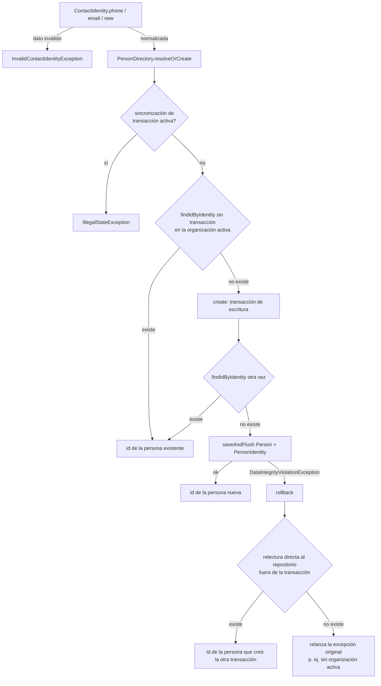
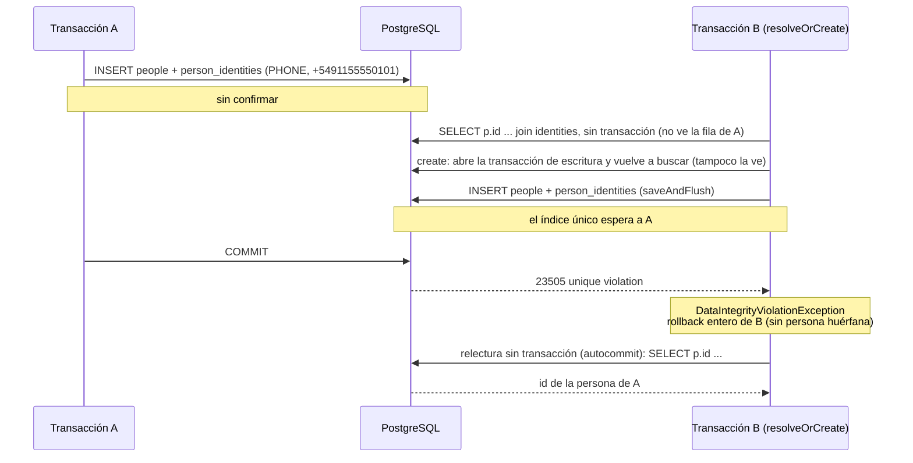

# Personas e identidades de contacto

Issue #6. Decisiones: D-003 (resolución de identidades) y P-026 (módulo y API), P-027 (identidad por tipo de dato),
P-028 (normalización), P-029 (concurrencia), P-030 (alcance de `Person`), P-031 (sin datos personales en los errores
de la base) en `docs/decisiones.md`. Se apoya en el multi-tenant de `docs/multi-tenant.md`.

## Resumen

Una `Person` es alguien que le escribe a una organización: es permanente y de una sola organización. Se la reconoce
por sus **identidades de contacto**: un teléfono, un email o el id que le da un canal (Instagram, Messenger,
Telegram). Una identidad es **tipo de dato + valor normalizado** (P-027), no canal + id: el mismo teléfono por
WhatsApp y por SMS es la misma identidad.

El módulo `people` expone una sola operación: `PersonDirectory.resolveOrCreate(ContactIdentity)`. Si en la
organización activa ya hay una persona con esa identidad, devuelve su id; si no, crea una persona nueva con esa única
identidad y devuelve el id nuevo (D-003). Antes de buscar, la identidad ya está normalizada (teléfono a E.164, email en
minúsculas), así que «+54 9 11 5555-0101» y «+5491155550101» son la misma persona.

Se va a activar con cada mensaje entrante: el flujo entrante (#10) resuelve la persona del remitente antes de guardar
el mensaje (y antes de registrar la actividad en su oportunidad). Hoy nadie la llama todavía fuera de los tests.

Fuera de #6 (P-030): nombre de la persona, endpoints REST, agregar una segunda identidad a una persona existente y
fusión de duplicados.

## Piezas

Módulo `people` (`backend/src/main/java/com/communicatorone/people/`). No depende de ningún otro módulo: la
organización la asigna y filtra Hibernate con `@TenantId` (P-018).

| Clase | Visibilidad | Qué hace |
|---|---|---|
| `PersonDirectory` | pública (API) | `@Service` con `resolveOrCreate(ContactIdentity): UUID` (`PersonDirectory.java:26-31`), que busca sin transacción y solo si no encuentra llama a `create` (`PersonDirectory.java:33-40`). Recibe en el constructor el bean `TransactionTemplate` que arma Spring Boot y lo usa para la escritura (`PersonDirectory.java:20-24`). |
| `ContactIdentity` | pública (API) | `record (IdentityKind kind, String value)` que se normaliza en el constructor compacto (`ContactIdentity.java:14-17`), con fábricas `phone(raw)` y `email(raw)` (`ContactIdentity.java:19-25`). `toString` muestra solo el tipo (`ContactIdentity.java:27-30`). |
| `IdentityKind` | pública (API) | `PHONE`, `EMAIL`, `INSTAGRAM_USER`, `MESSENGER_USER`, `TELEGRAM_USER` (`IdentityKind.java:3-9`). |
| `InvalidContactIdentityException` | pública (API) | Unchecked, con constructor package-private; el mensaje es «Invalid <tipo> identity», sin el valor (`InvalidContactIdentityException.java:3-8`). |
| `Person` | package-private | Entidad de la tabla `people`: `id`, `@TenantId organizationId`, `createdAt` y la lista de identidades con `cascade = ALL` (`Person.java:23-35`). Fábrica `Person.identifiedBy(identity, clock)` (`Person.java:45-47`). |
| `PersonIdentity` | package-private | Entidad de la tabla `person_identities`: `id`, `@TenantId organizationId`, `kind` guardado por nombre y `value` (`PersonIdentity.java:18-29`). Se arma desde una `ContactIdentity` ya normalizada (`PersonIdentity.java:34-37`). |
| `PersonRepository` | package-private | `JpaRepository<Person, UUID>` con `findIdByIdentity(kind, value)`, un JPQL que hace join con las identidades y devuelve solo el id (`PersonRepository.java:11-12`). |

Los otros módulos solo ven el id de la persona (`UUID`, P-019) y el value object. La entidad persistida se llama
`PersonIdentity` y no `ContactIdentity` porque ese nombre es del value object público, el mismo que recibe
`ChannelAdapter.send(ContactIdentity to, …)` en `docs/vision.md` §5.

Dependencia nueva: `com.googlecode.libphonenumber:libphonenumber` 9.0.43, con la versión en la propiedad
`libphonenumber.version` (`backend/pom.xml:20`, `:68-72`). Para los tests se suma Awaitility (scope test, versión de
Boot, `backend/pom.xml:93-97`).

Configuración: `spring.datasource.hikari.data-source-properties.logServerErrorDetail: false`
(`backend/src/main/resources/application.yml:10-12`, P-031; ver «Datos personales»).

### Tipos de identidad

| `IdentityKind` | Qué es | Alcance |
|---|---|---|
| `PHONE` | Teléfono en E.164 | Global a los canales: WhatsApp, SMS y llamadas comparten la identidad. |
| `EMAIL` | Email en minúsculas | Global a los canales. |
| `INSTAGRAM_USER` | IGSID (id de Instagram por página) | Solo Instagram. |
| `MESSENGER_USER` | PSID (id de Messenger por página) | Solo Messenger. |
| `TELEGRAM_USER` | Id de usuario de Telegram | Solo Telegram. |

`people` no conoce canales. Cada adaptador decide qué tipo sale de su payload: por ejemplo, el `wa_id` de WhatsApp
(dígitos sin `+`) lo pasa como `PHONE` anteponiéndole el `+` (#11). `WEBCHAT_VISITOR` y `WHATSAPP_USER` (BSUID) se
agregan con sus tareas.

## Contrato de uso

```java
UUID personId = personDirectory.resolveOrCreate(ContactIdentity.phone("+54 9 11 5555-0101"));
```

Quien llama a `resolveOrCreate`:

1. **No tiene una transacción abierta.** Si tiene que crear, la operación abre la suya; y si hay sincronización de
   transacción activa (una transacción real o un ámbito `SUPPORTS`), lanza `IllegalStateException` sin tocar la base
   (`PersonDirectory.java:28-29`). Es la misma comprobación de transacción que hace `CurrentOrganization.runAs`,
   sin la del `EntityManager` abierto.
2. **Tiene organización activa:** corre dentro de `currentOrganization.callAs(organizationId, ...)` (webhooks, jobs)
   o en un request con operador autenticado. Sin organización, la creación falla con
   `DataIntegrityViolationException` por la FK de `organization_id` contra el centinela, y no queda nada guardado.
3. **Construye la `ContactIdentity` antes**, y atrapa `InvalidContactIdentityException` si el dato que trae el proveedor
   no es válido.

Orden para el flujo entrante (#10): tres transacciones de escritura, una por paso (más la de solo lectura de
`isRecorded`). La persona se confirma en la suya **antes** de la oportunidad (`OpportunityTracker.recordActivity`, con
su propia transacción; ver `docs/oportunidades.md`) y del mensaje (`Timeline.recordReceived`, también con la suya; ver
`docs/mensajes.md`). El mensaje duplicado se descarta con `Timeline.isRecorded` antes de `recordActivity`, para que un
reenvío del proveedor no cuente como actividad.

```java
currentOrganization.callAs(organizationId, () -> {
    var personId = personDirectory.resolveOrCreate(identity);                     // tx 1
    if (timeline.isRecorded(channelAccountId, externalId)) {                      // solo lectura
        return null;                                                              // reenvío: no cuenta como actividad
    }
    var opportunityId = opportunityTracker.recordActivity(personId, source);      // tx 2
    var recorded = timeline.recordReceived(new ReceivedMessage(personId, opportunityId, channelAccountId,
            channel, externalId, content, occurredAt));                           // tx 3
    // #10 publica «mensaje recibido» solo si !recorded.duplicate()
    return recorded;
});
```

`isRecorded` no es autoritativo (dos copias en paralelo pueden pasarlo las dos); lo autoritativo es
`RecordedMessage.duplicate`.

No se envuelve todo el flujo en un `@Transactional`: `resolveOrCreate` y `recordActivity` lo rechazarían. Si lo que
sigue falla, la persona ya creada queda (sin mensajes), y el reintento del webhook la encuentra en vez de crear otra.

## Diagramas

Resolución:



Carrera entre dos resoluciones de la misma identidad nueva en la misma organización:



## Flujo en detalle

### Normalización (`ContactIdentity`)

El constructor compacto rechaza un `kind` nulo con `NullPointerException` y reemplaza `value` por su forma normalizada
(`ContactIdentity.java:14-17`). Como lo hace el constructor, no existe una `ContactIdentity` sin normalizar y
`equals` compara valores normalizados. Para todos los tipos, `null`, vacío o en blanco lanza
`InvalidContactIdentityException`, y el resto se recorta con `strip()` (`ContactIdentity.java:32-36`). Después,
un `switch` sobre el tipo (`ContactIdentity.java:37-41`):

- **Teléfono** (`ContactIdentity.java:44-54`): con el `PhoneNumberUtil` de la constante estática `PHONE_NUMBERS`
  (`ContactIdentity.java:12`), `parse(valor, "ZZ")`, todo en un único `try`. La región `ZZ` es «desconocida»:
  libphonenumber solo acepta números en formato internacional, con `+`. Si no parsea (`NumberParseException`), si trae
  extensión (`hasExtension()`, por ejemplo «x1» o «ext. 2») o si no es un número posible (`isPossibleNumber`, que mira
  longitud por país), `InvalidContactIdentityException` (`ContactIdentity.java:47-48`). La extensión se rechaza
  porque E.164 no la representa: se perdería y dos internos distintos quedarían como la misma identidad. Si pasa, se
  guarda en E.164. No se usa región por defecto porque la organización no tiene país y una región equivocada
  adjudicaría el número a otra persona sin avisar; no se usa `isValidNumber` porque con metadata vieja rechazaría
  números reales (P-028).
- **Email** (`ContactIdentity.java:56-69`): `isWellFormedEmail` (`ContactIdentity.java:63-69`) exige exactamente
  una «@», con parte local y dominio no vacíos, y ningún espacio interno (`Character::isWhitespace`; los de los
  extremos ya los sacó el `strip()`). Si pasa, minúsculas con `Locale.ROOT`. No toca puntos ni alias (`+ventas`) ni
  valida nada más (ni el dominio ni los caracteres permitidos).
- **Ids de canal** (`INSTAGRAM_USER`, `MESSENGER_USER`, `TELEGRAM_USER`): solo `strip()`. Respetan mayúsculas.

Ejemplos (salidas de los tests de `ContactIdentityTest` salvo donde se indica):

| Entrada | Resultado |
|---|---|
| `phone("+54 9 11 5555-0101")`, `phone(" +5491155550101 ")`, `phone("+54 (9 11) 5555 0101")` | `PHONE` `+5491155550101` |
| `phone("+1 (202) 555-0143")`, `phone("+1 202-555-0143")` | `PHONE` `+12025550143` |
| `phone("+34 612 34 56 78")`, `phone("+34 612-345-678 ")` | `PHONE` `+34612345678` |
| `phone("11 5555-0101")`, `phone("011 5555-0101")`, `phone("5491155550101")` | `InvalidContactIdentityException` (sin `+`) |
| `phone("+54 12")`, `phone("hola")` | `InvalidContactIdentityException` (no es un número posible) |
| `phone("+1 202-555-0143 x1")`, `phone("+54 9 11 5555-0101 ext. 2")` | `InvalidContactIdentityException` (con extensión) |
| `email("  Ana.Perez+Ventas@Acme.TEST ")` | `EMAIL` `ana.perez+ventas@acme.test` |
| `email("ana.perez.acme.test")`, `email("@")`, `email("ana@")`, `email("@acme.test")`, `email("a@b@c")`, `email("ana perez@acme.test")` | `InvalidContactIdentityException` |
| `email("")`, `email("   ")` | `InvalidContactIdentityException` (`identityWithoutValueIsRejected`) |
| `new ContactIdentity(TELEGRAM_USER, "  AbC-123_xY ")` | `TELEGRAM_USER` `AbC-123_xY` (conserva las mayúsculas) |
| `new ContactIdentity(null, "ana@acme.test")` | `NullPointerException` |
| `phone("+54 9 11 5555-0101").toString()` | `ContactIdentity[PHONE]` |
| Mensaje de la excepción de un teléfono inválido | `Invalid PHONE identity` |

### Resolución (`PersonDirectory.resolveOrCreate`)

`resolveOrCreate` (`PersonDirectory.java:26-31`) y `create` (`PersonDirectory.java:33-40`):

1. Rechaza una identidad nula (`NullPointerException`) y, con `Assert.state`, la sincronización de transacción activa
   (`IllegalStateException`, «A person is resolved in its own transaction, not inside an open one»;
   `PersonDirectory.java:27-29`).
2. Busca con `findIdByIdentity(kind, value)` **sin transacción** (`PersonDirectory.java:30`). El JPQL
   (`PersonRepository.java:11-12`) pasa por `@TenantId`, así que solo ve personas e identidades de la organización
   activa: la misma identidad en otra organización es otra persona. Spring Data no le pone transacción por defecto a
   un `@Query` declarado en la interfaz: la consulta pasa por el `EntityManager` compartido de Spring, que abre una
   sesión para esa consulta con la organización del `callAs` o del usuario, y corre en autocommit. Si encuentra,
   devuelve el id sin abrir ninguna transacción de escritura: es el camino de cada mensaje de una persona conocida.
3. Si no encuentra, `create` abre la transacción de escritura con el `TransactionTemplate`, vuelve a buscar (por si
   otra transacción la confirmó entre medio) y, si sigue sin estar, crea `Person.identifiedBy(identity, clock)`
   (`created_at` = `clock.instant()`, con una sola `PersonIdentity`) y hace `saveAndFlush`
   (`PersonDirectory.java:35-36`). La cascada inserta la persona y su identidad; el `@JoinColumn(name =
   "person_id", nullable = false, updatable = false)` (`Person.java:33-35`) hace que la identidad se inserte ya con
   `person_id`. Hibernate asigna `organization_id` a las dos filas. El `flush` adentro del callback hace que una
   violación salga como `DataIntegrityViolationException` ahí mismo, y no en el commit.
4. Si el `INSERT` choca con el `UNIQUE (organization_id, kind, value)`, la transacción de escritura se deshace entera y
   se relee con la misma consulta sin transacción del paso 2 (`PersonDirectory.java:37-38`). Con READ COMMITTED (el
   default de PostgreSQL) ve la persona que confirmó la otra transacción y devuelve su id. Si no hay nada, relanza la
   excepción original.

El caso «sin organización» pasa por el mismo camino: las búsquedas filtran por el centinela y no encuentran nada, el
`INSERT` falla por la FK de `organization_id` contra `organizations`, la relectura tampoco encuentra nada y sale la
`DataIntegrityViolationException` original.

Por qué la operación tiene que tener su propia transacción: en PostgreSQL una violación de restricción aborta la
transacción en curso, así que la relectura dentro de una transacción externa fallaría. Por eso el guard del paso 1.

## Esquema

`backend/src/main/resources/db/migration/V3__create_people.sql`:

```sql
CREATE TABLE people (
    id UUID PRIMARY KEY,
    organization_id UUID NOT NULL REFERENCES organizations (id),
    created_at TIMESTAMPTZ NOT NULL,
    CONSTRAINT people_id_organization_id_key UNIQUE (id, organization_id)
);

CREATE INDEX people_organization_id_idx ON people (organization_id);

CREATE TABLE person_identities (
    id UUID PRIMARY KEY,
    organization_id UUID NOT NULL REFERENCES organizations (id),
    person_id UUID NOT NULL,
    kind TEXT NOT NULL,
    value TEXT NOT NULL,
    CONSTRAINT person_identities_person_id_organization_id_fkey
        FOREIGN KEY (person_id, organization_id) REFERENCES people (id, organization_id),
    CONSTRAINT person_identities_organization_id_kind_value_key UNIQUE (organization_id, kind, value)
);

CREATE INDEX person_identities_organization_id_idx ON person_identities (organization_id);
CREATE INDEX person_identities_person_id_idx ON person_identities (person_id);
```

- La restricción `person_identities_organization_id_kind_value_key` (`V3__create_people.sql:18`) es la que hace única
  una identidad por organización y resuelve la carrera (P-029).
- `person_identities_organization_id_idx` (`V3__create_people.sql:21`) es redundante con ese `UNIQUE`, que empieza por
  `organization_id`; se creó antes de la excepción de `.claude/rules/flyway.md` y se puede borrar en una migración
  posterior si se quiere.
- `kind` es `TEXT` sin `CHECK`, como `operators.role`: los tipos nuevos no necesitan migración.
- La base no normaliza: quien inserte identidades por SQL tiene que guardarlas ya normalizadas (E.164, email en
  minúsculas), o no van a coincidir con las de la app.
- La FK compuesta `person_identities_person_id_organization_id_fkey` (`V3__create_people.sql:16-17`) apunta a
  `people (id, organization_id)`: la base garantiza que una identidad es de la misma organización que su persona,
  aunque alguien inserte por SQL. Para eso `people` lleva `UNIQUE (id, organization_id)`
  (`people_id_organization_id_key`, `V3__create_people.sql:5`), redundante con la clave primaria pero necesario como
  destino de la FK.

Fila de ejemplo después de `resolveOrCreate(ContactIdentity.phone("+54 9 11 5555-0101"))` con ámbito Acme
(`PersonDirectoryTest.unknownIdentityCreatesANewPerson`):

```
people:             id = <personId>, organization_id = <Acme>, created_at = 2026-03-02 09:00:00+00
person_identities:  person_id = <personId>, organization_id = <Acme>, kind = PHONE, value = +5491155550101
```

## Datos personales

Teléfonos y emails no tienen que llegar a logs ni a mensajes de error (`.claude/rules/java.md`):

- `ContactIdentity.toString()` muestra solo el tipo, `ContactIdentity[PHONE]` (`ContactIdentity.java:27-30`), así que
  loguear o concatenar una identidad no expone el dato.
- `InvalidContactIdentityException` lleva solo el tipo en el mensaje (`InvalidContactIdentityException.java:5-7`).
- **P-031**: en una carrera, PostgreSQL contesta la violación del `UNIQUE` con un `DETAIL` que trae los valores
  (`Key (organization_id, kind, value)=(…, PHONE, +5491155550101) already exists`). Con
  `logServerErrorDetail: false` (`application.yml:10-12`), pgjdbc no lo pone en el mensaje de la excepción. Lo que
  queda en el log de la app es el WARN de Hibernate con el SQLState y el nombre de la restricción, por ejemplo (salida
  real del test de la carrera):

  ```
  WARN ... org.hibernate.orm.jdbc.error : HHH000247: ErrorCode: 0, SQLState: 23505
  WARN ... org.hibernate.orm.jdbc.error : ERROR: duplicate key value violates unique constraint "person_identities_organization_id_kind_value_key"
  ```

  La propiedad es global (se pierde el valor en conflicto de toda violación) y aplica al Hikari que arma Spring Boot,
  que usan también Flyway y los tests. Un `DataSource` armado a mano no la hereda: tiene que llevarla.

## Tests

`backend/src/test/java/com/communicatorone/people/ContactIdentityTest.java` (sin Spring). Los rechazos verifican,
además, que el mensaje de la excepción no contenga el valor ni sus dígitos (`assertRejectedWithoutRevealing`).

| Test | Qué cubre |
|---|---|
| `phoneWrittenInDifferentFormatsIsNormalizedToTheSameE164Identity` | Argentina, Estados Unidos y España, cada uno escrito de tres formas: todas dan `PHONE` con el mismo valor E.164. |
| `phoneWithoutInternationalPrefixIsRejected` | «11 5555-0101», «011 5555-0101» y «5491155550101» (sin `+`) se rechazan sin revelar el número. |
| `impossiblePhoneIsRejected` | «+54 12» y «hola» se rechazan sin revelar el valor. |
| `phoneWithExtensionIsRejected` | «+1 202-555-0143 x1» y «+54 9 11 5555-0101 ext. 2» se rechazan sin revelar el número. |
| `emailIsNormalizedToLowercaseWithoutSurroundingSpaces` | Recorta y pasa a minúsculas, conservando el alias `+ventas`. |
| `malformedEmailIsRejected` | Sin «@», solo «@», sin parte local, sin dominio, con dos «@» o con un espacio interno: se rechaza sin revelar el valor (vacío y en blanco los cubre `identityWithoutValueIsRejected`). |
| `channelUserIdKeepsItsCaseWithoutSurroundingSpaces` | Para los tres `*_USER`: recorta y conserva las mayúsculas. |
| `identityWithoutKindIsRejected` | `kind` nulo da `NullPointerException`. |
| `identityWithoutValueIsRejected` | Para cada tipo, valor nulo, vacío o en blanco da `InvalidContactIdentityException`. |
| `identityDoesNotRevealItsValueWhenPrinted` | `toString` de un teléfono y de un email muestra el tipo y no el dato. |

`backend/src/test/java/com/communicatorone/people/PersonDirectoryTest.java` (`@SpringBootTest` con `RANDOM_PORT` +
Testcontainers, sin `@Transactional`; reloj fijo en `MutableClock.INITIAL_INSTANT`). Cada test crea sus organizaciones
y resuelve con `callAs` (`resolveIn`). Las filas se leen con `PeopleFixture` (`JdbcTemplate`, filtrando por
`organization_id` salvo `identitiesInAnyOrganizationWithValue`, que busca en todas).

| Test | Qué cubre |
|---|---|
| `unknownIdentityCreatesANewPerson` | Crea una persona con `created_at` del reloj y una identidad normalizada. |
| `knownIdentityWrittenDifferentlyResolvesToTheSamePerson` | El mismo teléfono escrito distinto devuelve la misma persona y no crea filas. |
| `knownEmailResolvesToTheSamePersonRegardlessOfCase` | Lo mismo con un email en otras mayúsculas. |
| `sameExternalIdOnDifferentChannelsBelongsToDifferentPeople` | `TELEGRAM_USER` y `MESSENGER_USER` con el mismo «12345» son dos personas. |
| `sameIdentityInAnotherOrganizationResolvesToADifferentPerson` | El mismo teléfono en Globex es otra persona, y Acme sigue resolviendo a la suya: el JPQL con join filtra por organización. |
| `concurrentResolutionOfTheSameNewIdentityCreatesASinglePerson` | La carrera del diagrama, determinista: un hilo rival inserta la persona y la identidad sin confirmar (`PeopleFixture.rivalStartsCreatingPerson`); la resolución corre en otro hilo; Awaitility espera en `pg_stat_activity` otra sesión bloqueada por un lock sobre `person_identities` (`anotherSessionIsWaitingToWriteIdentities`) y recién ahí confirma el rival. Afirma que devuelve el id del rival, que hay una sola persona y una sola identidad, y que la salida capturada nombra la restricción sin contener el teléfono (P-031). |
| `identityCannotBeResolvedWithoutOrganization` | Sin ámbito ni usuario: `DataIntegrityViolationException` y ninguna identidad con ese valor en ninguna organización. |
| `identityCannotBelongToAPersonOfAnotherOrganization` | Insertar por SQL (`PeopleFixture.insertIdentity`) una identidad de Acme para una persona de Globex lanza `DataIntegrityViolationException` (FK compuesta): Acme sigue sin identidades y Globex conserva solo la suya. |
| `identityCannotBeResolvedInsideAnOpenTransactionalScope` | Parametrizado con `Propagation.REQUIRED` (transacción real) y `Propagation.SUPPORTS` (ámbito sin transacción): `IllegalStateException` y nada guardado. |

`TenantIsolationTest.everyBusinessEntityBelongsToAnOrganization` cubre que `Person` y `PersonIdentity` lleven
`@TenantId`, y `ModularStructureTest` que `people` no dependa de internos de otros módulos.

## Riesgos y pendientes

- **Argentina**: «+54 11 5555-0101» da `+541155550101` y «+54 9 11 5555-0101» da `+5491155550101` (el `9` de los
  móviles). Son dos identidades y, por lo tanto, dos personas. Se acepta por D-003 hasta la revisión de duplicados.
- **México**: el `1` que se anteponía a los móviles (`+52 1 55 1234 5678`) no es un número posible para libphonenumber
  9.0.43 y se rechaza con `InvalidContactIdentityException`; `+52 55 1234 5678` pasa. El adaptador que reciba el
  formato viejo tiene que quitar el `1`. Estos dos casos no están en los tests.
- **WhatsApp BSUID**: cuando WhatsApp mande el id de usuario sin teléfono, esa persona va a quedar duplicada respecto
  de la que entró por teléfono hasta que existan `WHATSAPP_USER` y la fusión.
- **PSID/IGSID**: los ids de Messenger e Instagram son por página. La misma persona escribiendo a dos páginas de la
  organización queda como dos personas (P-027, aceptable por D-003).
- **Log del servidor PostgreSQL**: P-031 limpia los mensajes de la app, pero el servidor sigue guardando el `DETAIL`
  con el valor en cada carrera. Pendiente para el deploy: `log_error_verbosity = terse` por rol o en el parameter
  group.
- **Metadata de libphonenumber**: se actualiza seguido; la versión está fija en `backend/pom.xml:20`.
- El test de la carrera depende de `pg_stat_activity` (PostgreSQL).
