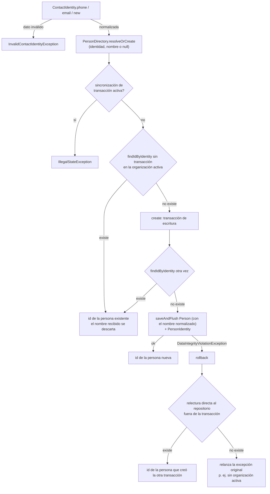
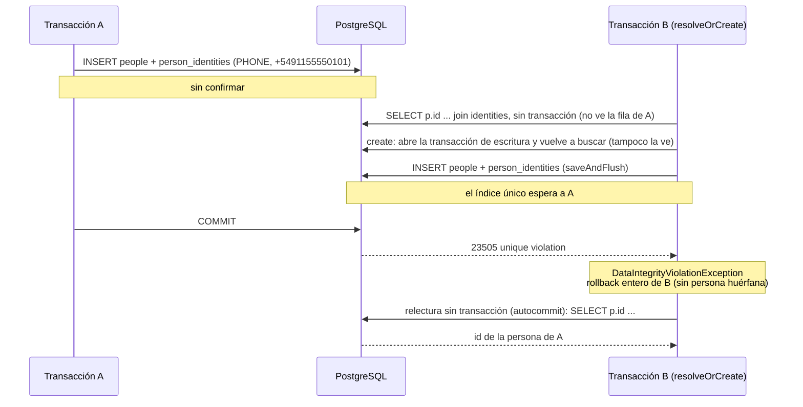

# Personas e identidades de contacto

Issues #6 y #48 (parte de #11, nombre visible). Decisiones: D-003 (resolución de identidades) y P-026 (módulo y API),
P-027 (identidad por tipo de dato), P-028 (normalización), P-029 (concurrencia), P-030 (alcance de `Person`), P-031
(sin datos personales en los errores de la base) y P-054 (nombre visible desde el perfil del canal) en
`docs/decisiones.md`. Se apoya en el multi-tenant de `docs/multi-tenant.md`.

## Resumen

Una `Person` es alguien que le escribe a una organización: es permanente y de una sola organización. Se la reconoce
por sus **identidades de contacto**: un teléfono, un email o el id que le da un canal (Instagram, Messenger,
Telegram). Una identidad es **tipo de dato + valor normalizado** (P-027), no canal + id: el mismo teléfono por
WhatsApp y por SMS es la misma identidad.

El módulo `people` expone una sola operación, en dos sobrecargas: `PersonDirectory.resolveOrCreate(ContactIdentity,
String displayName)` y `resolveOrCreate(ContactIdentity)`, que pasa el nombre nulo. Si en la organización activa ya hay
una persona con esa identidad, devuelve su id; si no, crea una persona nueva con esa única identidad y devuelve el id
nuevo (D-003). Antes de buscar, la identidad ya está normalizada (teléfono a E.164, email en minúsculas), así que
«+54 9 11 5555-0101» y «+5491155550101» son la misma persona.

Desde #48, la persona tiene un **nombre visible** opcional (`people.display_name`), que sale del perfil del canal (en
WhatsApp, `contacts[].profile.name`). Se guarda **solo al crear** la persona, limpio de caracteres de control y
separadores raros y truncado a 200 code points; a una persona conocida nunca se le cambia, tenga o no nombre (P-054,
ver «Nombre visible»).

La llama el pipeline entrante (`InboundPipeline`, #10, `docs/canales.md`) con cada mensaje nuevo: resuelve la persona
del remitente antes de registrar la actividad en su oportunidad y de guardar el mensaje. Como el pipeline todavía no
tiene endpoint (P-049), hoy solo se ejercita desde los tests.

Fuera de #6 (P-030): endpoints REST, agregar una segunda identidad a una persona existente y fusión de duplicados.
El nombre de la persona, que #6 también dejaba afuera, llegó con #48 (P-030 ajustada en #10 y en #48, P-054). Fuera
de #48: leer o mostrar el nombre (no hay accesor ni endpoint), editarlo a mano y completarlo en las personas que ya
existían (no hay de dónde sacarlo).

## Piezas

Módulo `people` (`backend/src/main/java/com/communicatorone/people/`). No depende de ningún otro módulo: la
organización la asigna y filtra Hibernate con `@TenantId` (P-018).

| Clase | Visibilidad | Qué hace |
|---|---|---|
| `PersonDirectory` | pública (API) | `@Service` con `resolveOrCreate(ContactIdentity, String displayName): UUID` (`PersonDirectory.java:30-35`), que busca sin transacción y solo si no encuentra llama a `create` con el nombre (`PersonDirectory.java:37-44`), y la sobrecarga `resolveOrCreate(ContactIdentity): UUID`, que pasa el nombre nulo (`PersonDirectory.java:26-28`), para quien no conoce el nombre (hoy, los tests y fixtures). Recibe en el constructor el bean `TransactionTemplate` que arma Spring Boot y lo usa para la escritura (`PersonDirectory.java:20-24`). |
| `ContactIdentity` | pública (API) | `record (IdentityKind kind, String value)` que se normaliza en el constructor compacto (`ContactIdentity.java:14-17`), con fábricas `phone(raw)` y `email(raw)` (`ContactIdentity.java:19-25`). `toString` muestra solo el tipo (`ContactIdentity.java:27-30`). |
| `IdentityKind` | pública (API) | `PHONE`, `EMAIL`, `INSTAGRAM_USER`, `MESSENGER_USER`, `TELEGRAM_USER` (`IdentityKind.java:3-9`). |
| `InvalidContactIdentityException` | pública (API) | Unchecked, con constructor package-private; el mensaje es «Invalid <tipo> identity», sin el valor (`InvalidContactIdentityException.java:3-8`). |
| `Person` | package-private | Entidad de la tabla `people`: `id`, `@TenantId organizationId`, `createdAt`, `displayName` (desde #48, nulo, mapeado a `display_name` sin `@Column`, `Person.java:37`) y la lista de identidades con `cascade = ALL` (`Person.java:27-41`). Fábrica `Person.identifiedBy(identity, displayName, clock)` (`Person.java:52-54`), que normaliza el nombre con el privado `normalizedDisplayName` (`Person.java:56-65`). Sin accesor del nombre: nadie lo lee todavía (los tests lo leen por JDBC). |
| `PersonIdentity` | package-private | Entidad de la tabla `person_identities`: `id`, `@TenantId organizationId`, `kind` guardado por nombre y `value` (`PersonIdentity.java:18-29`). Se arma desde una `ContactIdentity` ya normalizada (`PersonIdentity.java:34-37`). |
| `PersonRepository` | package-private | `JpaRepository<Person, UUID>` con `findIdByIdentity(kind, value)`, un JPQL que hace join con las identidades y devuelve solo el id (`PersonRepository.java:11-12`). |

Los otros módulos solo ven el id de la persona (`UUID`, P-019), el value object y, al crear, le pasan el nombre como
`String`. La entidad persistida se llama
`PersonIdentity` y no `ContactIdentity` porque ese nombre es del value object público, el mismo que recibe
`ChannelAdapter.send(ContactIdentity to, …)` (`docs/vision.md` §5; en el código desde #43, `ChannelAdapter.java:16`,
que además lo devuelve como remitente en `InboundMessage.sender`, `docs/canales.md`).

Dependencia nueva: `com.googlecode.libphonenumber:libphonenumber` 9.0.43, con la versión en la propiedad
`libphonenumber.version` (`backend/pom.xml:20`, `:68-72`). Para los tests se suma Awaitility (scope test, versión de
Boot, `backend/pom.xml:93-97`).

Configuración: `spring.datasource.hikari.data-source-properties.logServerErrorDetail: false`
(`backend/src/main/resources/application.yml:10-12`, P-031; ver «Datos personales»).

### Tipos de identidad

| `IdentityKind` | Qué es | Alcance |
|---|---|---|
| `PHONE` | Teléfono en E.164 | Global a los canales: WhatsApp, SMS y llamadas comparten la identidad. |
| `EMAIL` | Email en minúsculas | Global a los canales. |
| `INSTAGRAM_USER` | IGSID (id de Instagram por página) | Solo Instagram. |
| `MESSENGER_USER` | PSID (id de Messenger por página) | Solo Messenger. |
| `TELEGRAM_USER` | Id de usuario de Telegram | Solo Telegram. |

`people` no conoce canales. Cada adaptador decide qué tipo sale de su payload: por ejemplo, el adaptador de WhatsApp
(#47, P-053) pasa el `wa_id` (dígitos sin `+`, el `from` del mensaje) como `PHONE` anteponiéndole el `+`; a un `wa_id`
mexicano con el `1` móvil viejo (`521` y diez dígitos) le quita el `1`; e ignora el mensaje cuyo remitente no es
solo dígitos ASCII (un BSUID, letras, separadores) o no es un teléfono posible, hasta que exista `WHATSAPP_USER`
(`docs/canales.md`, «Adaptador `WHATSAPP`»). Exige los dígitos antes de llamar a `ContactIdentity.phone` porque
libphonenumber es laxo con letras de teclado, dígitos no ASCII y separadores.
`WEBCHAT_VISITOR` y `WHATSAPP_USER` (BSUID) se agregan con sus tareas.

## Contrato de uso

```java
UUID personId = personDirectory.resolveOrCreate(ContactIdentity.phone("+54 9 11 5555-0101"), "Ana Pérez");
UUID samePerson = personDirectory.resolveOrCreate(ContactIdentity.phone("+5491155550101"), "Ana María Pérez");
// samePerson == personId, y la persona sigue llamándose «Ana Pérez»
UUID unnamed = personDirectory.resolveOrCreate(ContactIdentity.email("juan@acme.test"));   // nombre nulo
```

Quien llama a `resolveOrCreate`:

1. **No tiene una transacción abierta.** Si tiene que crear, la operación abre la suya; y si hay sincronización de
   transacción activa (una transacción real o un ámbito `SUPPORTS`), lanza `IllegalStateException` sin tocar la base
   (`PersonDirectory.java:32-33`). Es la misma comprobación de transacción que hace `CurrentOrganization.runAs`,
   sin la del `EntityManager` abierto.
2. **Tiene organización activa:** corre dentro de `currentOrganization.callAs(organizationId, ...)` (webhooks, jobs)
   o en un request con operador autenticado. Sin organización, la creación falla con
   `DataIntegrityViolationException` por la FK de `organization_id` contra el centinela, y no queda nada guardado.
3. **Construye la `ContactIdentity` antes**, y atrapa `InvalidContactIdentityException` si el dato que trae el proveedor
   no es válido.
4. **Pasa el nombre tal como lo trae el canal, o nulo.** No hace falta limpiarlo: lo normaliza `Person` al crear (ver
   «Nombre visible»). Si la persona ya existe, el nombre se descarta sin mirarlo.

Orden en el flujo entrante, como quedó en `InboundPipeline.accept` (#10, `InboundPipeline.java:69-81`; detalle en
`docs/canales.md`): dentro del `runAs` de la organización de la cuenta de canal, primero `Timeline.isRecorded` (solo
lectura), para que un reenvío del proveedor no cree la persona ni cuente como actividad, y después tres transacciones
de escritura, una por paso. La persona se confirma en la suya **antes** de la oportunidad
(`OpportunityTracker.recordActivity`, con su propia transacción; ver `docs/oportunidades.md`) y del mensaje
(`Timeline.recordReceived`, también con la suya; ver `docs/mensajes.md`). La identidad es el `sender` del
`InboundMessage`, que el adaptador ya construyó y normalizó: si el dato del proveedor es inválido, el adaptador
rechaza el payload entero con `InvalidWebhookPayloadException` antes de que se escriba nada. El nombre es el
`senderDisplayName` del mismo `InboundMessage` (desde #48): el de WhatsApp lo saca de `contacts[].profile.name` y el
sandbox lo deja nulo (`docs/canales.md`).

```java
if (timeline.isRecorded(account.id(), inbound.externalId())) {                    // solo lectura
    return;                                                       // reenvío: sin persona, actividad ni evento
}
var personId = people.resolveOrCreate(inbound.sender(), inbound.senderDisplayName());   // tx 1
var opportunityId = opportunities.recordActivity(personId, account.channelType().name());   // tx 2
var recorded = timeline.recordReceived(new ReceivedMessage(personId, opportunityId, account.id(),
        account.channelType(), inbound.externalId(), inbound.content(), inbound.occurredAt()));   // tx 3
if (!recorded.duplicate()) {
    events.publishEvent(new MessageReceived(...));
}
```

`isRecorded` no es autoritativo (dos copias en paralelo pueden pasarlo las dos y las dos resuelven la misma persona,
P-029); lo autoritativo es `RecordedMessage.duplicate`.

No se envuelve todo el flujo en un `@Transactional`: `resolveOrCreate` y `recordActivity` lo rechazarían. Si lo que
sigue falla, la persona ya creada queda (sin mensajes), y el reintento del webhook la encuentra en vez de crear otra.

## Diagramas

Resolución:



Carrera entre dos resoluciones de la misma identidad nueva en la misma organización:



## Flujo en detalle

### Normalización (`ContactIdentity`)

El constructor compacto rechaza un `kind` nulo con `NullPointerException` y reemplaza `value` por su forma normalizada
(`ContactIdentity.java:14-17`). Como lo hace el constructor, no existe una `ContactIdentity` sin normalizar y
`equals` compara valores normalizados. Para todos los tipos, `null`, vacío o en blanco lanza
`InvalidContactIdentityException`, y el resto se recorta con `strip()` (`ContactIdentity.java:32-36`). Después,
un `switch` sobre el tipo (`ContactIdentity.java:37-41`):

- **Teléfono** (`ContactIdentity.java:44-54`): con el `PhoneNumberUtil` de la constante estática `PHONE_NUMBERS`
  (`ContactIdentity.java:12`), `parse(valor, "ZZ")`, todo en un único `try`. La región `ZZ` es «desconocida»:
  libphonenumber solo acepta números en formato internacional, con `+`. Si no parsea (`NumberParseException`), si trae
  extensión (`hasExtension()`, por ejemplo «x1» o «ext. 2») o si no es un número posible (`isPossibleNumber`, que mira
  longitud por país), `InvalidContactIdentityException` (`ContactIdentity.java:47-48`). La extensión se rechaza
  porque E.164 no la representa: se perdería y dos internos distintos quedarían como la misma identidad. Si pasa, se
  guarda en E.164. No se usa región por defecto porque la organización no tiene país y una región equivocada
  adjudicaría el número a otra persona sin avisar; no se usa `isValidNumber` porque con metadata vieja rechazaría
  números reales (P-028).
- **Email** (`ContactIdentity.java:56-69`): `isWellFormedEmail` (`ContactIdentity.java:63-69`) exige exactamente
  una «@», con parte local y dominio no vacíos, y ningún espacio interno (`Character::isWhitespace`; los de los
  extremos ya los sacó el `strip()`). Si pasa, minúsculas con `Locale.ROOT`. No toca puntos ni alias (`+ventas`) ni
  valida nada más (ni el dominio ni los caracteres permitidos).
- **Ids de canal** (`INSTAGRAM_USER`, `MESSENGER_USER`, `TELEGRAM_USER`): solo `strip()`. Respetan mayúsculas.

Ejemplos (salidas de los tests de `ContactIdentityTest` salvo donde se indica):

| Entrada | Resultado |
|---|---|
| `phone("+54 9 11 5555-0101")`, `phone(" +5491155550101 ")`, `phone("+54 (9 11) 5555 0101")` | `PHONE` `+5491155550101` |
| `phone("+1 (202) 555-0143")`, `phone("+1 202-555-0143")` | `PHONE` `+12025550143` |
| `phone("+34 612 34 56 78")`, `phone("+34 612-345-678 ")` | `PHONE` `+34612345678` |
| `phone("11 5555-0101")`, `phone("011 5555-0101")`, `phone("5491155550101")` | `InvalidContactIdentityException` (sin `+`) |
| `phone("+54 12")`, `phone("hola")` | `InvalidContactIdentityException` (no es un número posible) |
| `phone("+1 202-555-0143 x1")`, `phone("+54 9 11 5555-0101 ext. 2")` | `InvalidContactIdentityException` (con extensión) |
| `email("  Ana.Perez+Ventas@Acme.TEST ")` | `EMAIL` `ana.perez+ventas@acme.test` |
| `email("ana.perez.acme.test")`, `email("@")`, `email("ana@")`, `email("@acme.test")`, `email("a@b@c")`, `email("ana perez@acme.test")` | `InvalidContactIdentityException` |
| `email("")`, `email("   ")` | `InvalidContactIdentityException` (`identityWithoutValueIsRejected`) |
| `new ContactIdentity(TELEGRAM_USER, "  AbC-123_xY ")` | `TELEGRAM_USER` `AbC-123_xY` (conserva las mayúsculas) |
| `new ContactIdentity(null, "ana@acme.test")` | `NullPointerException` |
| `phone("+54 9 11 5555-0101").toString()` | `ContactIdentity[PHONE]` |
| Mensaje de la excepción de un teléfono inválido | `Invalid PHONE identity` |

### Resolución (`PersonDirectory.resolveOrCreate`)

`resolveOrCreate` (`PersonDirectory.java:30-35`; la sobrecarga de un argumento, `:26-28`, solo llama a esta con el
nombre nulo) y `create` (`PersonDirectory.java:37-44`):

1. Rechaza una identidad nula (`NullPointerException`) y, con `Assert.state`, la sincronización de transacción activa
   (`IllegalStateException`, «A person is resolved in its own transaction, not inside an open one»;
   `PersonDirectory.java:31-33`).
2. Busca con `findIdByIdentity(kind, value)` **sin transacción** (`PersonDirectory.java:34`). El JPQL
   (`PersonRepository.java:11-12`) pasa por `@TenantId`, así que solo ve personas e identidades de la organización
   activa: la misma identidad en otra organización es otra persona. Spring Data no le pone transacción por defecto a
   un `@Query` declarado en la interfaz: la consulta pasa por el `EntityManager` compartido de Spring, que abre una
   sesión para esa consulta con la organización del `callAs` o del usuario, y corre en autocommit. Si encuentra,
   devuelve el id sin abrir ninguna transacción de escritura: es el camino de cada mensaje de una persona conocida. El
   nombre recibido no se usa (P-054).
3. Si no encuentra, `create` abre la transacción de escritura con el `TransactionTemplate`, vuelve a buscar (por si
   otra transacción la confirmó entre medio) y, si sigue sin estar, crea `Person.identifiedBy(identity, displayName,
   clock)` (`created_at` = `clock.instant()`, `display_name` = el nombre normalizado, con una sola `PersonIdentity`) y
   hace `saveAndFlush` (`PersonDirectory.java:39-40`). La cascada inserta la persona y su identidad; el
   `@JoinColumn(name = "person_id", nullable = false, updatable = false)` (`Person.java:39-41`) hace que la identidad se inserte ya con
   `person_id`. Hibernate asigna `organization_id` a las dos filas. El `flush` adentro del callback hace que una
   violación salga como `DataIntegrityViolationException` ahí mismo, y no en el commit.
4. Si el `INSERT` choca con el `UNIQUE (organization_id, kind, value)`, la transacción de escritura se deshace entera y
   se relee con la misma consulta sin transacción del paso 2 (`PersonDirectory.java:41-42`). Con READ COMMITTED (el
   default de PostgreSQL) ve la persona que confirmó la otra transacción y devuelve su id. Si no hay nada, relanza la
   excepción original.

El caso «sin organización» pasa por el mismo camino: las búsquedas filtran por el centinela y no encuentran nada, el
`INSERT` falla por la FK de `organization_id` contra `organizations`, la relectura tampoco encuentra nada y sale la
`DataIntegrityViolationException` original.

Por qué la operación tiene que tener su propia transacción: en PostgreSQL una violación de restricción aborta la
transacción en curso, así que la relectura dentro de una transacción externa fallaría. Por eso el guard del paso 1.

### Nombre visible (`Person.identifiedBy`)

Regla (P-054): **el nombre del perfil solo nombra al crear.** `resolveOrCreate` lo pasa a `create`, y `create` a
`Person.identifiedBy`, únicamente cuando la identidad no existe; si la persona ya existe, el nombre recibido se descarta
sin mirarlo y no hay ninguna escritura. Así:

- Una persona conocida sigue costando un `SELECT` sin transacción, como en #6 (P-029).
- Es idempotente ante reenvíos y desorden: un webhook viejo con otro nombre no puede pisar uno nuevo (y un reenvío
  del mismo mensaje ni siquiera llega a `resolveOrCreate`, porque lo corta `Timeline.isRecorded`, P-050).
- No va a pisar una futura edición manual del nombre por un operador.
- En la carrera de creación (diagrama de arriba) queda el nombre **del ganador**: el perdedor deshace su transacción
  entera, con su nombre, y devuelve el id de la persona que creó el otro.

Contracara aceptada: una persona creada sin nombre (por el sandbox, por un webhook de WhatsApp sin `contacts` o con un
perfil sin nombre, o antes del deploy de #48) no lo toma de un perfil posterior.

| Situación | Resultado |
|---|---|
| Identidad desconocida con `"Ana Pérez"` | Persona nueva con `display_name = Ana Pérez` |
| Identidad desconocida con `null` (o con la sobrecarga de un argumento) | Persona nueva con `display_name` nulo |
| Persona conocida «Ana Pérez», llega `"Ana María Pérez"` | Mismo id; sigue «Ana Pérez» |
| Persona conocida «Ana Pérez», llega `null` | Mismo id; sigue «Ana Pérez» |
| Persona conocida sin nombre, llega `"Ana Pérez"` | Mismo id; sigue sin nombre |
| El mismo teléfono en Acme con `"Ana Pérez"` y en Globex con `"Anita"` | Dos personas, cada una con su nombre (`@TenantId`) |
| Carrera: un rival crea la persona sin nombre mientras se resuelve con `"Ana Pérez"` | Queda la persona del rival, sin nombre |

**Normalización** (`Person.normalizedDisplayName`, `Person.java:56-65`, con las constantes de `Person.java:24-25`), al
crear la persona:

1. `null` da `null`.
2. Cada racha de caracteres que coincide con `UNPRINTABLE_AND_SPACE_RUNS` = `[\p{Cc}\p{Z}\p{Cs}]+` se reemplaza por
   **un solo** espacio: los de control (`\p{Cc}`: NUL, TAB, CR, LF, U+0085…), todos los separadores (`\p{Z}`: el
   espacio ASCII, NBSP U+00A0, U+2007, U+202F, el separador de línea U+2028 y el de párrafo U+2029) y los surrogates
   sueltos (`\p{Cs}`, mitades de un par sustituto sin su pareja). También colapsa espacios ASCII repetidos.
3. `strip()`.
4. Si pasa de `MAX_DISPLAY_NAME_LENGTH` = 200 **code points**, se corta en el code point 200 con `offsetByCodePoints`
   (nunca parte un par sustituto, así que un emoji no queda por la mitad) y se vuelve a hacer `strip()`, por si el
   corte dejó un espacio al final.
5. Si quedó vacío, `null`.

Conserva los caracteres de formato (`\p{Cf}`), como el ZWJ (U+200D) que une los emojis compuestos o las marcas de
dirección, y no toca mayúsculas ni acentos. La limpieza es de `people` y no del canal: el adaptador pasa el nombre tal
como llega (`docs/canales.md`).

| Entrada | `display_name` |
|---|---|
| `"  Ana Pérez  "`, `"Ana\nPérez"`, `"Ana\r\nPérez"`, `"Ana\u2028Pérez"`, `"Ana\tPérez\n"`, `"Ana\u0000Pérez"`, `"Ana\uD83DPérez"` (surrogate suelto), `"Ana\u00A0Pérez"`, `"Ana   Pérez"`, `"Ana Pérez"` | `Ana Pérez` |
| `"Ana 👩\u200D👩\u200D👧 Pérez"` | El mismo texto, con los ZWJ |
| `""`, `"   "`, `"\n\t"`, `"\u0000"`, `"\u2028 \r\n"`, `"\u00A0"`, `"\u2007\u202F\u00A0"` | `null` |
| 199 `a` + `😀` + `bbb` | 199 `a` + `😀` (200 code points, el emoji entero) |
| 300 `a` | 200 `a` |

## Esquema

`backend/src/main/resources/db/migration/V3__create_people.sql`:

```sql
CREATE TABLE people (
    id UUID PRIMARY KEY,
    organization_id UUID NOT NULL REFERENCES organizations (id),
    created_at TIMESTAMPTZ NOT NULL,
    CONSTRAINT people_id_organization_id_key UNIQUE (id, organization_id)
);

CREATE INDEX people_organization_id_idx ON people (organization_id);

CREATE TABLE person_identities (
    id UUID PRIMARY KEY,
    organization_id UUID NOT NULL REFERENCES organizations (id),
    person_id UUID NOT NULL,
    kind TEXT NOT NULL,
    value TEXT NOT NULL,
    CONSTRAINT person_identities_person_id_organization_id_fkey
        FOREIGN KEY (person_id, organization_id) REFERENCES people (id, organization_id),
    CONSTRAINT person_identities_organization_id_kind_value_key UNIQUE (organization_id, kind, value)
);

CREATE INDEX person_identities_organization_id_idx ON person_identities (organization_id);
CREATE INDEX person_identities_person_id_idx ON person_identities (person_id);
```

- La restricción `person_identities_organization_id_kind_value_key` (`V3__create_people.sql:18`) es la que hace única
  una identidad por organización y resuelve la carrera (P-029).
- `person_identities_organization_id_idx` (`V3__create_people.sql:21`) es redundante con ese `UNIQUE`, que empieza por
  `organization_id`; se creó antes de la excepción de `.claude/rules/flyway.md` y se puede borrar en una migración
  posterior si se quiere.
- `kind` es `TEXT` sin `CHECK`, como `operators.role`: los tipos nuevos no necesitan migración.
- La base no normaliza: quien inserte identidades por SQL tiene que guardarlas ya normalizadas (E.164, email en
  minúsculas), o no van a coincidir con las de la app.
- La FK compuesta `person_identities_person_id_organization_id_fkey` (`V3__create_people.sql:16-17`) apunta a
  `people (id, organization_id)`: la base garantiza que una identidad es de la misma organización que su persona,
  aunque alguien inserte por SQL. Para eso `people` lleva `UNIQUE (id, organization_id)`
  (`people_id_organization_id_key`, `V3__create_people.sql:5`), redundante con la clave primaria pero necesario como
  destino de la FK.

`backend/src/main/resources/db/migration/V8__add_display_name_to_people.sql` (#48):

```sql
ALTER TABLE people ADD COLUMN display_name TEXT;
```

- `display_name` es nula, sin default, sin índice (nadie busca por nombre) y sin `CHECK` de largo ni de caracteres: el
  largo y la limpieza los garantiza `Person` (como el id de `channel_accounts`, P-043). Quien inserte por SQL tiene que
  respetar la misma normalización.
- Las filas que ya existían quedan con `display_name` nulo: no hay backfill, porque el nombre del perfil no se guardó
  en ningún lado.

Fila de ejemplo después de `resolveOrCreate(ContactIdentity.phone("+54 9 11 5555-0101"), "Ana Pérez")` con ámbito
Acme (`PersonDirectoryTest.unknownIdentityResolvedWithANameCreatesAPersonWithThatName`):

```
people:             id = <personId>, organization_id = <Acme>, created_at = 2026-03-02 09:00:00+00,
                    display_name = Ana Pérez
person_identities:  person_id = <personId>, organization_id = <Acme>, kind = PHONE, value = +5491155550101
```

Con `resolveOrCreate(ContactIdentity.phone("+54 9 11 5555-0101"))` (`unknownIdentityCreatesANewPerson`), la misma
fila con `display_name = NULL`.

## Datos personales

Teléfonos y emails no tienen que llegar a logs ni a mensajes de error (`.claude/rules/java.md`):

- `ContactIdentity.toString()` muestra solo el tipo, `ContactIdentity[PHONE]` (`ContactIdentity.java:27-30`), así que
  loguear o concatenar una identidad no expone el dato.
- `InvalidContactIdentityException` lleva solo el tipo en el mensaje (`InvalidContactIdentityException.java:5-7`).
- **P-031**: en una carrera, PostgreSQL contesta la violación del `UNIQUE` con un `DETAIL` que trae los valores
  (`Key (organization_id, kind, value)=(…, PHONE, +5491155550101) already exists`). Con
  `logServerErrorDetail: false` (`application.yml:10-12`), pgjdbc no lo pone en el mensaje de la excepción. Lo que
  queda en el log de la app es el WARN de Hibernate con el SQLState y el nombre de la restricción, por ejemplo (salida
  real del test de la carrera):

  ```
  WARN ... org.hibernate.orm.jdbc.error : HHH000247: ErrorCode: 0, SQLState: 23505
  WARN ... org.hibernate.orm.jdbc.error : ERROR: duplicate key value violates unique constraint "person_identities_organization_id_kind_value_key"
  ```

  La propiedad es global (se pierde el valor en conflicto de toda violación) y aplica al Hikari que arma Spring Boot,
  que usan también Flyway y los tests. Un `DataSource` armado a mano no la hereda: tiene que llevarla.

## Tests

`backend/src/test/java/com/communicatorone/people/ContactIdentityTest.java` (sin Spring). Los rechazos verifican,
además, que el mensaje de la excepción no contenga el valor ni sus dígitos (`assertRejectedWithoutRevealing`).

| Test | Qué cubre |
|---|---|
| `phoneWrittenInDifferentFormatsIsNormalizedToTheSameE164Identity` | Argentina, Estados Unidos y España, cada uno escrito de tres formas: todas dan `PHONE` con el mismo valor E.164. |
| `phoneWithoutInternationalPrefixIsRejected` | «11 5555-0101», «011 5555-0101» y «5491155550101» (sin `+`) se rechazan sin revelar el número. |
| `impossiblePhoneIsRejected` | «+54 12» y «hola» se rechazan sin revelar el valor. |
| `phoneWithExtensionIsRejected` | «+1 202-555-0143 x1» y «+54 9 11 5555-0101 ext. 2» se rechazan sin revelar el número. |
| `emailIsNormalizedToLowercaseWithoutSurroundingSpaces` | Recorta y pasa a minúsculas, conservando el alias `+ventas`. |
| `malformedEmailIsRejected` | Sin «@», solo «@», sin parte local, sin dominio, con dos «@» o con un espacio interno: se rechaza sin revelar el valor (vacío y en blanco los cubre `identityWithoutValueIsRejected`). |
| `channelUserIdKeepsItsCaseWithoutSurroundingSpaces` | Para los tres `*_USER`: recorta y conserva las mayúsculas. |
| `identityWithoutKindIsRejected` | `kind` nulo da `NullPointerException`. |
| `identityWithoutValueIsRejected` | Para cada tipo, valor nulo, vacío o en blanco da `InvalidContactIdentityException`. |
| `identityDoesNotRevealItsValueWhenPrinted` | `toString` de un teléfono y de un email muestra el tipo y no el dato. |

`backend/src/test/java/com/communicatorone/people/PersonDirectoryTest.java` (`@SpringBootTest` con `RANDOM_PORT` +
Testcontainers, sin `@Transactional`; reloj fijo en `MutableClock.INITIAL_INSTANT`). Cada test crea sus organizaciones
y resuelve con `callAs` (`resolveIn`, con una sobrecarga que recibe el nombre y llama a la versión de dos
argumentos). Las filas se leen con `PeopleFixture` (`JdbcTemplate`, filtrando por `organization_id` salvo
`identitiesInAnyOrganizationWithValue`, que busca en todas); desde #48, `peopleOf` también lee `display_name` y el
record `StoredPerson(id, createdAt, displayName)` lo compara, así que todos los tests afirman el nombre (nulo en los
anteriores a #48, con el `assertOnlyPerson` de cuatro argumentos). 17 métodos, 35 ejecuciones.

| Test | Qué cubre |
|---|---|
| `unknownIdentityCreatesANewPerson` | Crea una persona con `created_at` del reloj, sin nombre (la sobrecarga de un argumento), y una identidad normalizada. |
| `unknownIdentityResolvedWithANameCreatesAPersonWithThatName` | (#48) Con «Ana Pérez», la persona nueva queda con ese `display_name`. |
| `unknownIdentityResolvedWithoutNameCreatesAnUnnamedPerson` | (#48) Con la sobrecarga de dos argumentos y nombre `null`: persona sin nombre. |
| `knownPersonKeepsHerNameWhenResolvedWithAnotherName` | (#48) Persona creada como «Ana Pérez»; resolver el mismo teléfono escrito distinto con «Ana María Pérez» devuelve el mismo id y el nombre no cambia. |
| `knownPersonKeepsHerNameWhenResolvedWithoutName` | (#48) Lo mismo resolviendo con `null`: sigue «Ana Pérez». |
| `knownUnnamedPersonStaysUnnamedWhenResolvedWithAName` | (#48) Persona creada sin nombre; resolverla con «Ana Pérez» no se lo pone. |
| `newPersonNameIsTrimmedAndCleanedOfLineBreaksAndControlCharacters` | (#48) Parametrizado, 11 casos (`Named`): espacios alrededor, `\n`, `\r\n`, U+2028, TAB y salto final, NUL, surrogate suelto, NBSP, racha de espacios y ya limpio dan «Ana Pérez»; un emoji con ZWJ se conserva entero. |
| `blankNameLeavesTheNewPersonUnnamed` | (#48) Parametrizado, 7 casos: `""`, espacios, `\n\t`, NUL, U+2028 con espacio y `\r\n`, NBSP, y U+2007 + U+202F + NBSP dan persona sin nombre. |
| `overlongNameIsCutAtTwoHundredCharactersWithoutSplittingAnEmoji` | (#48) Parametrizado: 199 `a` + 😀 + `bbb` queda en 199 `a` + 😀 (el emoji, de dos `char`, entra entero como code point 200); 300 `a` queda en 200. |
| `knownIdentityWrittenDifferentlyResolvesToTheSamePerson` | El mismo teléfono escrito distinto devuelve la misma persona y no crea filas. |
| `knownEmailResolvesToTheSamePersonRegardlessOfCase` | Lo mismo con un email en otras mayúsculas. |
| `sameExternalIdOnDifferentChannelsBelongsToDifferentPeople` | `TELEGRAM_USER` y `MESSENGER_USER` con el mismo «12345» son dos personas. |
| `sameIdentityInAnotherOrganizationResolvesToADifferentPerson` | El mismo teléfono en Globex es otra persona, y Acme sigue resolviendo a la suya: el JPQL con join filtra por organización. Desde #48, Acme la crea como «Ana Pérez» y Globex como «Anita»: cada una conserva el suyo, sin cruzarse. |
| `concurrentResolutionOfTheSameNewIdentityCreatesASinglePerson` | La carrera del diagrama, determinista: un hilo rival inserta la persona y la identidad sin confirmar (`PeopleFixture.rivalStartsCreatingPerson`); la resolución corre en otro hilo; Awaitility espera en `pg_stat_activity` otra sesión bloqueada por un lock sobre `person_identities` (`anotherSessionIsWaitingToWriteIdentities`) y recién ahí confirma el rival. Afirma que devuelve el id del rival, que hay una sola persona y una sola identidad, y que la salida capturada nombra la restricción sin contener el teléfono (P-031). Desde #48 la resolución pasa «Ana Pérez» y el rival crea la persona sin nombre: queda la del rival, sin nombre (gana el nombre del ganador), y la salida tampoco contiene «Ana Pérez». |
| `identityCannotBeResolvedWithoutOrganization` | Sin ámbito ni usuario: `DataIntegrityViolationException` y ninguna identidad con ese valor en ninguna organización. |
| `identityCannotBelongToAPersonOfAnotherOrganization` | Insertar por SQL (`PeopleFixture.insertIdentity`) una identidad de Acme para una persona de Globex lanza `DataIntegrityViolationException` (FK compuesta): Acme sigue sin identidades y Globex conserva solo la suya. |
| `identityCannotBeResolvedInsideAnOpenTransactionalScope` | Parametrizado con `Propagation.REQUIRED` (transacción real) y `Propagation.SUPPORTS` (ámbito sin transacción): `IllegalStateException` y nada guardado. |

`TenantIsolationTest.everyBusinessEntityBelongsToAnOrganization` cubre que `Person` y `PersonIdentity` lleven
`@TenantId`, y `ModularStructureTest` que `people` no dependa de internos de otros módulos.

El nombre de punta a punta (del perfil de WhatsApp a `people.display_name`) lo prueban, en
`InboundPipelineTest`, `whatsAppTextFromUnknownPhoneCreatesPersonNamedAfterHerProfileAndRecordsTheMessage`,
`knownPersonWhoChangedHerWhatsAppProfileNameKeepsTheNameSheArrivedWith`,
`whatsAppRedeliveryWithAnotherProfileNameChangesNothing` y
`personFirstKnownByHerPhoneWithoutNameStaysUnnamedWhenHerWhatsAppProfileArrives`; y que el sandbox crea personas sin
nombre, `messageFromUnknownIdentityCreatesPersonWithOpenOpportunityAndRecordsTheMessage` (`docs/canales.md`,
«Tests»).

## Riesgos y pendientes

- **Argentina**: «+54 11 5555-0101» da `+541155550101` y «+54 9 11 5555-0101» da `+5491155550101` (el `9` de los
  móviles). Son dos identidades y, por lo tanto, dos personas. Se acepta por D-003 hasta la revisión de duplicados.
- **México**: el `1` que se anteponía a los móviles (`+52 1 55 1234 5678`) no es un número posible para libphonenumber
  9.0.43 y se rechaza con `InvalidContactIdentityException`; `+52 55 1234 5678` pasa. El adaptador que reciba el
  formato viejo tiene que quitar el `1`: el de WhatsApp (#47) ya lo hace con un `wa_id` `521` + diez dígitos
  (`WhatsAppChannelAdapter.java:38`, `:211`; lo prueba
  `WhatsAppChannelAdapterTest.mexicanSenderWithTheOldMobilePrefixKeepsTheirE164PhoneWithoutTheOne`). Estos dos casos
  no están en los tests de `people`.
- **WhatsApp BSUID**: cuando WhatsApp mande el id de usuario sin teléfono, esa persona va a quedar duplicada respecto
  de la que entró por teléfono hasta que existan `WHATSAPP_USER` y la fusión. Mientras tanto, el adaptador de WhatsApp
  (#47, P-053) ignora esos mensajes: por ahora no se duplica ninguna persona, pero esos mensajes no se registran.
- **PSID/IGSID**: los ids de Messenger e Instagram son por página. La misma persona escribiendo a dos páginas de la
  organización queda como dos personas (P-027, aceptable por D-003).
- **Log del servidor PostgreSQL**: P-031 limpia los mensajes de la app, pero el servidor sigue guardando el `DETAIL`
  con el valor en cada carrera. Pendiente para el deploy: `log_error_verbosity = terse` por rol o en el parameter
  group.
- **Metadata de libphonenumber**: se actualiza seguido; la versión está fija en `backend/pom.xml:20`.
- El test de la carrera depende de `pg_stat_activity` (PostgreSQL).
- **Nombre visible congelado** (P-054): una persona creada sin nombre (sandbox, webhook de WhatsApp sin `contacts` o
  con perfil sin nombre) no lo toma de un perfil posterior, y la que cambia su nombre de perfil conserva el primero.
  Las personas creadas antes del deploy de #48 quedan sin nombre: no hay backfill posible. Si hace falta refrescarlo,
  lo decide la tarea que muestre o edite el nombre.
- **Caracteres de formato en el nombre**: la normalización conserva `\p{Cf}` (por el ZWJ de los emojis), así que
  pasan los override bidi (U+202E) y los de ancho cero (U+200B); un nombre de solo esos caracteres se guarda no nulo e
  invisible. Lo tiene que escapar la UI que lo muestre.
- **El truncado cuenta code points, no grafemas**: a 200 code points puede cortar un emoji compuesto con ZWJ o una
  letra con marca combinante (deja un emoji más simple o la letra sin la marca); nunca deja un surrogate suelto.
- **El nombre es dato personal**: no tiene que llegar a logs. `Person` no tiene `toString` propio ni accesor del
  nombre, `InboundMessage.toString` no lo muestra (`docs/canales.md`) y el test de la carrera afirma que la salida
  capturada no lo contiene. El `DETAIL` de una violación (P-031) solo trae las columnas del `UNIQUE` de identidades, no
  el nombre.
